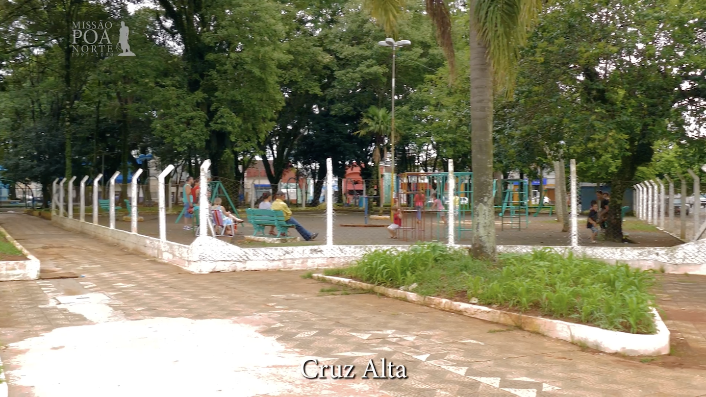

::: {.hero .column-screen}
::: {.eyebrow}
[Missão Brasil Porto Alegre Norte · 1997–2000]{.lang-pt}[Brazil Porto Alegre North Mission · 1997–2000]{.lang-en}
:::

# O Chamado

::: {.lead}
[Presidente Arlan e Síster Sally Woodward]{.lang-pt}[President Arlan and Sister Sally Woodward]{.lang-en}
:::

```{=html}
<div id="heroCarousel" class="carousel slide carousel-fade" data-bs-ride="carousel" data-bs-interval="4500">
  <div class="carousel-inner">
    <div class="carousel-item active"></div>
    <div class="carousel-item"></div>
    <div class="carousel-item"></div>
    <div class="carousel-item"></div>
    <div class="carousel-item"></div>
    <div class="carousel-item"></div>
    <div class="carousel-item"></div>
    <div class="carousel-item"></div>
  </div>
  <div class="carousel-nav">
    <button class="carousel-control-prev" type="button" data-bs-target="#heroCarousel" data-bs-slide="prev">
      <i class="bi bi-chevron-left" aria-hidden="true"></i><span class="visually-hidden">Anterior</span>
    </button>
    <div class="carousel-indicators">
      <button type="button" data-bs-target="#heroCarousel" data-bs-slide-to="0" class="active" aria-current="true" aria-label="Escritório"></button>
      <button type="button" data-bs-target="#heroCarousel" data-bs-slide-to="1" aria-label="Marau"></button>
      <button type="button" data-bs-target="#heroCarousel" data-bs-slide-to="2" aria-label="Santa Rosa"></button>
      <button type="button" data-bs-target="#heroCarousel" data-bs-slide-to="3" aria-label="Tramandaí"></button>
      <button type="button" data-bs-target="#heroCarousel" data-bs-slide-to="4" aria-label="Cruz Alta"></button>
      <button type="button" data-bs-target="#heroCarousel" data-bs-slide-to="5" aria-label="Santo Ângelo"></button>
      <button type="button" data-bs-target="#heroCarousel" data-bs-slide-to="6" aria-label="Capão da Canoa"></button>
      <button type="button" data-bs-target="#heroCarousel" data-bs-slide-to="7" aria-label="Vacaria"></button>
    </div>
    <button class="carousel-control-next" type="button" data-bs-target="#heroCarousel" data-bs-slide="next">
      <i class="bi bi-chevron-right" aria-hidden="true"></i><span class="visually-hidden">Próxima</span>
    </button>
  </div>
</div>
<p class="credito-fotos"><i class="bi bi-camera"></i> <span class="lang-pt">Fotos: cortesia do Élder George</span><span class="lang-en">Photos courtesy of Elder George</span></p>
```
:::

::: {.band .column-screen #missao}
```{=html}
<div class="secao-topo">
  <span class="section-eyebrow"><span class="lang-pt">A Missão</span><span class="lang-en">The Mission</span></span>
</div>

<blockquote class="scripture">
  <span class="lang-pt" lang="pt">Eleva o coração e regozija-te, pois é chegada a hora de tua missão.</span>
  <span class="lang-en" lang="en">Lift up your heart and rejoice, for the hour of your mission is come.</span>
  <footer><span class="lang-pt">Doutrina e Convênios 31:3</span><span class="lang-en">Doctrine and Covenants 31:3</span></footer>
</blockquote>

<div class="missao-texto lang-pt" lang="pt">
  <div class="intro-com-globo">
    <div class="globo" data-svg="images/globo-pt.svg"></div>
    <p class="missao-intro">A Missão Brasil Porto Alegre Norte cobria a metade norte do <strong>Rio Grande do Sul</strong>, o estado mais ao sul do Brasil: da zona norte de Porto Alegre e sua região metropolitana até a Serra Gaúcha, o Planalto e o Litoral Norte, e, até julho de 1998, o Noroeste e as Missões, perto da fronteira com a Argentina. <a href="#mapa">Ver o mapa das zonas ↓</a></p>
  </div>

  <div class="mapa-rs" data-svg="images/mapa-rs-pt.svg"></div>

  <div class="regioes">
    <div class="regiao regiao-metro"><h3><span class="regiao-icone" aria-hidden="true">🏙️</span> Porto Alegre e região metropolitana</h3>
      <p>A capital gaúcha e as cidades ao seu redor: Canoas, Esteio, Gravataí, Cachoeirinha, Alvorada e Guaíba. Bairros movimentados, ônibus lotados e muitas zonas da missão.</p></div>
    <div class="regiao regiao-vales"><h3><span class="regiao-icone" aria-hidden="true">👞</span> Vales do Sinos, Caí e Taquari</h3>
      <p>Novo Hamburgo, São Leopoldo, Sapiranga, Taquara, Montenegro e Lajeado. São Leopoldo foi o berço da imigração alemã no Brasil, em 1824, e o Vale dos Sinos é conhecido pela indústria de calçados.</p></div>
    <div class="regiao regiao-serra"><h3><span class="regiao-icone" aria-hidden="true">🍇</span> Serra Gaúcha</h3>
      <p>Caxias do Sul, Bento Gonçalves, Farroupilha, Gramado e Canela. Terra da imigração italiana a partir de 1875, dos parreirais e do vinho, com invernos frios e, às vezes, neve.</p></div>
    <div class="regiao regiao-planalto"><h3><span class="regiao-icone" aria-hidden="true">🌾</span> Planalto e Campos de Cima da Serra</h3>
      <p>Passo Fundo, Erechim, Carazinho, Marau e Vacaria. Lavouras de soja, trigo e milho, os pomares de maçã de Vacaria e algumas das madrugadas mais frias do estado.</p></div>
    <div class="regiao regiao-litoral"><h3><span class="regiao-icone" aria-hidden="true">🌊</span> Litoral Norte</h3>
      <p>Osório, Tramandaí e Capão da Canoa. Praias, lagoas e vento constante: cheias de veranistas no verão e quase vazias no inverno.</p></div>
    <div class="regiao regiao-noroeste"><h3><span class="regiao-icone" aria-hidden="true">⛪</span> Noroeste e Missões <small>até julho de 1998</small></h3>
      <p>Santo Ângelo, Ijuí, Cruz Alta e Santa Rosa, perto das ruínas jesuítico-guaranis de São Miguel das Missões, Patrimônio Mundial da UNESCO.</p></div>
  </div>

  <div class="missao-duo">
    <div><h3><i class="bi bi-thermometer-half"></i> O clima</h3>
      <p>Subtropical, com as quatro estações bem marcadas. Os verões são quentes e úmidos: em Porto Alegre o termômetro passa fácil dos 35 °C. Os invernos são frios e chuvosos, com geada no interior, neve de vez em quando nas partes altas da Serra e o minuano soprando do sudoeste. Muito missionário norte-americano chegou esperando o calor do Brasil e conheceu o frio gaúcho.</p></div>
    <div><h3><i class="bi bi-people"></i> O povo</h3>
      <p>O gaúcho é hospitaleiro e orgulhoso das suas tradições: o chimarrão passado de mão em mão, o churrasco de domingo, os CTGs (<em>Centros de Tradições Gaúchas</em>), onde se mantêm vivas as danças, a música e a pilcha, e o 20 de Setembro, que lembra a Revolução Farroupilha. A população mistura descendentes de portugueses e açorianos, alemães, italianos, poloneses, africanos e indígenas. No interior ainda se ouve em casa o alemão ou o dialeto vêneto trazido pelos imigrantes italianos, e todo missionário logo aprendia a dizer “bah, tchê!”.</p></div>
  </div>

</div>

<div class="missao-texto lang-en" lang="en">
  <div class="intro-com-globo">
    <div class="globo" data-svg="images/globo-en.svg"></div>
    <p class="missao-intro">The Brazil Porto Alegre North Mission covered the northern half of <strong>Rio Grande do Sul</strong>, Brazil's southernmost state: from the north side of Porto Alegre and its metro area up through the Serra Gaúcha highlands, the Planalto and the northern coast, and, until July 1998, the Northwest and the Missões region near the Argentine border. <a href="#mapa">See the map of the zones ↓</a></p>
  </div>

  <div class="mapa-rs" data-svg="images/mapa-rs-en.svg"></div>

  <div class="regioes">
    <div class="regiao regiao-metro"><h3><span class="regiao-icone" aria-hidden="true">🏙️</span> Porto Alegre and its metro area</h3>
      <p>The state capital and the cities around it: Canoas, Esteio, Gravataí, Cachoeirinha, Alvorada and Guaíba. Busy neighborhoods, packed buses and many of the mission's zones.</p></div>
    <div class="regiao regiao-vales"><h3><span class="regiao-icone" aria-hidden="true">👞</span> Sinos, Caí and Taquari valleys</h3>
      <p>Novo Hamburgo, São Leopoldo, Sapiranga, Taquara, Montenegro and Lajeado. São Leopoldo was the cradle of German immigration to Brazil in 1824, and the Sinos valley is known for its shoe industry.</p></div>
    <div class="regiao regiao-serra"><h3><span class="regiao-icone" aria-hidden="true">🍇</span> Serra Gaúcha</h3>
      <p>Caxias do Sul, Bento Gonçalves, Farroupilha, Gramado and Canela. Settled by Italian immigrants from 1875 on: vineyards, wine, cold winters and the occasional snowfall.</p></div>
    <div class="regiao regiao-planalto"><h3><span class="regiao-icone" aria-hidden="true">🌾</span> Planalto and Campos de Cima da Serra</h3>
      <p>Passo Fundo, Erechim, Carazinho, Marau and Vacaria. Soy, wheat and corn fields, Vacaria's apple orchards and some of the coldest mornings in the state.</p></div>
    <div class="regiao regiao-litoral"><h3><span class="regiao-icone" aria-hidden="true">🌊</span> Northern coast</h3>
      <p>Osório, Tramandaí and Capão da Canoa. Beaches, lagoons and constant wind: crowded with vacationers in summer, nearly empty in winter.</p></div>
    <div class="regiao regiao-noroeste"><h3><span class="regiao-icone" aria-hidden="true">⛪</span> Northwest and Missões <small>until July 1998</small></h3>
      <p>Santo Ângelo, Ijuí, Cruz Alta and Santa Rosa, near the Jesuit-Guarani ruins of São Miguel das Missões, a UNESCO World Heritage Site.</p></div>
  </div>

  <div class="missao-duo">
    <div><h3><i class="bi bi-thermometer-half"></i> The climate</h3>
      <p>Subtropical, with four distinct seasons. Summers are hot and humid; Porto Alegre easily tops 35 °C (95 °F). Winters are cold and rainy, with frost inland, occasional snow in the high Serra and the <em>minuano</em> wind blowing in from the southwest. Many North American missionaries arrived expecting tropical Brazil and met the gaúcho winter instead.</p></div>
    <div><h3><i class="bi bi-people"></i> The people</h3>
      <p>Gaúchos are warm, hospitable and proud of their traditions: chimarrão passed from hand to hand, Sunday churrasco, the CTGs (<em>Centros de Tradições Gaúchas</em>), clubs where people keep the folk dances, music and dress alive, and the 20th of September, which remembers the Farroupilha Revolution. The population blends Portuguese and Azorean, German, Italian, Polish, African and Indigenous roots. In the interior you can still hear German, or the Venetian dialect brought by the Italian immigrants, spoken at home, and every missionary soon learned to say “bah, tchê!”.</p></div>
  </div>

</div>

<script>
// Inline the map/globe SVGs (an  would not use the page fonts).
document.querySelectorAll("#missao [data-svg]").forEach(function (el) {
  fetch(el.getAttribute("data-svg"))
    .then(function (r) { return r.text(); })
    .then(function (t) { el.innerHTML = t; })
    .catch(function () { el.innerHTML = ""; });
});
</script>

```
:::

:::: {.band .column-screen .section-muted #areas}
::: {.secao-topo}
```{=html}
<span class="section-eyebrow"><span class="lang-pt">As Áreas</span><span class="lang-en">The Areas</span></span>
```

```{ojs}
{
  const go = k => definir(viewof quadroKey, k);
  return htl.html`<div class="nav-mes">
    <button class="nav-mes-btn" aria-label=${T("Mês anterior", "Previous month")} disabled=${snapIdx === 0} onclick=${() => go(snaps[snapIdx - 1].key)}><i class="bi bi-chevron-left"></i></button>
    <span class="snap-label">${fmtMesAno(snapAtual)}</span>
    <button class="nav-mes-btn" aria-label=${T("Próximo mês", "Next month")} disabled=${snapIdx === snaps.length - 1} onclick=${() => go(snaps[snapIdx + 1].key)}><i class="bi bi-chevron-right"></i></button>
  </div>`;
}
```
:::

::: {.wrap}

## [O quadro de transferências]{.lang-pt}[The transfer board]{.lang-en}

::: {.section-intro}
[Escolha um mês para ver todas as zonas, áreas e duplas da missão naquele momento. Toque num nome para ver quando o missionário chegou e saiu. Viu algum erro? Escreva para [info@ochamado.org](mailto:info@ochamado.org).]{.lang-pt}[Pick a month to see every zone, area and companionship in the mission at that time. Tap a name to see when that missionary arrived and left. Spot a mistake? Email [info@ochamado.org](mailto:info@ochamado.org).]{.lang-en}
:::

```{ojs}
quadro = FileAttachment("data/quadro.json").json()
snaps = quadro.snapshots
pessoas = new Map(quadro.missionarios.map(p => [p.id, p]))
viewof idioma = {
  const el = htl.html`<span hidden></span>`;
  el.value = document.documentElement.dataset.lang === "en" ? "en" : "pt";
  window.addEventListener("ochamado:idioma", () => {
    el.value = document.documentElement.dataset.lang === "en" ? "en" : "pt";
    el.dispatchEvent(new Event("input"));
  });
  return el;
}
T = (pt, en) => idioma === "en" ? en : pt
MES = idioma === "en"
  ? ["Jan", "Feb", "Mar", "Apr", "May", "Jun", "Jul", "Aug", "Sep", "Oct", "Nov", "Dec"]
  : ["jan", "fev", "mar", "abr", "mai", "jun", "jul", "ago", "set", "out", "nov", "dez"]
MES_NOME = idioma === "en"
  ? ["January", "February", "March", "April", "May", "June", "July", "August", "September", "October", "November", "December"]
  : ["Janeiro", "Fevereiro", "Março", "Abril", "Maio", "Junho", "Julho", "Agosto", "Setembro", "Outubro", "Novembro", "Dezembro"]
fmtYM = k => { if (!k) return "—"; const [y, m] = k.split("-"); return idioma === "en" ? `${MES[+m - 1]} ${y}` : `${MES[+m - 1]}/${y}`; }
fmtMesAno = s => idioma === "en" ? `${MES_NOME[s.mes - 1]} ${s.ano}` : `${MES_NOME[s.mes - 1].toLowerCase()} de ${s.ano}`
nacionalidade = n => idioma === "en" ? ({ "brasileiro": "Brazilian", "norte americano": "North American" }[n] ?? n) : n
nomeCompleto = l => l.replace(/^E\s+/, "Élder ").replace(/^S\s+/, "Síster ")
norm = s => String(s ?? "").normalize("NFD").replace(/[\u0300-\u036f]/g, "").toLowerCase().replace(/-/g, " ").replace(/\s+/g, " ").trim()
aparicoes = {
  const m = new Map();
  for (const s of snaps) for (const z of s.zonas) for (const a of z.areas) for (const p of a.dupla) {
    const k = p.id ?? "?" + p.n;
    if (!m.has(k)) m.set(k, []);
    m.get(k).push({ key: s.key, zona: z.nome, area: a.rotulo ?? z.nome, companheiros: a.dupla.filter(x => x !== p).map(x => nomeCompleto(x.n)) });
  }
  return m;
}
function estado(v) { const el = htl.html`<span hidden></span>`; el.value = v; return el; }
function definir(el, v) { el.value = v; el.dispatchEvent(new Event("input", { bubbles: true })); }
viewof quadroKey = estado("1997-10")
DIVISAO = "1998-07"
snapIdx = snaps.findIndex(s => s.key === quadroKey)
snapAtual = snaps[snapIdx]
```

```{ojs}
{
  const first = snaps[0], last = snaps[snaps.length - 1];
  const max = Math.max(...snaps.map(s => s.stats.zonas));
  const W = 640, H = 56, gap = 3, bw = W / snaps.length;
  const tile = (num, lbl, base) => htl.html`<div class="stat-tile"><div class="num">${num}</div><div class="lbl">${lbl}</div></div>`;
  return htl.html`<div>
    <p class="growth-headline"><strong>${first.stats.zonas}</strong> ${T("zonas em", "zones in")} ${fmtYM(first.key)} → <strong>${last.stats.zonas}</strong> ${T("zonas em", "zones in")} ${fmtYM(last.key)}</p>
    <div class="stat-tiles">
      ${tile(snapAtual.stats.zonas, T("Zonas", "Zones"))}
      ${tile(snapAtual.stats.areas, T("Áreas", "Areas"))}
      ${tile(snapAtual.stats.missionarios, T("Missionários", "Missionaries"))}
    </div>
    ${htl.svg`<svg class="growth-bars" viewBox="0 0 ${W} ${H}" preserveAspectRatio="none" role="img" aria-label=${T("Zonas por mês", "Zones per month")}>
      ${snaps.map((s, i) => {
        const h = Math.max(4, (s.stats.zonas / max) * H);
        return htl.svg`<rect class=${s.key === quadroKey ? "active" : ""} x=${i * bw + gap / 2} y=${H - h} width=${bw - gap} height=${h} rx="2"
          onclick=${() => definir(viewof quadroKey, s.key)}><title>${fmtYM(s.key)}: ${s.stats.zonas} ${T("zonas", "zones")}</title></rect>`;
      })}
      ${(() => {
        const i = snaps.findIndex(s => s.key === DIVISAO);
        return i < 0 ? "" : htl.svg`<line class="marco-divisao" x1=${i * bw} x2=${i * bw} y1="0" y2=${H}><title>${T("Julho de 1998: divisão da missão", "July 1998: the mission is divided")}</title></line>`;
      })()}
    </svg>`}
    <p class="growth-nota"><span class="marco"></span> ${T("Julho de 1998: a missão foi dividida para formar a Missão Brasil Santa Maria.", "July 1998: the mission was divided to create the Brazil Santa Maria Mission.")}</p>
  </div>`;
}
```

```{ojs}
{
  const anos = [...new Set(snaps.map(s => s.ano))];
  const doAno = snaps.filter(s => s.ano === snapAtual.ano);
  const go = k => definir(viewof quadroKey, k);
  const pill = (label, active, onclick) => htl.html`<button class=${active ? "pill active" : "pill"} onclick=${onclick}>${label}</button>`;
  return htl.html`<div class="filter-panel">
    <div class="pill-group">${anos.map(a => pill(a, a === snapAtual.ano, () => go(snaps.find(s => s.ano === a).key)))}</div>
    <div class="pill-group">${doAno.map(s => pill(MES[s.mes - 1], s.key === quadroKey, () => go(s.key)))}</div>
  </div>
  ${quadroKey === DIVISAO
    ? htl.html`<p class="aviso-divisao"><i class="bi bi-signpost-split"></i><span>${idioma === "en"
      ? htl.html`This month the mission was divided to create the <strong>Brazil Santa Maria Mission</strong>. The Ijuí and Santo Ângelo zones went to the new mission.`
      : htl.html`Neste mês a missão foi dividida para formar a <strong>Missão Brasil Santa Maria</strong>. As zonas de Ijuí e Santo Ângelo passaram para a nova missão.`}</span></p>`
    : ""}
  ${jornalPorMes.has(quadroKey)
    ? htl.html`<a class="jornal-do-mes" target="_blank" rel="noopener" href=${jornalUrl(jornalPorMes.get(quadroKey))}>
        <i class="bi bi-file-earmark-pdf"></i><span>${T("Ler", "Read")} <em>O Chamado</em> ${T("de", "for")} ${fmtMesAno(snapAtual)}</span></a>`
    : ""}`;
}
```

```{ojs}
function verHistorico(q) {
  return htl.html`<a href="#busca" onclick=${e => {
    e.preventDefault();
    const inp = document.getElementById("busca");
    inp.value = q;
    inp.dispatchEvent(new Event("input", { bubbles: true }));
    inp.scrollIntoView({ behavior: "smooth", block: "center" });
  }}>${T("Ver histórico completo ↓", "See full history ↓")}</a>`;
}

function detalheNome(p) {
  const ap = aparicoes.get(p.id ?? "?" + p.n) ?? [];
  if (!p.id) return htl.html`<div>${T("Sem registro de chegada/saída", "No arrival/departure record")} · ${T("em", "on")} ${ap.length} ${T("quadro(s)", "board(s)")}<br>${verHistorico(p.n)}</div>`;
  const x = pessoas.get(p.id);
  const provavel = p.c === "inferido" || p.c === "tolerancia";
  return htl.html`<div><strong>${x.titulo} ${x.plaqueta}</strong>${x.nacionalidade ? ` · ${nacionalidade(x.nacionalidade)}` : ""}<br>
    ${T("Chegada", "Arrived")} ${fmtYM(x.chegada)} · ${T("Saída", "Left")} ${fmtYM(x.saida)} · ${T("em", "on")} ${ap.length} ${T("quadros", "boards")}
    ${provavel ? htl.html`<br><span class="provavel">${T("identificação provável", "probable match")}</span>` : ""}
    <br>${verHistorico(x.plaqueta)}</div>`;
}

function linhaArea(a, z, cont) {
  const slot = htl.html`<div class="nome-detalhe" hidden></div>`;
  let aberto = null;
  const chips = a.dupla.map(p => {
    const b = htl.html`<button class=${p.id ? "chip" : "chip sem-registro"}>${nomeCompleto(p.n)}</button>`;
    b.onclick = () => {
      if (aberto) aberto.classList.remove("open");
      if (aberto === b) { aberto = null; slot.hidden = true; return; }
      aberto = b;
      b.classList.add("open");
      slot.replaceChildren(detalheNome(p));
      slot.hidden = false;
    };
    return b;
  });
  return htl.html`<div class=${cont ? "area-row cont" : "area-row"}>
    ${a.nome ? htl.html`<div class="area-name">${a.nome}${a.total > 1 ? htl.html`<span class="dupla-tag">#${a.n}</span>` : ""}</div>` : ""}
    <div class="nomes">${chips}</div>
    ${slot}
  </div>`;
}
```

```{ojs}
ZONA_POS = ({
  "Porto Alegre": [-30.035, -51.225], "Moinhos de Vento": [-30.012, -51.190], "Guaíba": [-30.114, -51.325],
  "Canoas": [-29.917, -51.183], "Canoas-Esteio": [-29.852, -51.179], "Gravataí": [-29.944, -50.992],
  "São Leopoldo": [-29.760, -51.147], "Novo Hamburgo": [-29.678, -51.131], "Taquara": [-29.650, -50.781],
  "Montenegro": [-29.689, -51.461], "Caxias do Sul": [-29.168, -51.179], "Bento Gonçalves": [-29.171, -51.519],
  "Vacaria": [-28.512, -50.934], "Passo Fundo": [-28.262, -52.408], "Vergueiro": [-28.230, -52.440],
  "Erechim": [-27.634, -52.274], "Osório": [-29.887, -50.270], "Capão da Canoa": [-29.745, -50.010],
  "Ijuí": [-28.388, -53.914], "Santo Ângelo": [-28.299, -54.263]
})

ZONA_METRO = ["Porto Alegre", "Moinhos de Vento", "Guaíba", "Canoas", "Canoas-Esteio", "Gravataí", "São Leopoldo", "Novo Hamburgo"]

rsContorno = FileAttachment("data/rs.geojson").json()

viewof mapa = {
  const el = htl.html`<div id="mapa" class="mapa-missao" role="region" aria-label="Mapa das zonas da missão / Map of the mission's zones"></div>`;
  const m = L.map(el, { scrollWheelZoom: false, zoomSnap: 0.25 }).setView([-29.0, -52.0], 7);
  L.tileLayer("https://tile.openstreetmap.org/{z}/{x}/{y}.png", {
    attribution: '&copy; <a href="https://www.openstreetmap.org/copyright">OpenStreetMap</a>',
    maxZoom: 14
  }).addTo(m);
  L.geoJSON(rsContorno, { style: { color: "#1b5e46", weight: 1.5, fill: false, dashArray: "4 4" }, interactive: false }).addTo(m);
  el.leaflet = m;
  el.camada = L.layerGroup().addTo(m);
  const metro = L.latLngBounds(ZONA_METRO.map(z => ZONA_POS[z])).pad(0.25);
  el.grandePoa = L.marker([-30.12, -51.40], {
    icon: L.divIcon({ className: "rotulo-grande-poa", html: "Grande Porto Alegre <i class='bi bi-zoom-in'></i>", iconSize: null }),
    keyboard: true
  }).on("click", () => m.flyToBounds(metro, { duration: 0.8 })).addTo(m);
  const zoomClasse = () => el.classList.toggle("zoom-perto", m.getZoom() >= 9);
  m.on("zoomend", zoomClasse);
  zoomClasse();
  // The element is detached while this cell runs, so fit the view once it has a real size.
  let enquadrado = false;
  new ResizeObserver(() => {
    m.invalidateSize();
    if (!enquadrado && el.clientWidth > 0) {
      m.fitBounds(L.latLngBounds(Object.values(ZONA_POS)).pad(0.08));
      enquadrado = true;
    }
  }).observe(el);
  return el;
}
```

```{ojs}
{
  const el = viewof mapa, camada = el.camada;
  camada.clearLayers();
  el.grandePoa.setIcon(L.divIcon({ className: "rotulo-grande-poa", html: `${T("Grande Porto Alegre", "Greater Porto Alegre")} <i class='bi bi-zoom-in'></i>`, iconSize: null }));
  const semLugar = [];
  for (const z of snapAtual.zonas) {
    const pos = ZONA_POS[z.nome];
    if (!pos) { semLugar.push(z.nome); continue; }
    const n = z.areas.length;
    const marcador = L.circleMarker(pos, {
      radius: 6 + Math.sqrt(n) * 3, color: "#fff", weight: 2,
      fillColor: "#1b5e46", fillOpacity: 0.85
    });
    const metro = ZONA_METRO.includes(z.nome);
    marcador.bindTooltip(`${z.nome} <span>${n}</span>`, {
      permanent: true, direction: z.nome === "Vergueiro" ? "left" : "right", offset: [z.nome === "Vergueiro" ? -8 : 8, 0],
      className: metro ? "rotulo-zona rotulo-metro" : "rotulo-zona"
    });
    marcador.on("click", () => {
      const card = [...document.querySelectorAll(".zone-card")].find(c => c.dataset.zona === z.nome);
      if (!card) return;
      card.scrollIntoView({ behavior: "smooth", block: "center" });
      card.classList.remove("destaque"); void card.offsetWidth; card.classList.add("destaque");
    });
    camada.addLayer(marcador);
  }
  return htl.html`<p class="mapa-legenda"><span class="ponto"></span> ${T(
    `Zonas em ${fmtMesAno(snapAtual)}; o tamanho do círculo mostra o número de duplas. Toque numa zona para ver suas áreas.${semLugar.length ? ` Sem lugar no mapa: ${semLugar.join(", ")}.` : ""}`,
    `Zones in ${fmtMesAno(snapAtual)}; circle size shows the number of companionships. Tap a zone to see its areas.${semLugar.length ? ` Not on the map: ${semLugar.join(", ")}.` : ""}`)}</p>`;
}
```

```{ojs}
{
  const zonas = [...snapAtual.zonas].sort((a, b) => a.especial - b.especial);
  const cartao = z => {
    const comps = z.areas.length;
    return htl.html`<article class=${z.especial ? "zone-card especial" : "zone-card"} data-zona=${z.nome}>
      <header><h3>${z.nome}</h3><span class="count">${comps} ${comps === 1 ? T("dupla", "companionship") : T("duplas", "companionships")}</span></header>
      ${z.areas.map((a, i) => linhaArea(a, z, i > 0 && a.n > 1 && z.areas[i - 1].nome === a.nome))}
    </article>`;
  };
  // Each zone is placed once in the shortest column, so opening a name only pushes cards down
  // within that column (CSS multi-column layouts rebalance and make cards jump between columns).
  const n = width >= 900 ? 3 : width >= 600 ? 2 : 1;
  const colunas = Array.from({ length: n }, () => ({ altura: 0, zonas: [] }));
  for (const z of zonas) {
    const c = colunas.reduce((min, col) => col.altura < min.altura ? col : min);
    c.zonas.push(z);
    c.altura += z.areas.length + 2;
  }
  return htl.html`<div class="board-grid">${colunas.map(c => htl.html`<div class="board-col">${c.zonas.map(cartao)}</div>`)}</div>`;
}
```

```{=html}
<div class="legenda-quadro">
  <p><span class="chip">Élder Widerberg</span> <span class="lang-pt">Toque num nome para ver quando o missionário chegou e saiu.</span><span class="lang-en">Tap a name to see when that missionary arrived and left.</span></p>
  <p><span class="chip sem-registro">Síster Sena</span> <span class="lang-pt">Borda tracejada: ainda não conseguimos ligar este nome a ninguém da lista de missionários. Pode estar faltando na lista, ou há dois missionários com o mesmo nome no mesmo período. Se você sabe quem é, escreva para <a href="mailto:info@ochamado.org">info@ochamado.org</a>.</span><span class="lang-en">Dashed border: we couldn't match this name to anyone on the missionary list yet. They may be missing from the list, or two missionaries shared the name at the same time. If you know who it is, email <a href="mailto:info@ochamado.org">info@ochamado.org</a>.</span></p>
</div>
```
:::
::::

:::: {.band .column-screen #missionarios}
```{=html}
<div class="secao-topo"><span class="section-eyebrow"><span class="lang-pt">Os Missionários</span><span class="lang-en">The Missionaries</span></span></div>
```
::: {.wrap}

## [Chegadas e saídas]{.lang-pt}[Arrivals and departures]{.lang-en}

::: {.section-intro}
[515 missionários serviram com os Woodward. Escolha o ano e o mês para ver quem chegou e quem partiu.]{.lang-pt}[515 missionaries served with the Woodwards. Pick a year and month to see who arrived and who went home.]{.lang-en}
:::

```{ojs}
missionaries = FileAttachment("data/missionarios.json").json()
viewof anoSel = estado(1997)
viewof mesSel = estado(7)
mesesDe = a => a === 1997 ? [7, 8, 9, 10, 11, 12] : a === 2000 ? [1, 2, 3, 4, 5, 6] : [1, 2, 3, 4, 5, 6, 7, 8, 9, 10, 11, 12]
```

```{ojs}
{
  const pill = (label, active, onclick) => htl.html`<button class=${active ? "pill active" : "pill"} onclick=${onclick}>${label}</button>`;
  return htl.html`<div class="filter-panel">
    <div class="pill-group"><span class="filter-label">${T("Ano", "Year")}</span>${[1997, 1998, 1999, 2000].map(a => pill(a, a === anoSel, () => {
      if (!mesesDe(a).includes(mesSel)) definir(viewof mesSel, mesesDe(a)[0]);
      definir(viewof anoSel, a);
    }))}</div>
    <div class="pill-group"><span class="filter-label">${T("Mês", "Month")}</span>${mesesDe(anoSel).map(m => pill(MES[m - 1], m === mesSel, () => definir(viewof mesSel, m)))}</div>
  </div>`;
}
```

```{ojs}
{
  const ch = missionaries.filter(m => m.ChegadaAno === anoSel && m["ChegadaMês"] === mesSel);
  const sa = missionaries.filter(m => m["SaídaAno"] === anoSel && m["SaídaMês"] === mesSel);
  const byName = (a, b) => a.Plaqueta.localeCompare(b.Plaqueta, "pt");
  const panel = (arr, cls, icon, title, vazio) => htl.html`<div class=${"missionary-panel " + cls}>
    <h4><i class=${"bi " + icon}></i> ${title}<span class="count-badge">${arr.length}</span></h4>
    ${arr.length
      ? htl.html`<ul class="missionary-list">${[...arr].sort(byName).map(m => htl.html`<li><span>${m["Título"]} ${m.Plaqueta}</span><span class="tag">${nacionalidade(m.Nacionalidade)}</span></li>`)}</ul>`
      : htl.html`<p class="missionary-empty">${vazio}</p>`}
  </div>`;
  return htl.html`<div class="missionary-board">
    ${panel(ch, "panel-chegadas", "bi-airplane-fill", T("Chegadas", "Arrivals"), T("Nenhuma chegada neste mês.", "No arrivals this month."))}
    ${panel(sa, "panel-saidas", "bi-house-heart-fill", T("Saídas", "Departures"), T("Nenhuma saída neste mês.", "No departures this month."))}
  </div>`;
}
```

::: {.search-block}
### [Procure um missionário]{.lang-pt}[Find a missionary]{.lang-en}

::: {.section-intro}
[Digite um sobrenome para ver todos os quadros, áreas e companheiros daquele missionário.]{.lang-pt}[Type a last name to see every board, area and companion for that missionary.]{.lang-en}
:::

```{ojs}
viewof busca = htl.html`<input type="search" id="busca" class="form-control busca" placeholder="Sobrenome (ex.: Widerberg)" data-placeholder-pt="Sobrenome (ex.: Widerberg)" data-placeholder-en="Last name (e.g. Widerberg)" autocomplete="off">`
```

```{ojs}
function cartaoPessoa({ p, label, ap }) {
  const meta = p
    ? `${nacionalidade(p.nacionalidade ?? "")} · ${T("Chegada", "Arrived")} ${fmtYM(p.chegada)} · ${T("Saída", "Left")} ${fmtYM(p.saida)} · ${T("em", "on")} ${ap.length} ${T("quadro(s)", "board(s)")}`
    : `${T("Sem registro de chegada/saída", "No arrival/departure record")} · ${T("em", "on")} ${ap.length} ${T("quadro(s)", "board(s)")}`;
  return htl.html`<div class="pessoa-card">
    <h4>${p ? `${p.titulo} ${p.plaqueta}` : nomeCompleto(label)}</h4>
    <div class="meta">${meta}</div>
    ${ap.length
      ? htl.html`<div class="table-scroll"><table class="historico-table">
          <thead><tr><th>${T("Quadro", "Board")}</th><th>${T("Zona", "Zone")}</th><th>${T("Área", "Area")}</th><th>${T("Companheiros", "Companions")}</th></tr></thead>
          <tbody>${ap.map(a => htl.html`<tr><td>${fmtYM(a.key)}</td><td>${a.zona}</td><td>${a.area}</td><td>${a.companheiros.join(", ")}</td></tr>`)}</tbody>
        </table></div>`
      : htl.html`<p class="busca-hint">${T("Não aparece nos quadros de transferências.", "Not on any transfer board.")}</p>`}
  </div>`;
}
```

```{ojs}
{
  const q = norm(busca);
  if (q.length < 2) return htl.html`<p class="busca-hint">${T("Digite pelo menos duas letras.", "Type at least two letters.")}</p>`;
  const pessoasEnc = quadro.missionarios
    .filter(p => norm(p.plaqueta).includes(q) || norm(`${p.titulo} ${p.plaqueta}`).includes(q) || norm(`${p.titulo[0]} ${p.plaqueta}`).includes(q))
    .map(p => ({ p, ap: aparicoes.get(p.id) ?? [] }));
  const semRegistro = [...aparicoes.keys()]
    .filter(k => k.startsWith("?") && norm(k.slice(1)).includes(q))
    .map(k => ({ label: k.slice(1), ap: aparicoes.get(k) }));
  const todos = [...pessoasEnc, ...semRegistro];
  if (!todos.length) return htl.html`<p class="busca-hint">${T("Ninguém encontrado para", "No one found for")} “${busca}”.</p>`;
  return htl.html`<div>
    ${todos.length > 15 ? htl.html`<p class="busca-hint">${todos.length} ${T("resultados; mostrando 15. Refine a busca.", "results; showing 15. Try a longer name.")}</p>` : ""}
    ${todos.slice(0, 15).map(cartaoPessoa)}
  </div>`;
}
```
:::
:::
::::

:::: {.band .column-screen .section-muted #templo}
```{=html}
<div class="secao-topo"><span class="section-eyebrow"><span class="lang-pt">O Templo</span><span class="lang-en">The Temple</span></span></div>
```
::: {.wrap}

## [A abertura de terra do Templo de Porto Alegre]{.lang-pt}[The Porto Alegre Temple groundbreaking]{.lang-en}

```{=html}
<div class="templo">
  <div class="templo-foto">
    
    <span class="credito"><span class="lang-pt">Foto</span><span class="lang-en">Photo</span>: <a href="https://commons.wikimedia.org/wiki/File:Templo_de_Porto_Alegre_(16_November_2008).jpg" target="_blank" rel="noopener">Ricardo630</a>, Wikimedia Commons, <a href="https://creativecommons.org/licenses/by/3.0/deed.pt_BR" target="_blank" rel="noopener">CC BY 3.0</a></span>
  </div>
  <div class="templo-texto">
    <p class="templo-destaque lang-pt">No dia <strong>2 de maio de 1998</strong>, durante a missão dos Woodward, mais de 3.500 pessoas se reuniram numa encosta com vista para Porto Alegre para a cerimônia de abertura de terra do primeiro templo do Rio Grande do Sul.</p>
    <p class="templo-destaque lang-en">On <strong>May 2, 1998</strong>, during the Woodwards' mission, more than 3,500 people gathered on a hillside overlooking Porto Alegre to break ground for the first temple in Rio Grande do Sul.</p>
    <ol class="linha-tempo">
      <li><span class="data"><span class="lang-pt">out 1997</span><span class="lang-en">Oct 1997</span></span><span><span class="lang-pt">O Presidente Gordon B. Hinckley anuncia um templo em Porto Alegre na conferência geral de outubro de 1997.</span><span class="lang-en">President Gordon B. Hinckley announces a temple in Porto Alegre at the October 1997 general conference.</span></span></li>
      <li class="marco-woodward"><span class="data"><span class="lang-pt">2 mai 1998</span><span class="lang-en">May 2, 1998</span></span><span><span class="lang-pt">O <strong>Presidente James E. Faust</strong>, da Primeira Presidência, preside a cerimônia de abertura de terra, com o Élder Joseph B. Wirthlin, do Quórum dos Doze, e o Élder W. Craig Zwick, presidente da Área Brasil.</span><span class="lang-en"><strong>President James E. Faust</strong> of the First Presidency presides at the groundbreaking, with Elder Joseph B. Wirthlin of the Quorum of the Twelve and Elder W. Craig Zwick, president of the Brazil Area.</span></span></li>
      <li><span class="data"><span class="lang-pt">dez 2000</span><span class="lang-en">Dec 2000</span></span><span><span class="lang-pt">Visitação pública, com cerca de 25 mil visitantes.</span><span class="lang-en">Public open house, with about 25,000 visitors.</span></span></li>
      <li><span class="data"><span class="lang-pt">17 dez 2000</span><span class="lang-en">Dec 17, 2000</span></span><span><span class="lang-pt">O Presidente Hinckley dedica o templo, o 102º da Igreja e o terceiro do Brasil, no bairro Vila Jardim, com vista para a cidade e o Guaíba.</span><span class="lang-en">President Hinckley dedicates the temple, the Church's 102nd and Brazil's third, in the Vila Jardim neighborhood overlooking the city and the Guaíba.</span></span></li>
    </ol>
    <p class="templo-chamada"><i class="bi bi-camera"></i> <span class="lang-pt">Você estava na abertura de terra? Mande suas fotos e lembranças para</span><span class="lang-en">Were you at the groundbreaking? Send your photos and memories to</span> <a href="mailto:info@ochamado.org?subject=Abertura%20de%20terra%20do%20Templo%20de%20Porto%20Alegre">info@ochamado.org</a>.</p>
    <p class="templo-fonte"><span class="lang-pt">Fonte</span><span class="lang-en">Source</span>: <a href="https://www.thechurchnews.com/1998/5/9/23250717/be-loyal-worthy-to-enter-temple-members-urged/" target="_blank" rel="noopener">Church News, <span class="lang-pt">9 de maio de 1998</span><span class="lang-en">May 9, 1998</span></a>.</p>
  </div>
</div>
```
:::
::::

:::: {.band .column-screen #jornal}
```{=html}
<div class="secao-topo"><span class="section-eyebrow"><span class="lang-pt">O Jornal</span><span class="lang-en">The Newsletter</span></span></div>
```
::: {.wrap}

## [O boletim da missão]{.lang-pt}[The mission newsletter]{.lang-en}

::: {.section-intro}
[Edições de *O Chamado* publicadas durante a missão dos Woodward.]{.lang-pt}[Issues of *O Chamado* published during the Woodwards' mission. The newsletters are in Portuguese.]{.lang-en}
:::

```{ojs}
jornais = FileAttachment("data/jornais.json").json()
jornalPorMes = new Map(jornais.map(j => [j.key, j]))
jornalUrl = j => "o-chamado-newsletters/" + encodeURIComponent(j.arquivo)
```

```{ojs}
{
  // One tile per month of the Woodwards' mission (Jul 1997 – Jun 2000); months with no PDF yet are grey and open an email.
  const meses = [];
  for (let n = 1997 * 12 + 6; n <= 2000 * 12 + 5; n++) meses.push({ ano: Math.floor(n / 12), mes: n % 12 + 1 });
  const tile = ({ ano, mes }) => {
    const key = `${ano}-${String(mes).padStart(2, "0")}`, j = jornalPorMes.get(key);
    if (j) return htl.html`<a class="jornal-card" target="_blank" rel="noopener" href=${jornalUrl(j)}>
        <i class="bi bi-file-earmark-pdf"></i><span><strong>${MES_NOME[mes - 1]}</strong><small>${ano}</small></span></a>`;
    const assunto = T(`Tenho O Chamado de ${MES_NOME[mes - 1].toLowerCase()} de ${ano}`, `I have O Chamado for ${MES_NOME[mes - 1]} ${ano}`);
    return htl.html`<a class="jornal-card faltando" href=${`mailto:info@ochamado.org?subject=${encodeURIComponent(assunto)}`}
        title=${T("Edição faltando: se você tem, toque para nos escrever", "Missing issue: if you have it, tap to email us")}>
        <i class="bi bi-file-earmark"></i><span><strong>${MES_NOME[mes - 1]}</strong><small>${T("faltando", "missing")}</small></span></a>`;
  };
  return htl.html`<div>${[...new Set(meses.map(m => m.ano))].map(y => htl.html`
    <h3 class="jornal-year">${y}</h3>
    <div class="jornal-grid">${meses.filter(m => m.ano === y).map(tile)}</div>`)}</div>`;
}
```

```{=html}
<div class="contato-card">
  <i class="bi bi-envelope-paper"></i>
  <div>
    <strong><span class="lang-pt">Tem uma edição que falta aqui?</span><span class="lang-en">Have an issue that's missing here?</span></strong>
    <p><span class="lang-pt">Os meses em cinza ainda não têm jornal. Se você guardou algum desses números de <em>O Chamado</em>, toque no mês ou escreva para</span><span class="lang-en">The grey months don't have a newsletter yet. If you kept one of those issues of <em>O Chamado</em>, tap the month or email</span> <a href="mailto:info@ochamado.org">info@ochamado.org</a>.</p>
  </div>
</div>
```
:::
::::

:::: {.band .column-screen .section-dark #reencontros}
```{=html}
<div class="secao-topo"><span class="section-eyebrow"><span class="lang-pt">Os Reencontros</span><span class="lang-en">The Reunions</span></span></div>
```
::: {.wrap-narrow}

## [Abril de 2016]{.lang-pt}[April 2016]{.lang-en}

```{=html}
<a class="ratio ratio-16x9 video-frame video-card" target="_blank" rel="noopener" href="https://youtu.be/31IHb7dBMEo" aria-label="Assistir ao reencontro de abril de 2016 no YouTube">
  
  <span class="video-meta">
    <span><strong><span class="lang-pt">Reencontro dos missionários</span><span class="lang-en">Missionary reunion</span></strong><small><span class="lang-pt">Abril de 2016</span><span class="lang-en">April 2016</span></small></span>
    <span class="yt"><i class="bi bi-youtube"></i> <span class="lang-pt">Assistir no YouTube</span><span class="lang-en">Watch on YouTube</span></span>
  </span>
</a>
<p class="credito-video"><i class="bi bi-camera-video"></i> <span class="lang-pt">Vídeo: cortesia do Élder George</span><span class="lang-en">Video courtesy of Elder George</span></p>
```
:::
::::

::: {.band .column-screen #woodwards}
```{=html}
<div class="secao-topo"><span class="section-eyebrow"><span class="lang-pt">Os Woodwards</span><span class="lang-en">The Woodwards</span></span></div>
```

```{=html}
<div class="woodwards-foto">
  
  <span class="credito"><span class="lang-pt">Foto</span><span class="lang-en">Photo</span>: <a href="https://www.thechurchnews.com/2007/11/17/23232387/missionary-training-center-presidents-4/" target="_blank" rel="noopener">Church News, 2007</a></span>
</div>
```

[Arlan & Sally Woodward]{.woodwards-names .d-block}

::: {.section-intro}
[Presidente e Síster da Missão Brasil Porto Alegre Norte, 1997–2000. Em 2007 voltaram ao Brasil para presidir o Centro de Treinamento Missionário.]{.lang-pt}[President and Sister of the Brazil Porto Alegre North Mission, 1997–2000. In 2007 they returned to Brazil to preside over the Missionary Training Center.]{.lang-en}
:::
:::

::: {.band .column-screen .section-muted #contato}
```{=html}
<div class="secao-topo"><span class="section-eyebrow"><span class="lang-pt">Contato</span><span class="lang-en">Contact</span></span></div>
```

## [Comentários e sugestões]{.lang-pt}[Comments and suggestions]{.lang-en}

::: {.section-intro}
[Tem fotos, histórias, correções no quadro de transferências ou ideias para o site? Adoraríamos ouvir de você.]{.lang-pt}[Have photos, stories, corrections to the transfer board or ideas for the site? We'd love to hear from you.]{.lang-en}
:::

```{=html}
<a class="email-btn" href="mailto:info@ochamado.org?subject=O%20Chamado%20-%20coment%C3%A1rio"><i class="bi bi-envelope"></i> info@ochamado.org</a>
<p class="organizador"><span class="lang-pt">Site organizado pelo <strong>Élder Billy Hereth</strong>, que serviu com os Woodward.</span><span class="lang-en">Site organized by <strong>Elder Billy Hereth</strong>, who served with the Woodwards.</span></p>
<p class="organizador"><span class="lang-pt">Agradecimento especial ao meu sobrinho <strong>Nathan Garcia</strong>, que serviu na Missão Portugal Porto e digitou os registros a partir dos jornais da missão.</span><span class="lang-en">Special thanks to my nephew <strong>Nathan Garcia</strong>, who served in the Portugal Porto Mission and typed in the records from the mission newsletters.</span></p>
<p class="organizador"><span class="lang-pt">Este site foi possível graças ao apoio generoso da <strong>Síster Sally Woodward</strong>.</span><span class="lang-en">This site was made possible by the generous support of <strong>Sister Sally Woodward</strong>.</span></p>
```
:::

::: {.column-screen}
```{=html}
<div class="pampa-foto">
  
  <span class="credito-campos"><span class="lang-pt">Foto</span><span class="lang-en">Photo</span>: <a href="https://commons.wikimedia.org/wiki/File:Paisagem_Natura_de_Canela.jpg" target="_blank" rel="noopener">Cesar Vieira</a>, <a href="https://creativecommons.org/licenses/by-sa/4.0/" target="_blank" rel="noopener">CC BY-SA 4.0</a></span>
</div>
```
:::
