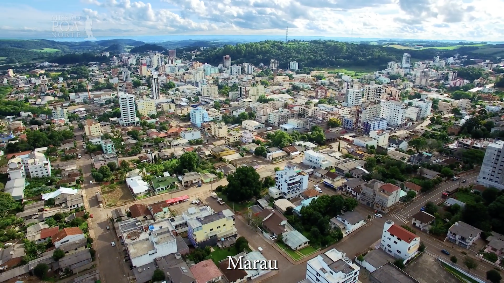
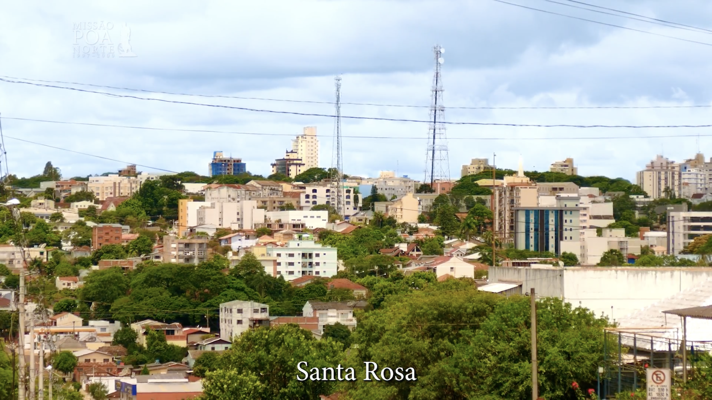
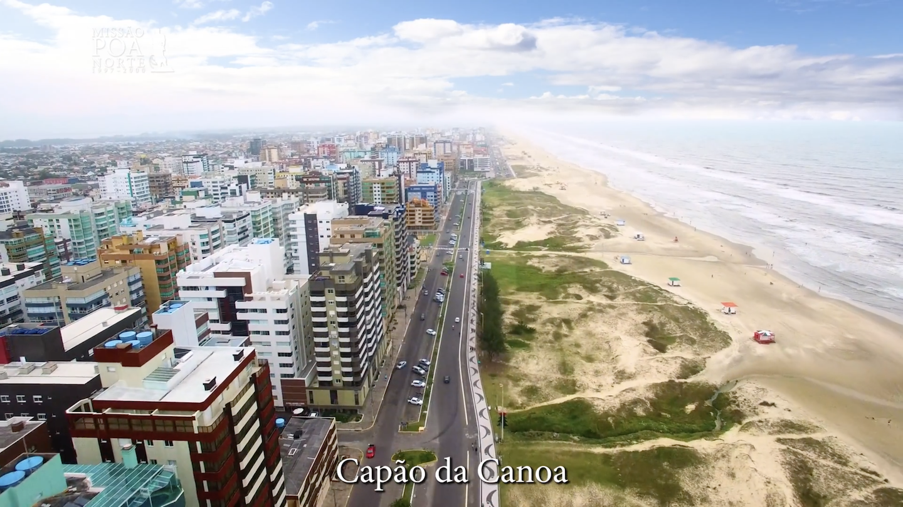
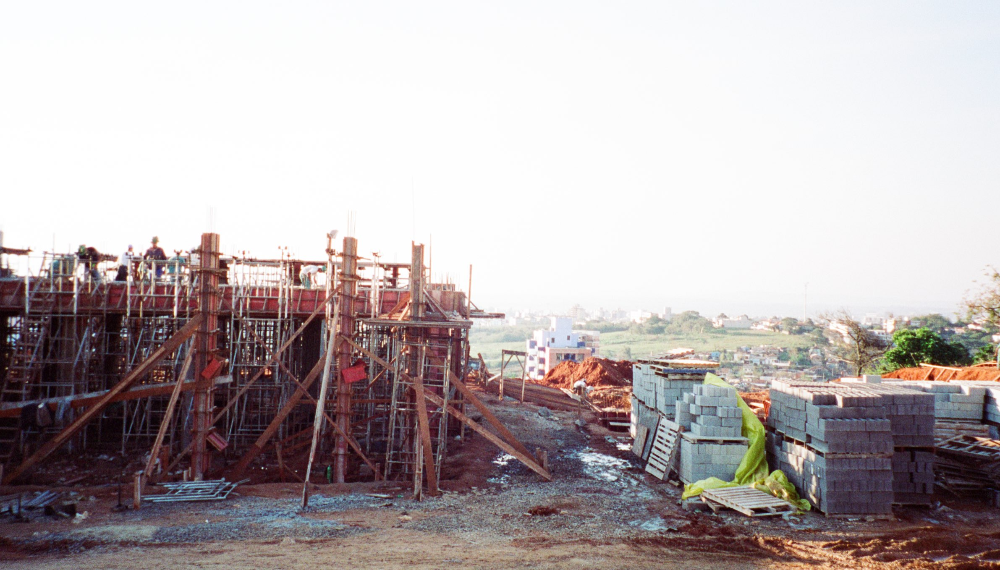
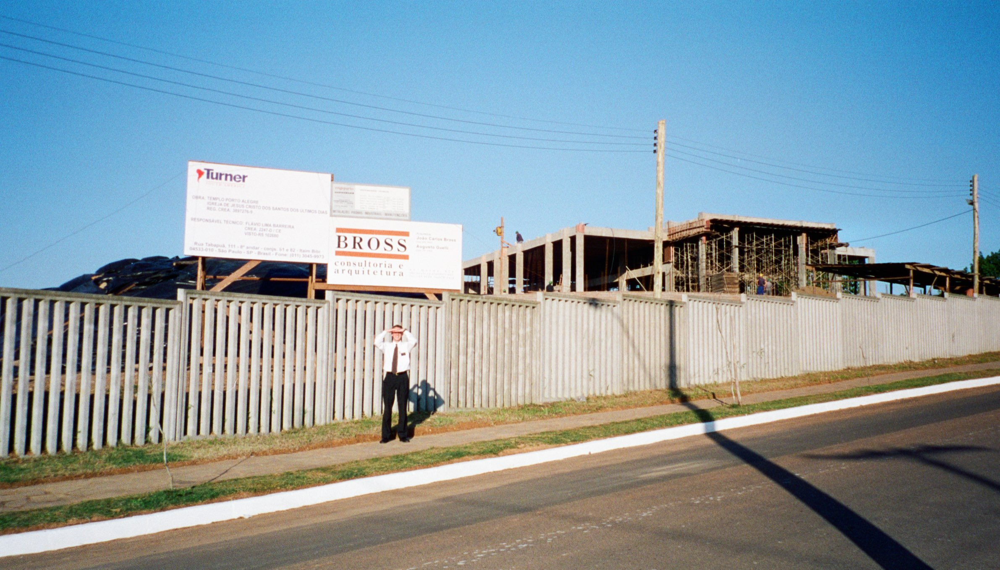
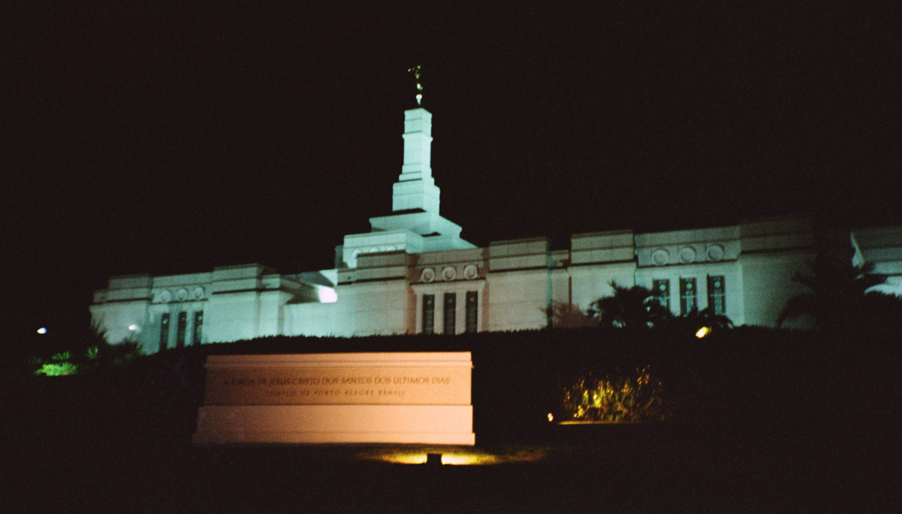
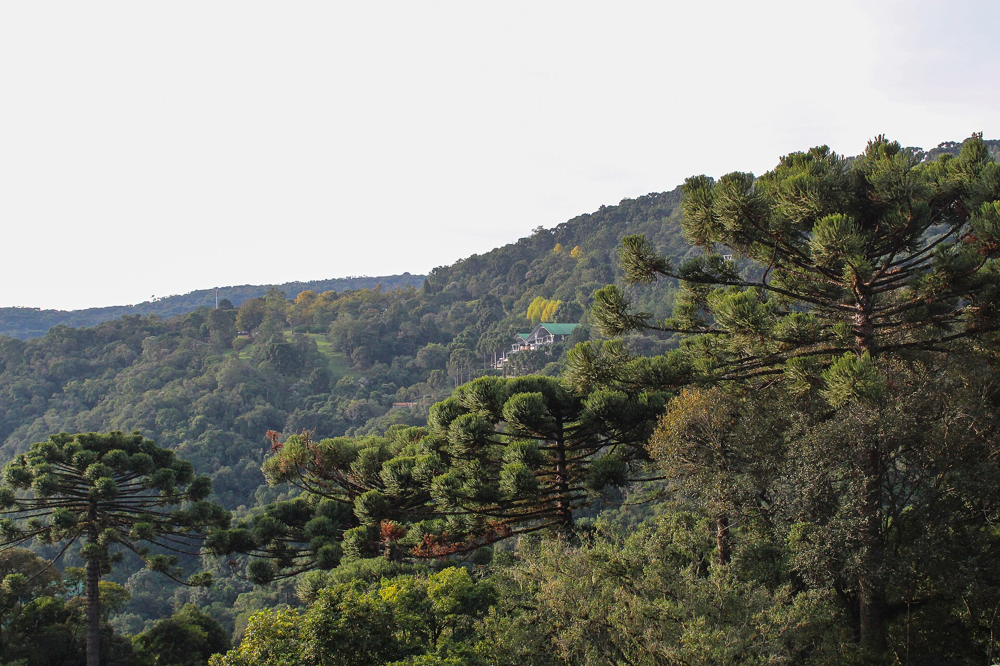

::: {.hero .column-screen}
::: {.eyebrow}
[Missão Brasil Porto Alegre Norte · 1997–2000]{.lang-pt}[Brazil Porto Alegre North Mission · 1997–2000]{.lang-en}
:::

# O Chamado

::: {.lead}
[Presidente Arlan e Síster Sally Woodward]{.lang-pt}[President Arlan and Sister Sally Woodward]{.lang-en}
:::

```{=html}
<div id="heroCarousel" class="carousel slide carousel-fade" data-bs-ride="carousel" data-bs-interval="4500">
  <div class="carousel-inner">
    <div class="carousel-item active"></div>
    <div class="carousel-item"></div>
    <div class="carousel-item"></div>
    <div class="carousel-item"></div>
    <div class="carousel-item"></div>
    <div class="carousel-item"></div>
    <div class="carousel-item"></div>
    <div class="carousel-item"></div>
  </div>
  <div class="carousel-nav">
    <button class="carousel-control-prev" type="button" data-bs-target="#heroCarousel" data-bs-slide="prev">
      <i class="bi bi-chevron-left" aria-hidden="true"></i><span class="visually-hidden">Anterior</span>
    </button>
    <div class="carousel-indicators">
      <button type="button" data-bs-target="#heroCarousel" data-bs-slide-to="0" class="active" aria-current="true" aria-label="Escritório"></button>
      <button type="button" data-bs-target="#heroCarousel" data-bs-slide-to="1" aria-label="Marau"></button>
      <button type="button" data-bs-target="#heroCarousel" data-bs-slide-to="2" aria-label="Santa Rosa"></button>
      <button type="button" data-bs-target="#heroCarousel" data-bs-slide-to="3" aria-label="Tramandaí"></button>
      <button type="button" data-bs-target="#heroCarousel" data-bs-slide-to="4" aria-label="Cruz Alta"></button>
      <button type="button" data-bs-target="#heroCarousel" data-bs-slide-to="5" aria-label="Santo Ângelo"></button>
      <button type="button" data-bs-target="#heroCarousel" data-bs-slide-to="6" aria-label="Capão da Canoa"></button>
      <button type="button" data-bs-target="#heroCarousel" data-bs-slide-to="7" aria-label="Vacaria"></button>
    </div>
    <button class="carousel-control-next" type="button" data-bs-target="#heroCarousel" data-bs-slide="next">
      <i class="bi bi-chevron-right" aria-hidden="true"></i><span class="visually-hidden">Próxima</span>
    </button>
  </div>
</div>
<p class="credito-fotos"><i class="bi bi-camera"></i> <span class="lang-pt">Fotos: cortesia do Élder George</span><span class="lang-en">Photos courtesy of Elder George</span></p>
```
:::

::: {.band .column-screen #missao}
```{=html}
<div class="secao-topo">
  <span class="section-eyebrow"><span class="lang-pt">A Missão</span><span class="lang-en">The Mission</span></span>
</div>

<blockquote class="scripture">
  <span class="lang-pt" lang="pt">Eleva o coração e regozija-te, pois é chegada a hora de tua missão.</span>
  <span class="lang-en" lang="en">Lift up your heart and rejoice, for the hour of your mission is come.</span>
  <footer><span class="lang-pt">Doutrina e Convênios 31:3</span><span class="lang-en">Doctrine and Covenants 31:3</span></footer>
</blockquote>

<div class="missao-texto lang-pt" lang="pt">
  <div class="intro-com-globo">
    <div class="globo" data-svg="images/globo-pt.svg"></div>
    <p class="missao-intro">A Missão Brasil Porto Alegre Norte cobria a metade norte do <strong>Rio Grande do Sul</strong>, o estado mais ao sul do Brasil: da zona norte de Porto Alegre e sua região metropolitana até a Serra Gaúcha, o Planalto e o Litoral Norte, e, até julho de 1998, o Noroeste e as Missões, perto da fronteira com a Argentina.</p>
  </div>

  <div class="mapa-rs" data-svg="images/mapa-rs-pt.svg"></div>

  <div class="regioes">
    <div class="regiao regiao-metro"><h3><span class="regiao-icone" aria-hidden="true">🏙️</span> Porto Alegre e região metropolitana</h3>
      <p>A capital gaúcha e as cidades ao seu redor: Canoas, Esteio, Gravataí, Cachoeirinha, Alvorada e Guaíba. Bairros movimentados, ônibus lotados e muitas zonas da missão.</p></div>
    <div class="regiao regiao-vales"><h3><span class="regiao-icone" aria-hidden="true">👞</span> Vales do Sinos, Caí e Taquari</h3>
      <p>Novo Hamburgo, São Leopoldo, Sapiranga, Taquara, Montenegro e Lajeado. São Leopoldo foi o berço da imigração alemã no Brasil, em 1824, e o Vale dos Sinos é conhecido pela indústria de calçados.</p></div>
    <div class="regiao regiao-serra"><h3><span class="regiao-icone" aria-hidden="true">🍇</span> Serra Gaúcha</h3>
      <p>Caxias do Sul, Bento Gonçalves, Farroupilha, Gramado e Canela. Terra da imigração italiana a partir de 1875, dos parreirais e do vinho, com invernos frios e, às vezes, neve.</p></div>
    <div class="regiao regiao-planalto"><h3><span class="regiao-icone" aria-hidden="true">🌾</span> Planalto e Campos de Cima da Serra</h3>
      <p>Passo Fundo, Erechim, Carazinho, Marau e Vacaria. Lavouras de soja, trigo e milho, os pomares de maçã de Vacaria e algumas das madrugadas mais frias do estado.</p></div>
    <div class="regiao regiao-litoral"><h3><span class="regiao-icone" aria-hidden="true">🌊</span> Litoral Norte</h3>
      <p>Osório, Tramandaí e Capão da Canoa. Praias, lagoas e vento constante: cheias de veranistas no verão e quase vazias no inverno.</p></div>
    <div class="regiao regiao-noroeste"><h3><span class="regiao-icone" aria-hidden="true">⛪</span> Noroeste e Missões <small>até julho de 1998</small></h3>
      <p>Santo Ângelo, Ijuí, Cruz Alta e Santa Rosa, perto das ruínas jesuítico-guaranis de São Miguel das Missões, Patrimônio Mundial da UNESCO.</p></div>
  </div>

  <div class="missao-duo">
    <div><h3><i class="bi bi-thermometer-half"></i> O clima</h3>
      <p>Subtropical, com as quatro estações bem marcadas. Os verões são quentes e úmidos: em Porto Alegre o termômetro passa fácil dos 35 °C. Os invernos são frios e chuvosos, com geada no interior, neve de vez em quando nas partes altas da Serra e o minuano soprando do sudoeste. Muito missionário norte-americano chegou esperando o calor do Brasil e conheceu o frio gaúcho.</p></div>
    <div><h3><i class="bi bi-people"></i> O povo</h3>
      <p>O gaúcho é hospitaleiro e orgulhoso das suas tradições: o chimarrão passado de mão em mão, o churrasco de domingo, os Centros de Tradições Gaúchas, onde se mantêm vivas as danças, a música e a pilcha, e o 20 de Setembro, que lembra a Revolução Farroupilha. A população mistura descendentes de portugueses e açorianos, alemães, italianos, poloneses, africanos e indígenas. No interior ainda se ouve em casa o alemão ou o dialeto vêneto trazido pelos imigrantes italianos, e todo missionário logo aprendia a dizer “bah, tchê!”.</p></div>
  </div>

</div>

<div class="missao-texto lang-en" lang="en">
  <div class="intro-com-globo">
    <div class="globo" data-svg="images/globo-en.svg"></div>
    <p class="missao-intro">The Brazil Porto Alegre North Mission covered the northern half of <strong>Rio Grande do Sul</strong>, Brazil's southernmost state: from the north side of Porto Alegre and its metro area up through the Serra Gaúcha highlands, the Planalto and the northern coast, and, until July 1998, the Northwest and the Missões region near the Argentine border.</p>
  </div>

  <div class="mapa-rs" data-svg="images/mapa-rs-en.svg"></div>

  <div class="regioes">
    <div class="regiao regiao-metro"><h3><span class="regiao-icone" aria-hidden="true">🏙️</span> Porto Alegre and its metro area</h3>
      <p>The state capital and the cities around it: Canoas, Esteio, Gravataí, Cachoeirinha, Alvorada and Guaíba. Busy neighborhoods, packed buses and many of the mission's zones.</p></div>
    <div class="regiao regiao-vales"><h3><span class="regiao-icone" aria-hidden="true">👞</span> Sinos, Caí and Taquari valleys</h3>
      <p>Novo Hamburgo, São Leopoldo, Sapiranga, Taquara, Montenegro and Lajeado. São Leopoldo was the cradle of German immigration to Brazil in 1824, and the Sinos valley is known for its shoe industry.</p></div>
    <div class="regiao regiao-serra"><h3><span class="regiao-icone" aria-hidden="true">🍇</span> Serra Gaúcha</h3>
      <p>Caxias do Sul, Bento Gonçalves, Farroupilha, Gramado and Canela. Settled by Italian immigrants from 1875 on: vineyards, wine, cold winters and the occasional snowfall.</p></div>
    <div class="regiao regiao-planalto"><h3><span class="regiao-icone" aria-hidden="true">🌾</span> Planalto and Campos de Cima da Serra</h3>
      <p>Passo Fundo, Erechim, Carazinho, Marau and Vacaria. Soy, wheat and corn fields, Vacaria's apple orchards and some of the coldest mornings in the state.</p></div>
    <div class="regiao regiao-litoral"><h3><span class="regiao-icone" aria-hidden="true">🌊</span> Northern coast</h3>
      <p>Osório, Tramandaí and Capão da Canoa. Beaches, lagoons and constant wind: crowded with vacationers in summer, nearly empty in winter.</p></div>
    <div class="regiao regiao-noroeste"><h3><span class="regiao-icone" aria-hidden="true">⛪</span> Northwest and Missões <small>until July 1998</small></h3>
      <p>Santo Ângelo, Ijuí, Cruz Alta and Santa Rosa, near the Jesuit-Guarani ruins of São Miguel das Missões, a UNESCO World Heritage Site.</p></div>
  </div>

  <div class="missao-duo">
    <div><h3><i class="bi bi-thermometer-half"></i> The climate</h3>
      <p>Subtropical, with four distinct seasons. Summers are hot and humid; Porto Alegre easily tops 35 °C (95 °F). Winters are cold and rainy, with frost inland, occasional snow in the high Serra and the <em>minuano</em> wind blowing in from the southwest. Many North American missionaries arrived expecting tropical Brazil and met the gaúcho winter instead.</p></div>
    <div><h3><i class="bi bi-people"></i> The people</h3>
      <p>Gaúchos are warm, hospitable and proud of their traditions: chimarrão passed from hand to hand, Sunday churrasco, the <em>Centros de Tradições Gaúchas</em> (gaúcho tradition centers), clubs where people keep the folk dances, music and dress alive, and the 20th of September, which remembers the Farroupilha Revolution. The population blends Portuguese and Azorean, German, Italian, Polish, African and Indigenous roots. In the interior you can still hear German, or the Venetian dialect brought by the Italian immigrants, spoken at home, and every missionary soon learned to say “bah, tchê!”.</p></div>
  </div>

</div>

<p class="atalho-busca"><a href="#busca" onclick="var b=document.getElementById('busca'); if (b) { event.preventDefault(); b.scrollIntoView({behavior:'smooth', block:'center'}); b.focus({preventScroll:true}); }"><i class="bi bi-search"></i> <span class="lang-pt">Siga a jornada de um missionário</span><span class="lang-en">Follow a missionary's journey</span> ↓</a></p>

<script>
// Inline the map/globe SVGs (an  would not use the page fonts).
document.querySelectorAll("#missao [data-svg]").forEach(function (el) {
  fetch(el.getAttribute("data-svg"))
    .then(function (r) { return r.text(); })
    .then(function (t) { el.innerHTML = t; })
    .catch(function () { el.innerHTML = ""; });
});
</script>

```

```{ojs}
galeriaSecao("missao")
```
:::

:::: {.band .column-screen .section-muted #areas}
::: {.secao-topo}
```{=html}
<span class="section-eyebrow"><span class="lang-pt">As Áreas</span><span class="lang-en">The Areas</span></span>
```

```{ojs}
{
  const go = k => definir(viewof quadroKey, k);
  return htl.html`<div class="nav-mes">
    <button class="nav-mes-btn" aria-label=${T("Mês anterior", "Previous month")} disabled=${snapIdx === 0} onclick=${() => go(snaps[snapIdx - 1].key)}><i class="bi bi-chevron-left"></i></button>
    <span class="snap-label">${fmtMesAno(snapAtual)}</span>
    <button class="nav-mes-btn" aria-label=${T("Próximo mês", "Next month")} disabled=${snapIdx === snaps.length - 1} onclick=${() => go(snaps[snapIdx + 1].key)}><i class="bi bi-chevron-right"></i></button>
  </div>`;
}
```
:::

::: {.wrap}

## [O quadro de transferências]{.lang-pt}[The transfer board]{.lang-en}

::: {.section-intro}
[Foi nessas cidades e bairros que os missionários trabalharam. A cada transferência, as duplas mudavam e as zonas se reorganizavam. Escolha um mês para ver o quadro e toque no nome de uma área ou de um missionário para ver mais detalhes. Viu algum erro? Escreva para [info@ochamado.org](mailto:info@ochamado.org).]{.lang-pt}[These are the cities and neighborhoods where the missionaries served. At every transfer, companionships changed and zones were reorganized. Pick a month to see the board, and tap an area or missionary name to see more details. Spot a mistake? Email [info@ochamado.org](mailto:info@ochamado.org).]{.lang-en}
:::

```{ojs}
quadro = FileAttachment("data/quadro.json").json()
snaps = quadro.snapshots
pessoas = new Map(quadro.missionarios.map(p => [p.id, p]))
viewof idioma = {
  const el = htl.html`<span hidden></span>`;
  el.value = document.documentElement.dataset.lang === "en" ? "en" : "pt";
  window.addEventListener("ochamado:idioma", () => {
    el.value = document.documentElement.dataset.lang === "en" ? "en" : "pt";
    el.dispatchEvent(new Event("input"));
  });
  return el;
}
T = (pt, en) => idioma === "en" ? en : pt
MES = idioma === "en"
  ? ["Jan", "Feb", "Mar", "Apr", "May", "Jun", "Jul", "Aug", "Sep", "Oct", "Nov", "Dec"]
  : ["jan", "fev", "mar", "abr", "mai", "jun", "jul", "ago", "set", "out", "nov", "dez"]
MES_NOME = idioma === "en"
  ? ["January", "February", "March", "April", "May", "June", "July", "August", "September", "October", "November", "December"]
  : ["Janeiro", "Fevereiro", "Março", "Abril", "Maio", "Junho", "Julho", "Agosto", "Setembro", "Outubro", "Novembro", "Dezembro"]
fmtYM = k => { if (!k) return "—"; const [y, m] = k.split("-"); return idioma === "en" ? `${MES[+m - 1]} ${y}` : `${MES[+m - 1]}/${y}`; }
fmtMesAno = s => idioma === "en" ? `${MES_NOME[s.mes - 1]} ${s.ano}` : `${MES_NOME[s.mes - 1].toLowerCase()} de ${s.ano}`
nacionalidade = n => idioma === "en" ? ({ "brasileiro": "Brazilian", "norte americano": "North American" }[n] ?? n) : n
nomeCompleto = l => l.replace(/^E\s+/, "Élder ").replace(/^S\s+/, "Síster ")
// Letters (A, B, C) and role tags (LD, LZ, Casal) mark companionships within one área; numbers are separate wards.
semLetra = n => n == null ? n : n.replace(/(\s+(LD|LZ|Casal|[A-D]))+$/i, "").trim()
norm = s => String(s ?? "").normalize("NFD").replace(/[\u0300-\u036f]/g, "").toLowerCase().replace(/-/g, " ").replace(/\s+/g, " ").trim()
aparicoes = {
  const m = new Map();
  for (const s of snaps) for (const z of s.zonas) for (const a of z.areas) for (const p of a.dupla) {
    const k = p.id ?? "?" + p.n;
    if (!m.has(k)) m.set(k, []);
    // area = the área name without the board's #1/#2 or A/B/LD… (those only tell companionships in the same área apart).
    m.get(k).push({ key: s.key, zona: z.nome, especial: z.especial, areaNome: a.nome, area: semLetra(a.nome) ?? z.nome, companheiros: a.dupla.filter(x => x !== p) });
  }
  return m;
}
function estado(v) { const el = htl.html`<span hidden></span>`; el.value = v; return el; }
function definir(el, v) { el.value = v; el.dispatchEvent(new Event("input", { bubbles: true })); }
viewof quadroKey = estado("1997-10")
// Every month of the Woodwards' mission (July 1997 – June 2000); months without a transfer board are shown greyed out.
MESES_MISSAO = { const l = []; for (let n = 1997 * 12 + 6; n <= 2000 * 12 + 5; n++) l.push(`${Math.floor(n / 12)}-${String(n % 12 + 1).padStart(2, "0")}`); return l; }
temQuadro = new Set(snaps.map(s => s.key))
DIVISAO = "1998-07"
snapIdx = snaps.findIndex(s => s.key === quadroKey)
snapAtual = snaps[snapIdx]
```

```{ojs}
{
  const first = snaps[0], last = snaps[snaps.length - 1];
  const max = Math.max(...snaps.map(s => s.stats.zonas));
  const W = 640, H = 56, gap = 3, bw = W / MESES_MISSAO.length;
  const porChave = new Map(snaps.map(s => [s.key, s]));
  const tile = (num, lbl, base) => htl.html`<div class="stat-tile"><div class="num">${num}</div><div class="lbl">${lbl}</div></div>`;
  return htl.html`<div>
    <p class="growth-headline"><strong>${first.stats.zonas}</strong> ${T("zonas em", "zones in")} ${fmtYM(first.key)} → <strong>${last.stats.zonas}</strong> ${T("zonas em", "zones in")} ${fmtYM(last.key)}</p>
    <div class="stat-tiles">
      ${tile(snapAtual.stats.zonas, T("Zonas", "Zones"))}
      ${tile(snapAtual.stats.areas, T("Áreas", "Areas"))}
      ${tile(snapAtual.stats.missionarios, T("Missionários", "Missionaries"))}
    </div>
    ${htl.svg`<svg class="growth-bars" viewBox="0 0 ${W} ${H}" preserveAspectRatio="none" role="img" aria-label=${T("Zonas por mês", "Zones per month")}>
      ${MESES_MISSAO.map((k, i) => {
        const s = porChave.get(k);
        if (!s) return htl.svg`<rect class="sem-dados" x=${i * bw + gap / 2} y=${H - 4} width=${bw - gap} height="4" rx="2"><title>${fmtYM(k)}: ${T("sem quadro de transferências", "no transfer board")}</title></rect>`;
        const h = Math.max(4, (s.stats.zonas / max) * H);
        return htl.svg`<rect class=${s.key === quadroKey ? "active" : ""} x=${i * bw + gap / 2} y=${H - h} width=${bw - gap} height=${h} rx="2"
          onclick=${() => definir(viewof quadroKey, s.key)}><title>${fmtYM(s.key)}: ${s.stats.zonas} ${T("zonas", "zones")}</title></rect>`;
      })}
      ${(() => {
        const i = MESES_MISSAO.indexOf(DIVISAO);
        return i < 0 ? "" : htl.svg`<line class="marco-divisao" x1=${i * bw} x2=${i * bw} y1="0" y2=${H}><title>${T("Julho de 1998: divisão da missão", "July 1998: the mission is divided")}</title></line>`;
      })()}
    </svg>`}
    <p class="growth-nota"><span class="marco"></span> ${T("Julho de 1998: a missão foi dividida para formar a Missão Brasil Santa Maria.", "July 1998: the mission was divided to create the Brazil Santa Maria Mission.")}</p>
  </div>`;
}
```

```{ojs}
{
  const anos = [...new Set(MESES_MISSAO.map(k => +k.slice(0, 4)))];
  const doAno = MESES_MISSAO.filter(k => +k.slice(0, 4) === snapAtual.ano);
  const go = k => definir(viewof quadroKey, k);
  const pill = (label, active, onclick) => htl.html`<button class=${active ? "pill active" : "pill"} onclick=${onclick}>${label}</button>`;
  const semQuadro = k => htl.html`<button class="pill sem-dados" disabled title=${T("Sem quadro de transferências para este mês", "No transfer board for this month")}>${MES[+k.slice(5) - 1]}</button>`;
  const algumVazio = doAno.some(k => !temQuadro.has(k));
  return htl.html`<div class="filter-panel">
    <div class="pill-group">${anos.map(a => {
      const primeiro = snaps.find(s => s.ano === a);
      return primeiro ? pill(a, a === snapAtual.ano, () => go(primeiro.key)) : htl.html`<button class="pill sem-dados" disabled>${a}</button>`;
    })}</div>
    <div class="pill-group">${doAno.map(k => temQuadro.has(k) ? pill(MES[+k.slice(5) - 1], k === quadroKey, () => go(k)) : semQuadro(k))}</div>
    ${algumVazio ? htl.html`<p class="nota-sem-dados">${T("Meses em cinza: não temos o quadro de transferências desse mês.", "Greyed-out months: we don't have that month's transfer board.")}</p>` : ""}
  </div>
  ${quadroKey === DIVISAO
    ? htl.html`<p class="aviso-divisao"><i class="bi bi-signpost-split"></i><span>${idioma === "en"
      ? htl.html`This month the mission was divided to create the <strong>Brazil Santa Maria Mission</strong>. The Ijuí and Santo Ângelo zones went to the new mission.`
      : htl.html`Neste mês a missão foi dividida para formar a <strong>Missão Brasil Santa Maria</strong>. As zonas de Ijuí e Santo Ângelo passaram para a nova missão.`}</span></p>`
    : ""}`;
}
```

```{ojs}
// Area history: same área name across snapshots, even when its zone changed (zones split over time).
// "Rio Branco" exists both in Porto Alegre and in Caxias do Sul, so those are kept apart by region.
chaveArea = (nome, zona) => {
  const k = norm(semLetra(nome));
  return /^rio branco/.test(k) ? k + (["Moinhos de Vento", "Porto Alegre"].includes(zona) ? "|poa" : "|serra") : k;
}

historicoArea = {
  const m = new Map();
  snaps.forEach((s, i) => {
    for (const z of s.zonas) {
      if (z.especial) continue;
      for (const a of z.areas) {
        if (!a.nome) continue;
        const k = chaveArea(a.nome, z.nome);
        if (!m.has(k)) m.set(k, { nome: semLetra(a.nome), zonas: [], duplas: new Map(), ini: i, fim: i });
        const h = m.get(k);
        h.fim = i;
        if (!h.zonas.includes(z.nome)) h.zonas.push(z.nome);
        const dk = a.dupla.map(p => p.id ?? "?" + p.n).sort().join("+");
        if (!h.duplas.has(dk)) h.duplas.set(dk, { dupla: a.dupla, idx: [] });
        const d = h.duplas.get(dk);
        if (d.idx.at(-1) !== i) d.idx.push(i);
      }
    }
  });
  return m;
}

dlgArea = {
  const d = htl.html`<dialog class="dialogo-area" aria-labelledby="dlg-area-titulo"></dialog>`;
  d.addEventListener("click", e => { if (e.target === d) d.close(); });
  return d;
}

chavePessoa = p => p.id ?? "?" + p.n

// The area and missionary dialogs link to each other, so their functions share one cell
// (separate OJS cells may not reference each other in a cycle).
dialogos = {
  // The same dialog shows an area or a missionary; links inside it swap its content.
  function mostrarDialogo(conteudo) {
    dlgArea.replaceChildren(conteudo);
    if (!dlgArea.open) dlgArea.showModal();
    dlgArea.scrollTop = 0;
  }

  function topoDialogo(titulo, meta) {
    return htl.html`<div class="dlg-topo">
      <div><h3 id="dlg-area-titulo">${titulo}</h3>${meta}</div>
      <button class="dlg-fechar" aria-label=${T("Fechar", "Close")} onclick=${() => dlgArea.close()}><i class="bi bi-x-lg"></i></button>
    </div>`;
  }


  // A missionary's name (or a ditto mark for a repeat) that opens their dialog.
  function botaoPessoa(p, rep = false) {
    const nome = nomeCompleto(p.n);
    // A repeat is a plain mark (not clickable); the full name shows on hover.
    if (rep) return htl.html`<span class="ditto" title=${nome}>${dittoConteudo(nome)}</span>`;
    return htl.html`<button class=${"link-caixa" + (p.id ? "" : " sem-registro")} onclick=${() => abrirPessoa(p)}>${nome}</button>`;
  }

  // One table row per companionship run; each missionary has a column, and someone who also
  // appears in the row above keeps that column and is shown as a ditto mark.
  function linhaHistoricoArea(periodoTxt, cols, atual) {
    const tds = cols.map(c => c ? htl.html`<td>${botaoPessoa(c.p, c.rep)}</td>` : htl.html`<td></td>`);
    return htl.html`<tr class=${atual ? "atual" : ""}><td class="periodo">${periodoTxt}</td>${tds}</tr>`;
  }

  // A missionary's boards: zone, area and companions, with ditto marks for repeats.
  function tabelaPessoa(ap) {
    // Every month from the first to the last board they're on; consecutive empty months share one grey row.
    const porMes = new Map(ap.map(a => [a.key, a]));
    const linhas = [];
    for (let k = ap[0].key; k <= ap.at(-1).key; k = mesDepois(k)) {
      const a = porMes.get(k);
      if (a) { linhas.push({ a }); continue; }
      const tipo = temQuadro.has(k) ? "ausente" : "semQuadro", ult = linhas.at(-1);
      if (ult && ult.tipo === tipo) ult.fim = k; else linhas.push({ tipo, ini: k, fim: k });
    }
    return htl.html`<div class="table-scroll"><table class="historico-table">
      <thead><tr><th>${T("Quadro", "Board")}</th><th>${T("Zona", "Zone")}</th><th>${T("Área", "Area")}</th><th>${T("Companheiros", "Companions")}</th></tr></thead>
      <tbody>${linhas.map((l, i) => {
        if (!l.a) return htl.html`<tr class="sem-dados"><td class="periodo">${l.ini === l.fim ? fmtYM(l.ini) : `${fmtYM(l.ini)} – ${fmtYM(l.fim)}`}</td>
          <td colspan="3">${l.tipo === "semQuadro" ? T("Sem quadro de transferências", "No transfer board") : T("Não aparece no quadro", "Not on the board")}</td></tr>`;
        const a = l.a, ant = linhas[i - 1]?.a;
        const repZona = ant && ant.zona === a.zona;
        const repArea = ant && ant.area === a.area;
        const compAnt = new Set(ant ? ant.companheiros.map(chavePessoa) : []);
        const ditto = (txt, rep) => rep ? htl.html`<span class="ditto" title=${txt}>${dittoConteudo(txt)}</span>` : txt;
        return htl.html`<tr class=${a.key === snapAtual.key ? "atual" : ""}><td class="periodo">${fmtYM(a.key)}</td><td>${ditto(a.zona, repZona)}</td>
          <td>${a.areaNome && !a.especial && !repArea
            ? htl.html`<button class="link-caixa" title=${T("Ver todas as duplas desta área", "See every companionship in this area")}
                onclick=${() => abrirArea({ nome: a.areaNome }, { nome: a.zona })}>${a.area}</button>`
            : ditto(a.area, repArea)}</td>
          <td class="companheiros">${a.companheiros.map(c => botaoPessoa(c, compAnt.has(chavePessoa(c))))}</td></tr>`;
      })}</tbody>
    </table></div>`;
  }

  function abrirPessoa(p) {
    const x = p.id ? pessoas.get(p.id) : null;
    const ap = aparicoes.get(chavePessoa(p)) ?? [];
    const nQuadros = `${T("em", "on")} ${ap.length} ${ap.length === 1 ? T("quadro", "board") : T("quadros", "boards")}`;
    const provavel = p.c === "inferido" || p.c === "tolerancia";
    const meta = x
      ? htl.html`<div class="meta">${x.nacionalidade ? `${nacionalidade(x.nacionalidade)} · ` : ""}<strong>${T("Chegada", "Arrived")}</strong> ${fmtYM(x.chegada)} · <strong>${T("Saída", "Left")}</strong> ${fmtYM(x.saida)} · ${nQuadros}${provavel ? htl.html` · <span class="provavel">${T("identificação provável", "probable match")}</span>` : ""}</div>`
      : htl.html`<div class="meta">${T("Sem registro de chegada/saída", "No arrival/departure record")} · ${nQuadros}</div>`;
    mostrarDialogo(htl.html`${topoDialogo(x ? `${x.titulo} ${x.plaqueta}` : nomeCompleto(p.n), meta)}
      <div class="dlg-corpo">
        ${ap.length ? htl.html`<button class="pill botao-jornada" onclick=${() => verJornada(chavePessoa(p))}><i class="bi bi-signpost-2"></i> ${T("Ver a jornada no mapa", "See the journey on the map")}</button>` : ""}
        ${ap.length ? tabelaPessoa(ap) : htl.html`<p class="busca-hint">${T("Não aparece nos quadros de transferências.", "Not on any transfer board.")}</p>`}
        ${x ? "" : htl.html`<p class="dlg-nota">${T("Ainda não conseguimos ligar este nome a ninguém da lista de missionários. Se você sabe quem é, escreva para info@ochamado.org.",
          "We couldn't match this name to anyone on the missionary list yet. If you know who it is, email info@ochamado.org.")}</p>`}
        <p class="dlg-nota">${T("A chegada é o mês em que o missionário chegou ao campo missionário. ↓ = igual à linha de cima. A linha destacada é o mês escolhido no quadro.",
          "Arrival is the month the missionary arrived in the mission field. ↓ = same as the row above. The highlighted row is the month selected on the board.")}</p>
      </div>`);
  }

  // Closes the window and plays this missionary's journey on the journey map.
  function verJornada(chave) {
    dlgArea.close();
    definir(viewof jornadaModo, { tipo: "pessoa", chave, auto: true });
    document.getElementById("mapa-jornada")?.scrollIntoView({ behavior: "smooth", block: "center" });
  }

  function abrirArea(a, z) {
    const h = historicoArea.get(chaveArea(a.nome, z.nome));
    if (!h) return;
    const linhas = [];
    for (const { dupla, idx } of h.duplas.values()) {
      let ini = idx[0], ant = idx[0];
      for (const i of [...idx.slice(1), null]) {
        if (i === ant + 1) { ant = i; continue; }
        linhas.push({ ini, fim: ant, dupla });
        ini = ant = i;
      }
    }
    linhas.sort((x, y) => x.ini - y.ini || x.fim - y.fim);
    const nPessoas = new Set(linhas.flatMap(r => r.dupla.map(p => p.id ?? "?" + p.n))).size;
    const periodo = r => r.ini === r.fim ? fmtYM(snaps[r.ini].key) : `${fmtYM(snaps[r.ini].key)} – ${fmtYM(snaps[r.fim].key)}`;
    const zonas = h.zonas.join(", ");
    const chave = p => p.id ?? "?" + p.n;
    const nCol = Math.max(2, ...linhas.map(r => r.dupla.length));
    let colsAnt = [];
    const linhasCols = linhas.map(r => {
      const cols = Array(nCol).fill(null), resto = [];
      for (const p of r.dupla) {
        const j = colsAnt.findIndex(q => q && chave(q) === chave(p));
        if (j >= 0 && !cols[j]) cols[j] = { p, rep: true }; else resto.push(p);
      }
      for (const p of resto) cols[cols.findIndex(c => !c)] = { p, rep: false };
      colsAnt = cols.map(c => c && c.p);
      return { r, cols };
    });
    const meta = htl.html`<div class="meta">${T(h.zonas.length > 1 ? "Zonas" : "Zona", h.zonas.length > 1 ? "Zones" : "Zone")}: ${zonas} · ${nPessoas} ${T("missionários", "missionaries")}</div>`;
    mostrarDialogo(htl.html`${topoDialogo(h.nome, meta)}
      <div class="dlg-corpo">
        <table class="historico-table historico-area">
          <thead><tr><th>${T("Quando", "When")}</th><th colspan=${nCol}>${T("Dupla", "Companionship")}</th></tr></thead>
          <tbody>${linhasCols.map(({ r, cols }) => linhaHistoricoArea(periodo(r), cols, snapIdx >= r.ini && snapIdx <= r.fim))}</tbody>
        </table>
        <p class="dlg-nota">${T("↓ = mesmo missionário da linha de cima. Meses seguidos com a mesma dupla aparecem numa linha só. A linha destacada é o mês escolhido no quadro.",
          "↓ = same missionary as the row above. Consecutive months with the same companionship are shown as one row. The highlighted row is the month selected on the board.")}</p>
      </div>`);
  }

  return { abrirArea, abrirPessoa };
}

abrirArea = dialogos.abrirArea

abrirPessoa = dialogos.abrirPessoa

// Repeat mark: a down arrow, set in a little from the left edge of the text above.
function dittoConteudo(txt) {
  return htl.html`<span class="ditto-marca" aria-hidden="true"><i class="bi bi-arrow-down"></i></span>`;
}

function linhaArea(a, z, cont) {
  const chips = a.dupla.map(p => htl.html`<button class=${p.id ? "chip" : "chip sem-registro"} onclick=${() => abrirPessoa(p)}>${nomeCompleto(p.n)}</button>`);
  return htl.html`<div class=${cont ? "area-row cont" : "area-row"}>
    ${a.nome ? htl.html`<div class="area-name">${z.especial ? a.nome : htl.html`<button class="area-link link-caixa" title=${T("Ver todas as duplas desta área", "See every companionship in this area")} onclick=${() => abrirArea(a, z)}>${a.nome}<i class="bi bi-clock-history"></i></button>`}${a.total > 1 ? htl.html`<span class="dupla-tag">#${a.n}</span>` : ""}</div>` : ""}
    <div class="nomes">${chips}</div>
  </div>`;
}
```

```{ojs}
// Zone toggles for the areas map: one button per zone of the month, plus all / none.
{
  const zonas = snapAtual.zonas.filter(z => !z.especial).map(z => z.nome);
  const ocultas = new Set(zonasOcultas);
  const alternar = nome => {
    const s = new Set(zonasOcultas);
    s.has(nome) ? s.delete(nome) : s.add(nome);
    definir(viewof zonasOcultas, [...s]);
  };
  return htl.html`<div class="filtro-zonas">
    <span class="filtro-rotulo">${T("Zonas", "Zones")}</span>
    <button class="filtro-tudo" onclick=${() => definir(viewof zonasOcultas, [])}>${T("Todas", "All")}</button>
    <button class="filtro-tudo" onclick=${() => definir(viewof zonasOcultas, TODAS_ZONAS)}>${T("Nenhuma", "None")}</button>
    ${zonas.map(n => htl.html`<button class=${ocultas.has(n) ? "filtro-zona off" : "filtro-zona"} aria-pressed=${!ocultas.has(n)} onclick=${() => alternar(n)}>
      <span class="cor" style=${`background:${corZona(n)}`}></span>${n}</button>`)}
  </div>`;
}
```

```{ojs}
ZONA_POS = ({
  "Porto Alegre": [-30.035, -51.225], "Moinhos de Vento": [-30.012, -51.190], "Guaíba": [-30.114, -51.325],
  "Canoas": [-29.917, -51.183], "Canoas-Esteio": [-29.852, -51.179], "Gravataí": [-29.944, -50.992],
  "São Leopoldo": [-29.760, -51.147], "Novo Hamburgo": [-29.678, -51.131], "Taquara": [-29.650, -50.781],
  "Montenegro": [-29.689, -51.461], "Caxias do Sul": [-29.168, -51.179], "Bento Gonçalves": [-29.171, -51.519],
  "Vacaria": [-28.512, -50.934], "Passo Fundo": [-28.262, -52.408], "Vergueiro": [-28.230, -52.440],
  "Erechim": [-27.634, -52.274], "Osório": [-29.887, -50.270], "Capão da Canoa": [-29.745, -50.010],
  "Ijuí": [-28.388, -53.914], "Santo Ângelo": [-28.299, -54.263]
})

// A fixed color per zone (same in every month). Neighboring zones get clearly different hues.
ZONA_COR = ({
  "Porto Alegre": "#1f6fb4", "Moinhos de Vento": "#8e44ad", "Guaíba": "#17a2b8", "Canoas": "#d62728",
  "Canoas-Esteio": "#e377c2", "Gravataí": "#ff7f0e", "São Leopoldo": "#2ca02c", "Novo Hamburgo": "#8c564b",
  "Taquara": "#a9a619", "Montenegro": "#006d77", "Caxias do Sul": "#b5179e", "Bento Gonçalves": "#e9a23b",
  "Vacaria": "#264653", "Passo Fundo": "#3a86ff", "Vergueiro": "#6a3fd0", "Erechim": "#2a9d8f",
  "Osório": "#ef476f", "Capão da Canoa": "#06a77d", "Ijuí": "#e76f51", "Santo Ângelo": "#9c6644",
  "Assistentes": "#1b5e46", "Staff": "#5c6370", "Élderes Viajantes": "#b8862a"
})
// Assistants, Staff and Traveling Elders worked from the mission office, Av. Princesa Isabel 342, Porto Alegre.
ESCRITORIO = [-30.0505, -51.2115]
TODAS_ZONAS = [...new Set(snaps.flatMap(s => s.zonas.filter(z => !z.especial).map(z => z.nome)))]
// The office groups (Assistants, Staff, Traveling Elders) show only while every zone is on;
// once specific zones are picked, only those zones show.
mostrarEspeciais = snapAtual.zonas.filter(z => !z.especial).every(z => !zonasOcultas.includes(z.nome))
corZona = z => ZONA_COR[z] ?? "#555"

// Zones hidden on the areas map (kept when the month changes).
viewof zonasOcultas = estado([])

// Where each área was (data/areas-coords.json, built by scripts/geocode-areas.mjs and hand-checked).
// Áreas are grouped without their A/B letters, numbers and LD/LZ/Casal tags.
areasCoords = FileAttachment("data/areas-coords.json").json()
baseArea = nome => nome.replace(/(\s+(LD|LZ|Casal|[A-D]|\d+))+$/i, "").trim()
areaCoord = {
  const m = new Map(areasCoords.areas.map(e => [`${e.area}|${e.zona}`, e]));
  return (nome, zona) => m.get(`${baseArea(nome)}|${zona}`);
}

ZONA_METRO = ["Porto Alegre", "Moinhos de Vento", "Guaíba", "Canoas", "Canoas-Esteio", "Gravataí", "São Leopoldo", "Novo Hamburgo"]

rsContorno = FileAttachment("data/rs.geojson").json()

viewof mapa = {
  const el = htl.html`<div id="mapa" class="mapa-missao" role="region" aria-label="Mapa das zonas da missão / Map of the mission's zones"></div>`;
  const m = L.map(el, { scrollWheelZoom: false, zoomSnap: 0.25 }).setView([-29.0, -52.0], 7);
  L.tileLayer("https://tile.openstreetmap.org/{z}/{x}/{y}.png", {
    attribution: '&copy; <a href="https://www.openstreetmap.org/copyright">OpenStreetMap</a>',
    maxZoom: 14
  }).addTo(m);
  L.geoJSON(rsContorno, { style: { color: "#1b5e46", weight: 1.5, fill: false, dashArray: "4 4" }, interactive: false }).addTo(m);
  el.leaflet = m;
  el.camada = L.layerGroup().addTo(m);
  const metro = L.latLngBounds(ZONA_METRO.map(z => ZONA_POS[z])).pad(0.25);
  el.grandePoa = L.marker([-30.12, -51.40], {
    icon: L.divIcon({ className: "rotulo-grande-poa", html: "Grande Porto Alegre <i class='bi bi-zoom-in'></i>", iconSize: null }),
    keyboard: true
  }).on("click", () => m.flyToBounds(metro, { duration: 0.8 })).addTo(m);
  // "Whole mission" button: shown whenever the map is zoomed in past the full view
  // (after "Greater Porto Alegre", a filter's auto zoom, or zooming by hand).
  const inteira = L.latLngBounds(Object.values(ZONA_POS)).pad(0.08);
  const Voltar = L.Control.extend({
    onAdd() {
      const b = L.DomUtil.create("button", "btn-missao-inteira");
      b.type = "button";
      L.DomEvent.disableClickPropagation(b);
      L.DomEvent.on(b, "click", () => m.flyToBounds(inteira, { duration: 0.8 }));
      el.botaoVoltar = b;
      return b;
    }
  });
  new Voltar({ position: "topright" }).addTo(m);
  const zoomClasse = () => {
    el.classList.toggle("zoom-perto", m.getZoom() >= 9);
    // Shown whenever the view is not the whole mission: zoomed in by any means, or dragged aside.
    const foraDaVista = !m.getBounds().pad(0.05).contains(inteira.pad(-0.08));
    el.classList.toggle("zoom-dentro", el.clientWidth > 0 && (m.getZoom() > m.getBoundsZoom(inteira) + 0.1 || foraDaVista));
  };
  m.on("zoomend moveend", zoomClasse);
  zoomClasse();
  // The element is detached while this cell runs, so fit the view once it has a real size.
  let enquadrado = false;
  new ResizeObserver(() => {
    m.invalidateSize();
    if (!enquadrado && el.clientWidth > 0) {
      m.fitBounds(inteira);
      enquadrado = true;
    }
    zoomClasse();
  }).observe(el);
  return el;
}
```

```{ojs}
{
  const el = viewof mapa, camada = el.camada;
  camada.clearLayers();
  el.grandePoa.setIcon(L.divIcon({ className: "rotulo-grande-poa", html: `${T("Grande Porto Alegre", "Greater Porto Alegre")} <i class='bi bi-zoom-in'></i>`, iconSize: null }));
  el.botaoVoltar.innerHTML = `<i class="bi bi-zoom-out"></i> ${T("Ver a missão inteira", "See the whole mission")}`;
  // Zones: a small ring with the zone's name; tapping it scrolls to the zone's card.
  const ocultas = new Set(zonasOcultas);
  for (const z of snapAtual.zonas) {
    const pos = ZONA_POS[z.nome];
    if (!pos || ocultas.has(z.nome)) continue;
    const marcador = L.circleMarker(pos, { radius: 5, color: corZona(z.nome), weight: 2.5, fillColor: "#fff", fillOpacity: 1 });
    const metro = ZONA_METRO.includes(z.nome);
    marcador.bindTooltip(`${z.nome} <span>${z.areas.length}</span>`, {
      permanent: true, interactive: true, direction: z.nome === "Vergueiro" ? "left" : "right", offset: [z.nome === "Vergueiro" ? -6 : 6, 0],
      className: metro ? "rotulo-zona rotulo-metro" : "rotulo-zona"
    });
    marcador.on("click", () => {
      const card = [...document.querySelectorAll(".zone-card")].find(c => c.dataset.zona === z.nome);
      if (!card) return;
      card.scrollIntoView({ behavior: "smooth", block: "center" });
      card.classList.remove("destaque"); void card.offsetWidth; card.classList.add("destaque");
    });
    camada.addLayer(marcador);
  }
  // Office groups (Assistants, Staff, Traveling Elders): one dot each around the mission office.
  const grupos = mostrarEspeciais ? snapAtual.zonas.filter(z => z.especial) : [];
  if (grupos.length) {
    const escritorio = L.circleMarker(ESCRITORIO, { radius: 4, color: "#1b5e46", weight: 2, fillColor: "#fff", fillOpacity: 1 });
    escritorio.bindTooltip(T("Escritório da missão", "Mission office"), { permanent: true, direction: "left", offset: [-8, 0], className: "rotulo-zona rotulo-metro" });
    camada.addLayer(escritorio);
    grupos.forEach((z, i) => {
      const ang = Math.PI / 2 + (2 * Math.PI * i) / grupos.length, d = 0.004;
      const ponto = L.circleMarker([ESCRITORIO[0] + d * Math.sin(ang), ESCRITORIO[1] + d * Math.cos(ang) * 1.15], {
        radius: 6, color: "#fff", weight: 1.5, fillColor: corZona(z.nome), fillOpacity: 0.92
      });
      const nomes = z.areas.map(a => a.dupla.map(p => nomeCompleto(p.n)).join(" · ")).join("<br>");
      ponto.bindTooltip(`<strong>${z.nome}</strong> <span class="mapa-dica-zona">${T("Escritório da missão", "Mission office")}</span><br>${nomes}`,
        { direction: "top", offset: [0, -6], className: "dica-area" });
      ponto.on("click", () => {
        const card = [...document.querySelectorAll(".zone-card")].find(c => c.dataset.zona === z.nome);
        if (!card) return;
        card.scrollIntoView({ behavior: "smooth", block: "center" });
        card.classList.remove("destaque"); void card.offsetWidth; card.classList.add("destaque");
      });
      camada.addLayer(ponto);
    });
  }
  // Areas: one dot per área (its #1/#2 companionships together). Áreas that share a point,
  // such as wards placed at their city's center, are fanned out slightly so each can be tapped.
  const porArea = new Map();
  for (const z of snapAtual.zonas) {
    if (z.especial || ocultas.has(z.nome)) continue;
    for (const a of z.areas) {
      if (!a.nome) continue;
      const c = areaCoord(a.nome, z.nome);
      if (!c) continue;
      const k = `${baseArea(a.nome)}|${z.nome}`;
      if (!porArea.has(k)) porArea.set(k, { a, z, c, duplas: [] });
      porArea.get(k).duplas.push(a);
    }
  }
  const porPonto = new Map();
  for (const v of porArea.values()) {
    const k = `${v.c.lat},${v.c.lon}`;
    if (!porPonto.has(k)) porPonto.set(k, []);
    porPonto.get(k).push(v);
  }
  for (const grupo of porPonto.values()) {
    grupo.forEach((v, i) => {
      const ang = (2 * Math.PI * i) / grupo.length, d = grupo.length > 1 ? 0.006 : 0;
      const ponto = L.circleMarker([v.c.lat + d * Math.sin(ang), v.c.lon + d * Math.cos(ang) * 1.15], {
        radius: 6, color: "#fff", weight: 1.5, fillColor: corZona(v.z.nome), fillOpacity: 0.92
      });
      const nomes = v.duplas.map(a => a.dupla.map(p => nomeCompleto(p.n)).join(" · ")).join("<br>");
      ponto.bindTooltip(`<strong>${baseArea(v.a.nome)}</strong> <span class="mapa-dica-zona">${v.z.nome}</span><br>${nomes}${v.c.fonte === "aproximado" ? `<br><em>${T("posição aproximada", "approximate location")}</em>` : ""}`,
        { direction: "top", offset: [0, -6], className: "dica-area" });
      ponto.on("click", () => abrirArea(v.a, v.z));
      camada.addLayer(ponto);
    });
  }
  // Zoom to what is selected: when the zone filter changes (or the month changes while filtered),
  // fit the visible points; going back to all zones returns to the whole mission.
  const chaveFiltro = [...zonasOcultas].sort().join("|");
  const mudou = el.ultimoFiltro !== undefined && (el.ultimoFiltro !== chaveFiltro || (chaveFiltro && el.ultimoMes !== snapAtual.key));
  if (mudou) {
    const pts = camada.getLayers().map(l => l.getLatLng());
    if (!chaveFiltro) el.leaflet.flyToBounds(L.latLngBounds(Object.values(ZONA_POS)).pad(0.08), { duration: 0.8 });
    else if (pts.length) el.leaflet.flyToBounds(L.latLngBounds(pts).pad(0.3), { maxZoom: 11, duration: 0.8 });
  }
  el.ultimoFiltro = chaveFiltro;
  el.ultimoMes = snapAtual.key;
  return htl.html`<p class="mapa-legenda"><span class="ponto ponto-area"></span> ${T(
    `Áreas em ${fmtMesAno(snapAtual)}; toque numa área para ver todas as duplas que passaram por ela.`,
    `Areas in ${fmtMesAno(snapAtual)}; tap an area to see every companionship that served there.`)}
    <span class="ponto ponto-zona"></span> ${T("Zonas: toque no nome de uma zona para ir até as duplas dela, logo abaixo do mapa.", "Zones: tap a zone's name to jump to its companionships, just below the map.")}</p>`;
}
```

```{ojs}
{
  // Zones turned off in the map filter are hidden here too; the office groups follow mostrarEspeciais.
  const ocultas = new Set(zonasOcultas);
  const zonas = [...snapAtual.zonas].filter(z => z.especial ? mostrarEspeciais : !ocultas.has(z.nome)).sort((a, b) => a.especial - b.especial);
  const nOcultas = snapAtual.zonas.filter(z => !z.especial && ocultas.has(z.nome)).length;
  const cartao = z => {
    const comps = z.areas.length;
    return htl.html`<article class=${z.especial ? "zone-card especial" : "zone-card"} data-zona=${z.nome}>
      <header><h3>${z.nome}</h3><span class="count">${comps} ${comps === 1 ? T("dupla", "companionship") : T("duplas", "companionships")}</span></header>
      ${z.areas.map((a, i) => linhaArea(a, z, i > 0 && a.n > 1 && z.areas[i - 1].nome === a.nome))}
    </article>`;
  };
  // Each zone is placed once in the shortest column, so opening a name only pushes cards down
  // within that column (CSS multi-column layouts rebalance and make cards jump between columns).
  const n = width >= 900 ? 3 : width >= 600 ? 2 : 1;
  const colunas = Array.from({ length: n }, () => ({ altura: 0, zonas: [] }));
  for (const z of zonas) {
    const c = colunas.reduce((min, col) => col.altura < min.altura ? col : min);
    c.zonas.push(z);
    c.altura += z.areas.length + 2;
  }
  const aviso = nOcultas ? htl.html`<p class="aviso-filtro">${T(`${nOcultas} ${nOcultas === 1 ? "zona escondida" : "zonas escondidas"} pelo filtro do mapa.`, `${nOcultas} ${nOcultas === 1 ? "zone" : "zones"} hidden by the map filter.`)}
    <button class="filtro-tudo" onclick=${() => definir(viewof zonasOcultas, [])}>${T("Mostrar todas", "Show all")}</button></p>` : "";
  return htl.html`<div>${aviso}<div class="board-grid">${colunas.map(c => htl.html`<div class="board-col">${c.zonas.map(cartao)}</div>`)}</div></div>`;
}
```

```{=html}
<div class="legenda-quadro">
  <p><span class="chip">Élder Widerberg</span> <span class="lang-pt">Toque num nome para ver a chegada, a saída e todos os quadros do missionário.</span><span class="lang-en">Tap a name to see when that missionary arrived and left, and every board they were on.</span></p>
  <p><span class="area-name"><span class="area-link">Sapucaia<i class="bi bi-clock-history"></i></span></span> <span class="lang-pt">Toque no nome de uma área para ver todas as duplas que passaram por ela.</span><span class="lang-en">Tap an area name to see every companionship that served there.</span></p>
  <p><span class="chip sem-registro">Síster Sena</span> <span class="lang-pt">Borda tracejada: ainda não conseguimos ligar este nome a ninguém da lista de missionários. Pode estar faltando na lista, ou há dois missionários com o mesmo nome no mesmo período. Se você sabe quem é, escreva para <a href="mailto:info@ochamado.org">info@ochamado.org</a>.</span><span class="lang-en">Dashed border: we couldn't match this name to anyone on the missionary list yet. They may be missing from the list, or two missionaries shared the name at the same time. If you know who it is, email <a href="mailto:info@ochamado.org">info@ochamado.org</a>.</span></p>
</div>
```

::: {.search-block}
### [Procure uma área]{.lang-pt}[Find an area]{.lang-en}

::: {.section-intro}
[Digite o nome de uma área, cidade ou zona para ver todas as duplas que trabalharam ali.]{.lang-pt}[Type an area, city or zone to see every companionship that served there.]{.lang-en}
:::

```{ojs}
viewof buscaArea = htl.html`<input type="search" id="busca-area" class="form-control busca" placeholder="Área ou zona (ex.: Sapucaia)" data-placeholder-pt="Área ou zona (ex.: Sapucaia)" data-placeholder-en="Area or zone (e.g. Sapucaia)" autocomplete="off">`
```

```{ojs}
{
  const q = norm(buscaArea);
  if (q.length < 2) return htl.html`<p class="busca-hint">${T("Digite pelo menos duas letras.", "Type at least two letters.")}</p>`;
  const achadas = [...historicoArea.values()]
    .filter(h => norm(h.nome).includes(q) || h.zonas.some(z => norm(z).includes(q)))
    .sort((a, b) => (norm(b.nome).startsWith(q) - norm(a.nome).startsWith(q)) || a.nome.localeCompare(b.nome, "pt"));
  if (!achadas.length) return htl.html`<p class="busca-hint">${T("Nenhuma área encontrada para", "No area found for")} “${buscaArea}”.</p>`;
  const periodo = h => h.ini === h.fim ? fmtYM(snaps[h.ini].key) : `${fmtYM(snaps[h.ini].key)} – ${fmtYM(snaps[h.fim].key)}`;
  const nPessoas = h => new Set([...h.duplas.values()].flatMap(d => d.dupla.map(p => p.id ?? "?" + p.n))).size;
  return htl.html`<div class="area-resultados">${achadas.map(h => htl.html`<button class="area-resultado" onclick=${() => abrirArea({ nome: h.nome }, { nome: h.zonas[0] })}>
      <span class="nome">${h.nome}<i class="bi bi-clock-history"></i></span>
      <span class="meta">${h.zonas.join(", ")}</span>
      <span class="meta">${periodo(h)} · ${nPessoas(h)} ${T("missionários", "missionaries")}</span>
    </button>`)}</div>`;
}
```
:::

```{ojs}
galeriaSecao("areas")
```
:::
::::

:::: {.band .column-screen #missionarios}
```{=html}
<div class="secao-topo"><span class="section-eyebrow"><span class="lang-pt">Os Missionários</span><span class="lang-en">The Missionaries</span></span></div>
```
::: {.wrap}

## [Em números]{.lang-pt}[By the numbers]{.lang-en}

::: {.section-intro}
[Ao todo, 515 missionários, élderes e sísteres, serviram com os Woodward. Brasileiros e norte-americanos vieram quase meio a meio.]{.lang-pt}[In all, 515 missionaries, elders and sisters, served with the Woodwards. Brazilians and North Americans came in nearly equal numbers.]{.lang-en}
:::

```{ojs}
{
  const conta = f => missionaries.filter(f).length;
  const media = l => l.reduce((s, x) => s + x, 0) / l.length;
  const fmtNum = x => x.toLocaleString(idioma === "en" ? "en-US" : "pt-BR", { maximumFractionDigits: 1 });
  const ym = k => { const [y, m] = k.split("-").map(Number); return y * 12 + m - 1; };
  const idx = new Map(snaps.map((s, i) => [s.key, i]));
  // Companions: only missionaries whose whole mission falls within the boards, so partial missions don't pull the average down.
  const completos = quadro.missionarios.filter(p => p.chegada && p.saida && aparicoes.has(p.id)
    && ym(p.chegada) >= ym(snaps[0].key) && ym(p.saida) <= ym(snaps.at(-1).key));
  const mediaComp = media(completos.map(p => new Set(aparicoes.get(p.id).filter(a => !a.especial).flatMap(a => a.companheiros.map(chavePessoa))).size));
  // Time in one area: runs of consecutive boards in the same area; runs touching the first or last board are cut off, so skipped.
  const estadias = [];
  for (const [k, l] of aparicoes) {
    if (k.startsWith("?")) continue;
    let cur = null;
    for (const a of l) {
      const i = idx.get(a.key), ak = a.especial || !a.areaNome ? null : chaveArea(a.areaNome, a.zona);
      if (cur && ak && cur.ak === ak && i === cur.ult + 1) { cur.ult = i; continue; }
      if (cur) estadias.push(cur);
      cur = ak ? { ak, pri: i, ult: i } : null;
    }
    if (cur) estadias.push(cur);
  }
  const mediaArea = media(estadias.filter(e => e.pri > 0 && e.ult < snaps.length - 1).map(e => ym(snaps[e.ult].key) - ym(snaps[e.pri].key) + 1));
  const porMes = new Map();
  for (const m of missionaries) if (m.ChegadaAno) {
    const k = `${m.ChegadaAno}-${String(m["ChegadaMês"]).padStart(2, "0")}`;
    porMes.set(k, (porMes.get(k) ?? 0) + 1);
  }
  const [mesTop, nTop] = [...porMes].sort((a, b) => b[1] - a[1])[0];
  const [aTop, mTop] = mesTop.split("-").map(Number);
  // Cities the missionaries sent their mission papers from (counts only, no names).
  const cid = cidadesNatal.cidades;
  const estados = p => new Set(cid.filter(c => c.pais === p).map(c => c.estado));
  const topBR = cid.filter(c => c.pais === "BR").sort((a, b) => b.n - a.n)[0];
  const topUS = cid.filter(c => c.pais === "US").sort((a, b) => b.n - a.n)[0];
  const somaUS = cid.filter(c => c.pais === "US").reduce((s, c) => s + c.n, 0);
  const pctUT = Math.round(100 * cid.filter(c => c.estado === "UT").reduce((s, c) => s + c.n, 0) / somaUS);
  const tile = (num, lbl) => htl.html`<div class="stat-tile"><div class="num">${num}</div><div class="lbl">${lbl}</div></div>`;
  return htl.html`<div class="stat-tiles numeros">
      ${tile(conta(m => m["Título"] === "Élder"), T("élderes", "elders"))}
      ${tile(conta(m => m["Título"] === "Síster"), T("sísteres", "sisters"))}
      ${tile(conta(m => m.Nacionalidade === "brasileiro"), T("brasileiros", "Brazilians"))}
      ${tile(conta(m => m.Nacionalidade === "norte americano"), T("norte-americanos", "North Americans"))}
      ${tile(fmtNum(mediaArea), T("meses, em média, numa mesma área", "months: average stay in one area"))}
      ${tile(Math.round(mediaComp), T("companheiros, em média, por missão", "companions: average per mission"))}
      ${tile(cid.length, T("cidades de origem", "hometowns"))}
      ${tile(estados("BR").size, T("estados brasileiros", "Brazilian states"))}
      ${tile(estados("US").size, T("estados americanos", "U.S. states"))}
    </div>
    <p class="numeros-nota">${T(
      `O mês com mais chegadas foi ${MES_NOME[mTop - 1].toLowerCase()} de ${aTop}, com ${nTop} missionários. As cidades que mais mandaram missionários foram ${topBR.cidade} (${topBR.n}) e ${topUS.cidade} (${topUS.n}); ${pctUT}% dos norte-americanos vieram de Utah. As médias vêm dos quadros de transferências; a de companheiros conta os ${completos.length} missionários cuja missão inteira aparece nos quadros.`,
      `The busiest month for arrivals was ${MES_NOME[mTop - 1]} ${aTop}, with ${nTop} missionaries. The cities that sent the most missionaries were ${topBR.cidade} (${topBR.n}) and ${topUS.cidade} (${topUS.n}); ${pctUT}% of the North Americans came from Utah. The averages come from the transfer boards; the companion average counts the ${completos.length} missionaries whose whole mission appears on the boards.`)}</p>`;
}
```

## [De onde vieram]{.lang-pt}[Where they came from]{.lang-en}

::: {.section-intro}
[Cada círculo é uma cidade de origem, de onde missionários mandaram os papéis da missão; quanto maior o círculo, mais missionários saíram de lá.]{.lang-pt}[Each circle is a hometown, the city where missionaries submitted their mission papers; the bigger the circle, the more missionaries came from there.]{.lang-en}
:::

```{ojs}
cidadesNatal = FileAttachment("data/cidades.json").json()

{
  const el = htl.html`<div class="mapa-cidades" role="region" aria-label=${T("Mapa das cidades de origem dos missionários", "Map of the missionaries' hometowns")}></div>`;
  const m = L.map(el, { scrollWheelZoom: false, zoomSnap: 0.25, worldCopyJump: true }).setView([5, -70], 2);
  L.tileLayer("https://tile.openstreetmap.org/{z}/{x}/{y}.png", {
    attribution: '&copy; <a href="https://www.openstreetmap.org/copyright">OpenStreetMap</a>',
    maxZoom: 12
  }).addTo(m);
  const cor = { BR: "#1d7a43", US: "#c0392b" };
  const cidades = [...cidadesNatal.cidades].sort((a, b) => b.n - a.n); // big circles first, small ones on top
  for (const c of cidades) {
    L.circleMarker([c.lat, c.lon], {
      radius: 4 + Math.sqrt(c.n) * 3, color: "#fff", weight: 1,
      fillColor: cor[c.pais], fillOpacity: 0.75
    }).bindTooltip(`<strong>${c.cidade}</strong>, ${c.estado}<br>${c.n} ${c.n === 1 ? T("missionário", "missionary") : T("missionários", "missionaries")}`)
      .addTo(m);
  }
  // Zoom targets; Hawaii and Alaska would stretch the US view, so leave them out of it.
  const limites = f => L.latLngBounds(cidades.filter(f).map(c => [c.lat, c.lon])).pad(0.08);
  const vistas = {
    tudo: limites(() => true),
    br: limites(c => c.pais === "BR"),
    us: limites(c => c.pais === "US" && c.estado !== "HI" && c.estado !== "AK"),
    ut: limites(c => c.estado === "UT"),
    sp: limites(c => c.pais === "BR" && c.estado === "SP")
  };
  const somaUF = (p, uf) => cidades.filter(c => c.pais === p && c.estado === uf).reduce((s, c) => s + c.n, 0);
  let enquadrado = false;
  new ResizeObserver(() => {
    m.invalidateSize();
    if (!enquadrado && el.clientWidth > 0) { m.fitBounds(vistas.tudo); enquadrado = true; }
  }).observe(el);
  const soma = p => cidades.filter(c => c.pais === p).reduce((s, c) => s + c.n, 0);
  const botao = (k, txt) => htl.html`<button class="pill" onclick=${e => {
    e.currentTarget.parentElement.querySelectorAll(".pill").forEach(b => b.classList.toggle("active", b === e.currentTarget));
    m.flyToBounds(vistas[k], { duration: 0.8 });
  }}>${txt}</button>`;
  const botoes = htl.html`<div class="pill-group mapa-cidades-botoes">
    ${botao("tudo", T("Tudo", "All"))}${botao("br", `Brasil · ${soma("BR")}`)}${botao("sp", `São Paulo · ${somaUF("BR", "SP")}`)}${botao("us", `${T("EUA", "USA")} · ${soma("US")}`)}${botao("ut", `Utah · ${somaUF("US", "UT")}`)}
  </div>`;
  botoes.firstElementChild.classList.add("active");
  return htl.html`<div>${botoes}${el}</div>`;
}
```

## [Chegadas e saídas]{.lang-pt}[Arrivals and departures]{.lang-en}

::: {.section-intro}
[A missão mudava todo mês: uns chegavam do CTM, outros voltavam para casa. Escolha o ano e o mês para ver quem chegou e quem partiu. A chegada é o mês em que o missionário chegou ao campo missionário, não a entrada no CTM.]{.lang-pt}[The mission changed every month, as new missionaries arrived from the MTC and others went home. Pick a year and month to see who arrived and who left. Arrival is the month the missionary arrived in the mission field, not when they entered the MTC.]{.lang-en}
:::

```{ojs}
missionaries = FileAttachment("data/missionarios.json").json()
viewof anoSel = estado(1997)
viewof mesSel = estado(7)
mesesDe = a => a === 1997 ? [7, 8, 9, 10, 11, 12] : a === 2000 ? [1, 2, 3, 4, 5, 6, 7] : [1, 2, 3, 4, 5, 6, 7, 8, 9, 10, 11, 12]
```

```{ojs}
{
  const pill = (label, active, onclick) => htl.html`<button class=${active ? "pill active" : "pill"} onclick=${onclick}>${label}</button>`;
  // Previous / next month across years (July 1997 – July 2000).
  const todos = [1997, 1998, 1999, 2000].flatMap(a => mesesDe(a).map(m => [a, m]));
  const i = todos.findIndex(([a, m]) => a === anoSel && m === mesSel);
  const ir = j => { const [a, m] = todos[j]; definir(viewof mesSel, m); definir(viewof anoSel, a); };
  return htl.html`<div class="filter-panel">
    <div class="pill-group"><span class="filter-label">${T("Ano", "Year")}</span>${[1997, 1998, 1999, 2000].map(a => pill(a, a === anoSel, () => {
      if (!mesesDe(a).includes(mesSel)) definir(viewof mesSel, mesesDe(a)[0]);
      definir(viewof anoSel, a);
    }))}</div>
    <div class="pill-group"><span class="filter-label">${T("Mês", "Month")}</span>${mesesDe(anoSel).map(m => pill(MES[m - 1], m === mesSel, () => definir(viewof mesSel, m)))}</div>
    <div class="nav-mes nav-mes-chegadas">
      <button class="nav-mes-btn" aria-label=${T("Mês anterior", "Previous month")} disabled=${i <= 0} onclick=${() => ir(i - 1)}><i class="bi bi-chevron-left"></i></button>
      <span class="snap-label">${fmtMesAno({ ano: anoSel, mes: mesSel })}</span>
      <button class="nav-mes-btn" aria-label=${T("Próximo mês", "Next month")} disabled=${i >= todos.length - 1} onclick=${() => ir(i + 1)}><i class="bi bi-chevron-right"></i></button>
    </div>
  </div>`;
}
```

```{ojs}
{
  const ch = missionaries.filter(m => m.ChegadaAno === anoSel && m["ChegadaMês"] === mesSel);
  const sa = missionaries.filter(m => m["SaídaAno"] === anoSel && m["SaídaMês"] === mesSel);
  const byName = (a, b) => a.Plaqueta.localeCompare(b.Plaqueta, "pt");
  // Same person in quadro.json, so the tapped one is listed first when several share the name.
  const idDe = m => {
    const ch = m.ChegadaAno ? `${m.ChegadaAno}-${String(m["ChegadaMês"]).padStart(2, "0")}` : null;
    return quadro.missionarios.find(p => p.titulo === m["Título"] && p.plaqueta === m.Plaqueta && p.chegada === ch)?.id ?? null;
  };
  const panel = (arr, cls, icon, title, vazio) => htl.html`<div class=${"missionary-panel " + cls}>
    <h4><i class=${"bi " + icon}></i> ${title}<span class="count-badge">${arr.length}</span></h4>
    ${arr.length
      ? htl.html`<ul class="missionary-list">${[...arr].sort(byName).map(m => htl.html`<li><button class="link-caixa" title=${T("Ver histórico deste missionário", "See this missionary's history")}
          onclick=${() => abrirPessoa({ id: idDe(m), n: `${m["Título"][0]} ${m.Plaqueta}` })}>${m["Título"]} ${m.Plaqueta}</button><span class="tag">${nacionalidade(m.Nacionalidade)}</span></li>`)}</ul>`
      : htl.html`<p class="missionary-empty">${vazio}</p>`}
  </div>`;
  // Photos from the catalog (data/fotos.json) that belong to this month.
  const fotos = catalogoFotos.fotos.filter(f => f.mes === `${anoSel}-${String(mesSel).padStart(2, "0")}`);
  return htl.html`<div>
    <div class="missionary-board">
      ${panel(ch, "panel-chegadas", "bi-airplane-fill", T("Chegadas", "Arrivals"), T("Nenhuma chegada neste mês.", "No arrivals this month."))}
      ${panel(sa, "panel-saidas", "bi-house-heart-fill", T("Saídas", "Departures"), T("Nenhuma saída neste mês.", "No departures this month."))}
    </div>
    ${fotos.map(f => htl.html`<div class="despedida-foto">
      
      <p class="despedida-legenda">${T(f.pt, f.en)}<span class="credito">${T(f.credito[0], f.credito[1])}</span></p>
    </div>`)}
  </div>`;
}
```

## [Siga a jornada de um missionário]{.lang-pt}[Follow a missionary's journey]{.lang-en} {#jornada .titulo-espaco}

::: {.section-intro}
[Digite um sobrenome e toque no nome para ver a jornada do missionário no mapa: o nome sai do escritório da missão em Porto Alegre, passa pelas áreas dos quadros de transferências e volta a Porto Alegre no fim da missão. Abaixo do mapa ficam o itinerário e todos os quadros e companheiros.]{.lang-pt}[Type a last name and tap the name to see that missionary's journey on the map: the name leaves the mission office in Porto Alegre, moves through the areas on the transfer boards and returns to Porto Alegre at the end of the mission. Below the map are the itinerary and every board and companion.]{.lang-en}
:::

```{ojs}
// Who the journey map follows: one missionary (from the search, or the "See the journey" button in their window);
// "nenhum" until someone is chosen. auto = start playing.
viewof jornadaModo = estado({ tipo: "nenhum", auto: false })
seguirPessoa = chave => {
  definir(viewof jornadaModo, { tipo: "pessoa", chave, auto: true });
  setTimeout(() => document.getElementById("mapa-jornada")?.scrollIntoView({ behavior: "smooth", block: "center" }), 50);
}
chaveMes = (a, m) => `${a}-${String(m).padStart(2, "0")}`
mesAntes = k => { let [y, m] = k.split("-").map(Number); if (--m === 0) { m = 12; y--; } return chaveMes(y, m); }
mesDepois = k => { let [y, m] = k.split("-").map(Number); if (++m === 13) { m = 1; y++; } return chaveMes(y, m); }

jornadaLista = {
  if (jornadaModo.tipo === "pessoa") {
    const x = pessoas.get(jornadaModo.chave) ?? null;
    return [{ chave: jornadaModo.chave, x, nome: x ? `${x.titulo} ${x.plaqueta}` : nomeCompleto(jornadaModo.chave.slice(1)) }];
  }
  return [];
}

// A missionary's stops, month by month: the mission office at arrival, every área on the boards,
// and the office again at departure. Someone who drops off the boards before leaving (for example,
// the zones that went to the Santa Maria mission in July 1998) fades out instead of returning.
trajetoJornada = (chave, x) => {
  const ap = aparicoes.get(chave) ?? [];
  if (!ap.length) return null;
  const pri = ap[0].key, ult = ap.at(-1).key, ultSnap = snaps.at(-1).key;
  // Keys are "YYYY-MM|n" so an arrival (0), a board (1) and a departure (2) can share a month.
  // Missionaries who arrived before the first board (October 1997) have no known first areas:
  // they start at their first área on the boards instead of at the office.
  const parcial = !x?.chegada || x.chegada < snaps[0].key;
  const ev = parcial ? [] : [{ key: `${x.chegada <= pri ? x.chegada : mesAntes(pri)}|0`, pos: ESCRITORIO, tipo: "chegada" }];
  for (const a of ap) {
    const c = a.especial || !a.areaNome ? null : areaCoord(a.areaNome, a.zona);
    const pos = c ? [c.lat, c.lon] : a.especial ? ESCRITORIO : (ZONA_POS[a.zona] ?? ev.at(-1)?.pos ?? ESCRITORIO);
    ev.push({ key: `${a.key}|1`, pos, tipo: "area", area: a.especial ? a.zona : a.area, zona: a.zona, aprox: c?.fonte === "aproximado",
      companheiros: a.companheiros.map(p => nomeCompleto(p.n)) });
  }
  const sumiu = snaps.find(s => s.key > ult && (!x?.saida || s.key < x.saida));
  if (sumiu) {
    const santaMaria = ["Ijuí", "Santo Ângelo"].includes(ap.at(-1).zona) && ult < DIVISAO;
    ev.push({ key: `${sumiu.key}|1`, pos: ev.at(-1).pos, tipo: "fim", santaMaria });
  } else if (x?.saida && x.saida <= mesDepois(ultSnap)) {
    ev.push({ key: `${x.saida >= ult ? x.saida : mesDepois(ult)}|2`, pos: ESCRITORIO, tipo: "saida" });
  } else if (ult === ultSnap) {
    // Still serving when the Woodwards left (July 2000): the boards end, so they stay at their last área.
    ev.push({ key: `${mesDepois(ultSnap)}|1`, pos: ev.at(-1).pos, tipo: "continua", ate: x?.saida ?? null });
  }
  ev.parcial = parcial;
  return ev;
}
```

```{ojs}
viewof busca = htl.html`<input type="search" id="busca" class="form-control busca" placeholder="Sobrenome (ex.: Widerberg)" data-placeholder-pt="Sobrenome (ex.: Widerberg)" data-placeholder-en="Last name (e.g. Widerberg)" autocomplete="off">`
```

```{ojs}
// Search result: a card that plays the missionary's journey on the map (or, with no boards, opens their window).
function cartaoPessoa({ p, label, ap }) {
  const chave = p ? p.id : "?" + label;
  const nQuadros = `${ap.length} ${ap.length === 1 ? T("quadro", "board") : T("quadros", "boards")}`;
  const ativo = jornadaModo.tipo === "pessoa" && jornadaModo.chave === chave;
  return htl.html`<button class=${ativo ? "area-resultado ativo" : "area-resultado"} onclick=${() => ap.length ? seguirPessoa(chave) : abrirPessoa(p ? { id: p.id } : { id: null, n: label })}>
    <span class="nome">${p ? `${p.titulo} ${p.plaqueta}` : nomeCompleto(label)}<i class=${ap.length ? "bi bi-signpost-2" : "bi bi-person-lines-fill"}></i></span>
    <span class="meta">${p
      ? `${nacionalidade(p.nacionalidade ?? "")} · ${fmtYM(p.chegada)} – ${fmtYM(p.saida)}`
      : T("Sem registro de chegada/saída", "No arrival/departure record")}</span>
    <span class="meta">${nQuadros}</span>
  </button>`;
}
```

```{ojs}
{
  const q = norm(busca);
  if (q.length < 2) return htl.html`<p class="busca-hint jornada-centro">${T("Digite pelo menos duas letras.", "Type at least two letters.")}</p>`;
  const pessoasEnc = quadro.missionarios
    .filter(p => norm(p.plaqueta).includes(q) || norm(`${p.titulo} ${p.plaqueta}`).includes(q) || norm(`${p.titulo[0]} ${p.plaqueta}`).includes(q))
    .map(p => ({ p, ap: aparicoes.get(p.id) ?? [] }));
  const semRegistro = [...aparicoes.keys()]
    .filter(k => k.startsWith("?") && norm(k.slice(1)).includes(q))
    .map(k => ({ label: k.slice(1), ap: aparicoes.get(k) }));
  const todos = [...pessoasEnc, ...semRegistro];
  if (!todos.length) return htl.html`<p class="busca-hint jornada-centro">${T("Ninguém encontrado para", "No one found for")} “${busca}”.</p>`;
  return htl.html`<div class="jornada-resultados">
    ${todos.length > 30 ? htl.html`<p class="busca-hint jornada-centro">${todos.length} ${T("resultados; mostrando 30. Refine a busca.", "results; showing 30. Try a longer name.")}</p>` : ""}
    <div class="area-resultados">${todos.slice(0, 30).map(cartaoPessoa)}</div>
  </div>`;
}
```

```{ojs}
// Above the map: the missionary being followed, with dates and a button to their window.
{
  if (jornadaModo.tipo !== "pessoa") return htl.html`<div></div>`;
  const v = jornadaLista[0];
  return htl.html`<div class="jornada-pessoa-topo">
    <h3>${v.nome}</h3>
    <p class="meta">${v.x ? `${nacionalidade(v.x.nacionalidade ?? "")} · ${T("Chegada", "Arrived")} ${fmtYM(v.x.chegada)} · ${T("Saída", "Left")} ${fmtYM(v.x.saida)}` : T("Sem registro de chegada/saída", "No arrival/departure record")}</p>
    ${botaoAutoZoom()}
  </div>`;
}

// Toggle for the camera that follows the journey (auto zoom); on by default.
function botaoAutoZoom() {
  const mapa = viewof mapaJornada;
  const b = htl.html`<button class="pill jornada-zoom-toggle"></button>`;
  const atualizar = () => {
    const ligado = mapa.seguir ?? true;
    b.setAttribute("aria-pressed", ligado);
    b.replaceChildren(htl.html`<i class=${ligado ? "bi bi-zoom-out" : "bi bi-zoom-in"}></i> ${ligado ? T("Desligar o zoom automático", "Turn off auto zoom") : T("Ligar o zoom automático", "Turn on auto zoom")}`);
  };
  b.onclick = () => { mapa.seguir = !(mapa.seguir ?? true); mapa.dispatchEvent(new Event("autozoom")); atualizar(); };
  atualizar();
  return b;
}
```

```{ojs}
viewof mapaJornada = {
  const el = htl.html`<div id="mapa-jornada" class="mapa-jornada" role="region" aria-label="Mapa da jornada dos missionários / Map of the missionaries' journey"></div>`;
  const m = L.map(el, { scrollWheelZoom: false, zoomSnap: 0.25 }).setView([-29.5, -51.6], 7);
  // The camera moves while the journey plays: keep more tiles around the view and don't swap tiles mid-zoom.
  const opcoesFundo = { maxZoom: 14, keepBuffer: 6, updateWhenZooming: false };
  L.tileLayer("https://tile.openstreetmap.org/{z}/{x}/{y}.png", { ...opcoesFundo, attribution: '&copy; <a href="https://www.openstreetmap.org/copyright">OpenStreetMap</a>' }).addTo(m);
  L.geoJSON(rsContorno, { style: { color: "#1b5e46", weight: 1.5, fill: false, dashArray: "4 4" }, interactive: false }).addTo(m);
  el.leaflet = m;
  el.camada = L.layerGroup().addTo(m);
  // Fit with room in pixels for what is drawn beside the points: the moving name tag extends ~180px to the
  // right (two lines with the companion), and the play control sits in the top-right corner.
  el.margens = () => {
    const estreito = el.clientWidth < 600;
    return { paddingTopLeft: [30, estreito ? 100 : 85], paddingBottomRight: [estreito ? 150 : 216, 40], maxZoom: 11 };
  };
  // The element is detached while this cell runs; fit the view once it has a real size.
  new ResizeObserver(() => {
    m.invalidateSize();
    if (el.limites && !el.enquadrado && el.clientWidth > 0) { m.fitBounds(el.limites, el.margens()); el.enquadrado = true; }
  }).observe(el);
  return el;
}
```

```{ojs}
{
  const el = viewof mapaJornada, m = el.leaflet, camada = el.camada;
  camada.clearLayers();
  if (el.controle) el.controle.remove();
  const autoplay = jornadaModo.auto && el.ultimoModo !== jornadaModo;
  el.ultimoModo = jornadaModo;
  const VERDE = "#1b5e46";
  // One color per missionary, in a fixed order (the largest group has 19 people).
  const CORES = ["#1f6fb4", "#d62728", "#2a9d3c", "#8e44ad", "#e07b00", "#00838f", "#c2185b", "#6d4c41", "#3949ab", "#7c8c00",
    "#ef476f", "#00695c", "#b5179e", "#5d6d7e", "#f4a300", "#0277bd", "#9c27b0", "#558b2f", "#bf360c", "#283593"];
  const reduzir = matchMedia("(prefers-reduced-motion: reduce)").matches;
  // The movement is the point of this map and only starts when someone taps a button, so the names always
  // glide; with "reduce motion" on (Windows "Animation effects" off) each month just holds a little longer.
  const PAUSA = reduzir ? 1.4 : 1.1, MOVE = 1.5, PASSO = PAUSA + MOVE;

  L.circleMarker(ESCRITORIO, { radius: 5, color: VERDE, weight: 2.5, fillColor: "#fff", fillOpacity: 1, interactive: false })
    .addTo(camada);

  const viagens = jornadaLista.map(v => ({ ...v, ev: trajetoJornada(v.chave, v.x) })).filter(v => v.ev);
  const enquadrar = pts => {
    el.limites = L.latLngBounds(pts);
    el.enquadrado = false;
    if (el.clientWidth > 0) { m.fitBounds(el.limites, el.margens()); el.enquadrado = true; }
  };
  if (jornadaModo.tipo === "nenhum") {
    enquadrar(Object.values(ZONA_POS));
    const convite = htl.html`<div class="jornada-convite"><i class="bi bi-search"></i> ${T("Procure um missionário acima para ver sua jornada no mapa.", "Look up a missionary above to see their journey on the map.")}</div>`;
    L.DomEvent.disableClickPropagation(convite);
    el.controle = new (L.Control.extend({ onAdd: () => convite }))({ position: "topright" }).addTo(m);
    return htl.html`<div class="jornada-baixo"></div>`;
  }
  if (!viagens.length) {
    enquadrar(Object.values(ZONA_POS));
    return htl.html`<p class="busca-hint">${T("Ninguém desta turma aparece nos quadros de transferências, que começam em outubro de 1997.",
      "No one in this group is on the transfer boards, which start in October 1997.")}</p>`;
  }
  enquadrar([ESCRITORIO, ...viagens.flatMap(v => v.ev.map(e => e.pos))]);

  // Steps: every month in which someone in the group moves.
  const passosEv = [...new Set(viagens.flatMap(v => v.ev.map(e => e.key)))].sort();
  // Months with no transfer board (and the gap between arrival and the first board) are steps too,
  // the name keeps its last known área, companion and count (slightly faded), noted as "no board this month".
  const mesesEv = new Set(passosEv.map(k => k.slice(0, 7)));
  const passos = [...passosEv];
  for (let k = passosEv[0].slice(0, 7); k < passosEv.at(-1).slice(0, 7); k = mesDepois(k)) if (!mesesEv.has(k)) passos.push(`${k}|1`);
  passos.sort();
  const semInfo = passos.map(k => !mesesEv.has(k.slice(0, 7)));
  const n = passos.length;
  const chavePos = p => `${p[0]},${p[1]}`;

  viagens.forEach((v, q) => { v.cor = CORES[q % CORES.length]; });
  for (const v of viagens) {
    // Where the person is at each step: j = index of their latest stop; vis = on the map.
    v.est = passos.map(k => {
      let j = -1;
      v.ev.forEach((e, q) => { if (e.key <= k) j = q; });
      if (j < 0) return { vis: false, j, pos: v.ev[0].pos };
      const e = v.ev[j];
      const foi = e.tipo === "fim" || (e.tipo === "saida" && e.key < k);
      return { vis: !foi, j, pos: e.pos };
    });
    v.trilha = L.polyline([], { color: v.cor, weight: 2.5, opacity: 0.7, interactive: false }).addTo(camada);
    // Pins: a numbered dot at each área, in the order served (1 = first área). Back-to-back boards in the same
    // área are one stop; going back to an earlier área adds its new number to that dot ("2, 5").
    const vistos = new Map();
    let nArea = 0, ant = null;
    v.ev.forEach((e, q) => {
      if (e.tipo !== "area") { ant = null; return; }
      if (ant && ant.area === e.area && ant.zona === e.zona) return;
      ant = e; nArea++;
      const c = chavePos(e.pos);
      if (!vistos.has(c)) {
        const rotulo = document.createElement("span");
        rotulo.className = "jornada-pino";
        rotulo.style.setProperty("--c", v.cor);
        vistos.set(c, { q, paradas: [], rotulo, nomes: [], pino: L.marker(e.pos, {
          icon: L.divIcon({ className: "jornada-pino-marcador", html: rotulo, iconSize: null }), zIndexOffset: -1000, keyboard: false }) });
      }
      const p = vistos.get(c);
      p.paradas.push({ n: nArea, q });
      if (!p.nomes.includes(e.area)) p.nomes.push(e.area);
      p.pino.bindTooltip(`<strong>${p.nomes.join(" / ")}</strong> <span class="mapa-dica-zona">${e.zona}</span>${e.aprox ? `<br><em>${T("posição aproximada", "approximate location")}</em>` : ""}`, { direction: "top", offset: [0, -10], className: "dica-area" });
    });
    v.pinos = [...vistos.values()];
    v.conta = htl.html`<span class="jornada-conta"></span>`;
    v.comp = htl.html`<span class="jornada-comp" hidden></span>`;
    v.areaEl = htl.html`<span class="jornada-pill-area" hidden></span>`;
    v.pill = htl.html`<div class="jornada-pill" style=${`--c:${v.cor}`} title=${v.nome}><span class="jornada-pill-texto"><span>${v.nome}</span>${v.linhaArea = htl.html`<span class="jornada-pill-linha">${v.areaEl}${v.conta}</span>`}${v.comp}</span></div>`;
    v.marcador = L.marker(v.ev[0].pos, { icon: L.divIcon({ className: "jornada-marcador", html: v.pill, iconSize: null }), keyboard: false })
      .on("click", () => abrirPessoa(v.x ? { id: v.x.id } : { id: null, n: v.chave.slice(1) }))
      .addTo(camada);
    v.ultJ = null; v.ultDy = null;
  }

  // At each step, people sharing a point are stacked; more than four collapse into one count pill.
  const grupos = passos.map((k, i) => {
    const porPonto = new Map();
    for (const v of viagens) if (v.est[i].vis) {
      const c = chavePos(v.est[i].pos);
      if (!porPonto.has(c)) porPonto.set(c, []);
      porPonto.get(c).push(v);
    }
    const juntos = [];
    for (const g of porPonto.values()) {
      if (g.length > 4) { juntos.push({ pos: g[0].est[i].pos, nomes: g.map(v => v.nome) }); g.forEach(v => { v.est[i].junto = true; v.est[i].dy = 0; }); }
      else g.forEach((v, q) => { v.est[i].dy = q * 22 - (g.length - 1) * 11; });
    }
    return juntos;
  });
  const camadaGrupos = L.layerGroup().addTo(camada);
  let grupoMostrado = null;
  const mostrarGrupos = i => {
    if (grupoMostrado === i) return;
    grupoMostrado = i;
    camadaGrupos.clearLayers();
    if (i === null) return;
    for (const g of grupos[i]) L.marker(g.pos, {
      icon: L.divIcon({ className: "jornada-marcador", html: `<div class="jornada-pill jornada-grupo">${g.nomes.length} ${T("missionários", "missionaries")}</div>`, iconSize: null })
    }).bindTooltip(g.nomes.join("<br>"), { direction: "top", offset: [0, -10] }).addTo(camadaGrupos);
  };

  let foco = null;
  const aplicarFoco = () => {
    for (const v of viagens) {
      const f = v === foco, apagado = foco && !f;
      v.trilha.setStyle({ weight: f ? 4 : 2.5, opacity: apagado ? 0.12 : f ? 0.95 : 0.7 });
      if (f) v.trilha.bringToFront();
      v.pill.classList.toggle("foco", f && viagens.length > 1);
      v.pill.classList.toggle("apagado", !!apagado);
      v.marcador.setZIndexOffset(f ? 1000 : 0);
      v.pinos.forEach(p => { p.rotulo.style.opacity = apagado ? 0.25 : 1; });
    }
    legenda.querySelectorAll("button").forEach((b, q) => b.classList.toggle("active", viagens[q] === foco));
  };

  const ease = u => u < 0.5 ? 2 * u * u : 1 - (-2 * u + 2) ** 2 / 2;
  const lerp = (a, b, u) => [a[0] + (b[0] - a[0]) * u, a[1] + (b[1] - a[1]) * u];
  const rotuloMes = htl.html`<span class="jornada-mes"></span>`;
  const rotuloMarco = htl.html`<span class="jornada-marco" hidden></span>`;
  const slider = htl.html`<input type="range" class="jornada-slider" min="0" max=${n - 1} step="1" value="0" aria-label=${T("Mês", "Month")}>`;
  const v0 = viagens[0];
  const notaParcial = viagens.length === 1 && v0.ev.parcial ? htl.html`<p class="jornada-parcial">${v0.x?.chegada
    ? T(`Chegou em ${fmtYM(v0.x.chegada)}; os quadros de transferências só começam em ${fmtYM(snaps[0].key)}, então as primeiras áreas não aparecem.`, `Arrived ${fmtYM(v0.x.chegada)}; the transfer boards only start in ${fmtYM(snaps[0].key)}, so the first areas are missing.`)
    : T(`Sem data de chegada; a jornada começa no primeiro quadro em que aparece.`, `No arrival date; the journey starts on the first board they appear on.`)}</p>` : "";
  // One missionary: a single line under the map with where they are now, updated as the journey plays.
  const descreverParada = e => e.tipo === "chegada" ? T("Chegada: escritório da missão, Porto Alegre", "Arrival: mission office, Porto Alegre")
    : e.tipo === "saida" ? T("Saída: de volta a Porto Alegre", "Departure: back to Porto Alegre")
    : e.tipo === "continua" ? (e.ate
      ? T(`Os Woodward partem; continuou na missão até ${fmtYM(e.ate)} com o próximo presidente.`, `The Woodwards leave; stayed in the mission until ${fmtYM(e.ate)} under the next president.`)
      : T("Os Woodward partem; continuou na missão com o próximo presidente.", "The Woodwards leave; stayed in the mission under the next president."))
    : e.tipo === "fim" ? (e.santaMaria ? T("Passou para a Missão Brasil Santa Maria", "Moved to the Brazil Santa Maria Mission") : T("Não aparece mais nos quadros", "No longer on the boards"))
    : htl.html`<strong>${e.area}</strong> <span class="zona">${e.zona}</span>`;
  const itinerario = viagens.length === 1 ? htl.html`<p class="jornada-agora" aria-live="polite"></p>` : null;
  // Months in the current área (1, 2, 3…), counting from the first board of this stay; months between boards count.
  const mesNum = k => { const [y, m] = k.split("-").map(Number); return y * 12 + m; };
  const mesesNaArea = (v, j, mes) => {
    const e = v.ev[j];
    let ini = j;
    while (ini > 0 && v.ev[ini - 1].tipo === "area" && v.ev[ini - 1].area === e.area && v.ev[ini - 1].zona === e.zona) ini--;
    return Math.max(1, mesNum(mes) - mesNum(v.ev[ini].key.slice(0, 7)) + 1);
  };
  // Partial histories (on the mission before the first board): the first área run is their first *known* área.
  const primeiraConhecida = (v, j) => {
    if (!v.ev.parcial || j < 0 || v.ev[j].tipo !== "area") return false;
    for (let q = 1; q <= j; q++) if (v.ev[q].area !== v.ev[0].area || v.ev[q].zona !== v.ev[0].zona) return false;
    return true;
  };
  const motivoParcial = x => !x?.chegada
    ? T("sem data de chegada", "no arrival date")
    : x.chegada < "1997-07"
      ? T("já estava na missão quando os Woodward chegaram (julho de 1997)", "already on the mission when the Woodwards arrived (July 1997)")
      : T(`chegou em ${fmtYM(x.chegada)}, antes dos primeiros quadros`, `arrived ${fmtYM(x.chegada)}, before the first boards`);
  let paradaMostrada = null;
  const mostrarParada = (j, mes, vazio) => {
    const chave = j + "|" + mes;
    if (!itinerario || chave === paradaMostrada) return;
    paradaMostrada = chave;
    itinerario.replaceChildren(...(j < 0 ? [] : [htl.html`<span class="periodo">${fmtYM(mes)}</span>`, htl.html`<span>${descreverParada(viagens[0].ev[j])}${viagens[0].ev[j].tipo === "area" ? htl.html`<span class="jornada-meses"> · ${(() => { const n = mesesNaArea(viagens[0], j, mes); return T(`${n}º mês na área`, `month ${n} in this area`); })()}</span>` : ""}${primeiraConhecida(viagens[0], j) ? htl.html`<span class="jornada-inicio-nota"> — ${T("primeira área conhecida", "first known area")}; ${motivoParcial(viagens[0].x)}</span>` : ""}${vazio ? htl.html`<span class="jornada-sem-info"> — ${T("sem quadro neste mês", "no board this month")}</span>` : ""}</span>`]));
  };

  // Counter beside each name: how many months the missionary has been in the current área (1, 2, 3…),
  // starting over at each transfer. Months between boards count, since they stayed put.
  let mesContado = null;
  const contar = (k, atual) => {
    for (const v of viagens) {
      let txt = "";
      const j = v.est[atual].j, e = j >= 0 ? v.ev[j] : null;
      v.pill.classList.toggle("sem-info", semInfo[atual]);
      if (e?.tipo === "continua") {
        // Stayed on after the Woodwards left: just the name (the line under the map says until when).
        txt = "";
      } else if (e?.tipo === "area") {
        txt = T(`mês ${mesesNaArea(v, j, k)}`, `mo. ${mesesNaArea(v, j, k)}`);
      }
      v.conta.textContent = txt;
      v.conta.hidden = !txt;
      // Companions in this área, on a second line of the moving name.
      const comp = e?.tipo === "area" && e.companheiros.length ? T(`com ${e.companheiros.join(" e ")}`, `with ${e.companheiros.join(" and ")}`) : "";
      v.comp.textContent = comp;
      v.comp.hidden = !comp;
      // Where they are, on its own line: the área, or arrival/departure.
      let ondeTxt = "";
      if (e) {
        if (e.tipo === "area") ondeTxt = e.area;
        else if (e.tipo === "chegada") ondeTxt = T("Chegada", "Arrival");
        else if (e.tipo === "saida") ondeTxt = T("Saída", "Departure");
      }
      v.areaEl.textContent = ondeTxt;
      v.areaEl.hidden = !ondeTxt;
      v.linhaArea.hidden = !ondeTxt && !txt;
    }
  };

  function desenhar(f) {
    const i = Math.min(Math.floor(f), n - 1), u = f - i, b = Math.min(i + 1, n - 1);
    const repouso = u === 0;
    // Update the name tag text first, so the left/right choice below measures its new width.
    const atual = repouso || u < 0.5 ? i : b;
    if (atual !== mesContado) { mesContado = atual; contar(passos[atual].slice(0, 7), atual); }
    for (const v of viagens) {
      const A = v.est[i], B = v.est[b];
      let pos, op;
      if (repouso) { pos = A.pos; op = A.vis && !A.junto ? 1 : 0; }
      else if (A.vis && B.vis) { pos = lerp(A.pos, B.pos, ease(u)); op = 1; }
      else { pos = A.vis ? A.pos : B.pos; op = A.vis ? 1 - u : B.vis ? u : 0; }
      v.marcador.setLatLng(pos);
      // Near the right edge (mostly on phones), put the name tag on the left of the point instead.
      const px = m.latLngToContainerPoint(pos).x, w = v.pill.offsetWidth, larg = el.clientWidth;
      const esquerda = px + w + 16 > larg - 8 && px - w - 16 > larg - px - w - 16;
      if (esquerda !== v.esquerda) { v.pill.classList.toggle("esquerda", esquerda); v.esquerda = esquerda; }
      v.marcador.setOpacity(op);
      const icone = v.marcador.getElement();
      if (icone) icone.style.pointerEvents = op < 0.1 ? "none" : "";
      const dy = (repouso ? A.dy : B.dy) ?? 0;
      if (dy !== v.ultDy) { v.pill.style.setProperty("--dy", `${dy}px`); v.ultDy = dy; }
      const pts = A.j >= 0 ? v.ev.slice(0, A.j + 1).filter(e => e.tipo !== "fim").map(e => e.pos) : [];
      if (!repouso && A.vis && B.vis && B.j > A.j && v.ev[B.j].tipo !== "fim") pts.push(pos);
      v.trilha.setLatLngs(pts);
      if (A.j !== v.ultJ) {
        v.pinos.forEach(p => {
          const feitas = p.paradas.filter(r => r.q <= A.j);
          if ((feitas.length > 0) !== camada.hasLayer(p.pino)) feitas.length ? camada.addLayer(p.pino) : camada.removeLayer(p.pino);
          p.rotulo.textContent = feitas.map(r => r.n).join(", ");
        });
        v.ultJ = A.j;
      }
    }
    mostrarGrupos(repouso ? i : null);
    rotuloMes.textContent = fmtYM(passos[atual].slice(0, 7));
    const mesAtual = passos[atual].slice(0, 7);
    rotuloMarco.textContent = mesAtual === "2000-07" ? T("os Woodward partem", "the Woodwards leave") : mesAtual === "1997-07" ? T("os Woodward chegam", "the Woodwards arrive") : "";
    rotuloMarco.hidden = !rotuloMarco.textContent;
    slider.value = atual;
    mostrarParada(viagens[0].est[atual].j, passos[atual].slice(0, 7), semInfo[atual]);
  }

  // Clock: each step holds, then moves to the next.
  const total = (n - 1) * PASSO;
  let t = 0, tocando = false, antes = null, raf = null, timer = null;
  const fDe = t => {
    if (t >= total) return n - 1;
    const i = Math.floor(t / PASSO), w = MOVE ? (t - i * PASSO - PAUSA) / MOVE : (t - i * PASSO >= PAUSA ? 1 : 0);
    return w <= 0 ? i : w >= 1 ? i + 1 : i + w;
  };
  const botaoPlay = htl.html`<button class="jornada-play" aria-label=${T("Tocar", "Play")}><i class="bi bi-play-fill"></i></button>`;
  const marcarBotao = () => {
    botaoPlay.innerHTML = tocando ? '<i class="bi bi-pause-fill"></i>' : t >= total ? '<i class="bi bi-arrow-counterclockwise"></i>' : '<i class="bi bi-play-fill"></i>';
    botaoPlay.setAttribute("aria-label", tocando ? T("Pausar", "Pause") : t >= total ? T("Recomeçar", "Restart") : T("Tocar", "Play"));
  };
  let seguir = el.seguir ?? true, passoCamera = null;
  const enquadrarPasso = (i, animar) => {
    const v = viagens[0];
    const a = v.est[i], b = v.est[Math.min(i + 1, n - 1)];
    const lim = L.latLngBounds([a.pos, b.pos]);
    // Whole zoom levels only (sharp, reusable tiles), and move as little as possible: stay put if both places
    // already fit, slide at the same zoom if they fit there, and only zoom when the level has to change.
    const alvo = m._getBoundsCenterZoom(lim, { ...el.margens(), maxZoom: 10 });
    const z = Math.max(6, Math.min(10, Math.floor(alvo.zoom)));
    const zAtual = Math.round(m.getZoom());
    if (!animar) { m.setView(alvo.center, z, { animate: false }); return; }
    // The camera moves during the hold, before the name moves: moving both at once lets the trail and the
    // dots drift apart while Leaflet animates the zoom.
    const dur = Math.max(0.5, PAUSA - 0.15);
    const vista = m.getBounds().pad(-0.18);
    if (z === zAtual && vista.contains(lim)) return;
    if (z === zAtual || (z === zAtual + 1 && vista.contains(lim))) m.panTo(alvo.center, { animate: true, duration: dur, easeLinearity: 0.2 });
    else m.flyTo(alvo.center, z, { duration: dur });
  };
  const camera = t => {
    if (!seguir) return;
    if (t >= total) {
      if (passoCamera !== "fim") { passoCamera = "fim"; m.flyToBounds(el.limites, { ...el.margens(), duration: 1.2 }); }
      return;
    }
    const i = Math.floor(t / PASSO);
    if (i !== passoCamera) { passoCamera = i; enquadrarPasso(i, true); }
  };
  const quadroAnim = ts => {
    if (!tocando) return;
    if (antes !== null) t += (ts - antes) / 1000;
    antes = ts;
    desenhar(fDe(t));
    camera(t);
    if (t >= total) { tocando = false; marcarBotao(); return; }
    raf = requestAnimationFrame(quadroAnim);
  };
  const tocar = () => { if (t >= total) t = 0; passoCamera = null; tocando = true; antes = null; marcarBotao(); raf = requestAnimationFrame(quadroAnim); };
  const pausar = () => { tocando = false; cancelAnimationFrame(raf); marcarBotao(); };
  botaoPlay.onclick = () => tocando ? pausar() : tocar();
  slider.oninput = () => {
    // Reframe the map first, so the name tag picks its side (left/right) for the new view.
    pausar(); t = +slider.value * PASSO;
    if (seguir) { passoCamera = +slider.value; enquadrarPasso(+slider.value, false); }
    desenhar(+slider.value); marcarBotao();
  };
  // The "Turn auto zoom on/off" button above the map sets el.seguir and fires "autozoom" on the map.
  const aoMudarZoom = () => {
    seguir = el.seguir ?? true;
    if (seguir) { passoCamera = Math.min(Math.floor(t / PASSO), n - 1); enquadrarPasso(passoCamera, true); }
    else m.flyToBounds(el.limites, { ...el.margens(), duration: 0.8 });
  };
  el.addEventListener("autozoom", aoMudarZoom);
  invalidation.then(() => el.removeEventListener("autozoom", aoMudarZoom));
  // After every camera move, redraw the trail, dots and name so they line up again.
  const realinhar = () => desenhar(fDe(t));
  m.on("zoomend moveend", realinhar);
  invalidation.then(() => m.off("zoomend moveend", realinhar));
  // When this cell re-runs for the same people (for example, a language switch), carry on from the same moment.
  const assinatura = jornadaModo.tipo + "|" + viagens.map(v => v.chave).join(",");
  const salvo = el.salvo?.assinatura === assinatura && el.salvo.modo === jornadaModo ? el.salvo : null;
  invalidation.then(() => { el.salvo = { assinatura, modo: jornadaModo, t, tocando: tocando || timer !== null }; tocando = false; cancelAnimationFrame(raf); clearTimeout(timer); });

  const caixa = htl.html`<div class="jornada-controle">${botaoPlay}<div class="jornada-rotulos">${rotuloMes}${rotuloMarco}</div></div>`;
  L.DomEvent.disableClickPropagation(caixa);
  el.controle = new (L.Control.extend({ onAdd: () => caixa }))({ position: "topright" }).addTo(m);

  const legenda = htl.html`<div class="jornada-legenda">${viagens.length > 1 ? viagens.map(v => htl.html`<button class="chip jornada-chip" style=${`--c:${v.cor}`} title=${T("Seguir só este missionário", "Follow just this missionary")} onmouseenter=${() => { foco = v; aplicarFoco(); }} onmouseleave=${() => { foco = null; aplicarFoco(); }} onclick=${() => seguirPessoa(v.chave)}>${v.nome}${v.ev.parcial ? htl.html` <span class="parcial">${T(`desde ${fmtYM(snaps[0].key)}`, `from ${fmtYM(snaps[0].key)}`)}</span>` : ""}${v.ev.at(-1).tipo === "continua" ? htl.html` <span class="parcial">${v.ev.at(-1).ate ? T(`até ${fmtYM(v.ev.at(-1).ate)}`, `until ${fmtYM(v.ev.at(-1).ate)}`) : T("continuou", "stayed on")}</span>` : ""}</button>`) : ""}</div>`;
  aplicarFoco();
  if (salvo) t = salvo.t;
  desenhar(fDe(t));
  marcarBotao();
  if (salvo?.tocando) tocar();
  else if (autoplay) timer = setTimeout(() => { timer = null; tocar(); }, 700);

  return htl.html`<div class="jornada-baixo">
    <div class="jornada-linha">${slider}</div>
    ${viagens.length > 1 ? htl.html`<p class="jornada-dica">${T(`Cada missionário tem uma cor. Toque num nome abaixo para seguir só essa jornada; toque no nome no mapa para abrir a janela do missionário. “Desde ${fmtYM(snaps[0].key)}”: chegou antes dos primeiros quadros, então a jornada começa na primeira área conhecida. “Até …”: continuou na missão depois que os Woodward partiram, em julho de 2000; os quadros acabam em junho de 2000, então fica parado na última área conhecida.`,
      `Each missionary has a color. Tap a name below to follow just that journey; tap a name on the map to open the missionary's window. “From ${fmtYM(snaps[0].key)}”: arrived before the first boards, so the journey starts at the first known area. “Until …”: stayed in the mission after the Woodwards left in July 2000; the boards end in June 2000, so they stay at their last known area.`)}</p>` : ""}
    ${legenda}${notaParcial}${itinerario ?? ""}
    <p class="dlg-nota">${T("Os quadros de transferências vão de outubro de 1997 a junho de 2000 e faltam alguns meses; entre um quadro e outro, o missionário fica parado no mapa. Algumas áreas têm posição aproximada.",
      "The transfer boards run from October 1997 to June 2000 and a few months are missing; between boards, the missionary stays put on the map. Some areas have an approximate location.")}</p>
    ${viagens.length === 1 ? htl.html`<div class="jornada-fim">
      <button class="pill" onclick=${() => abrirPessoa(v0.x ? { id: v0.x.id } : { id: null, n: v0.chave.slice(1) })}><i class="bi bi-person-lines-fill"></i> ${T(
        `Ver todas as áreas e companheiros ${/^Síster/.test(v0.nome) ? "da" : "do"} ${v0.nome}`,
        `See all ${v0.nome}'s areas and companions`)}</button>
    </div>` : ""}
  </div>`;
}
```


```{ojs}
galeriaSecao("missionarios")
```
:::
::::

:::: {.band .column-screen .section-muted #templo}
```{=html}
<div class="secao-topo"><span class="section-eyebrow"><span class="lang-pt">O Templo</span><span class="lang-en">The Temple</span></span></div>
```
::: {.wrap}

## [A abertura de terra do Templo de Porto Alegre]{.lang-pt}[The Porto Alegre Temple groundbreaking]{.lang-en}

```{=html}
<div class="templo">
  <div class="templo-foto">
    
    <span class="credito"><span class="lang-pt">Foto</span><span class="lang-en">Photo</span>: <a href="https://commons.wikimedia.org/wiki/File:Templo_de_Porto_Alegre_(16_November_2008).jpg" target="_blank" rel="noopener">Ricardo630</a>, Wikimedia Commons, <a href="https://creativecommons.org/licenses/by/3.0/deed.pt_BR" target="_blank" rel="noopener">CC BY 3.0</a></span>
    <div class="templo-galeria">
      <figure>
        
        <figcaption><span class="lang-pt">A obra no alto do morro, com a cidade ao fundo.</span><span class="lang-en">The construction site on the hill, with the city beyond.</span></figcaption>
      </figure>
      <figure>
        
        <figcaption><span class="lang-pt">O Élder Hereth diante do tapume e das placas da obra.</span><span class="lang-en">Elder Hereth in front of the construction fence and signs.</span></figcaption>
      </figure>
      <figure>
        
        <figcaption><span class="lang-pt">O templo pronto.</span><span class="lang-en">The finished temple.</span></figcaption>
      </figure>
      <figure>
        
        <figcaption><span class="lang-pt">O templo iluminado à noite.</span><span class="lang-en">The temple lit up at night.</span></figcaption>
      </figure>
      <p class="credito templo-galeria-credito"><span class="lang-pt">Fotos: cortesia do Élder Billy Hereth</span><span class="lang-en">Photos courtesy of Elder Billy Hereth</span></p>
    </div>
  </div>
  <div class="templo-texto">
    <p class="templo-destaque lang-pt">No dia <strong>2 de maio de 1998</strong>, durante a missão dos Woodward, mais de 3.500 pessoas se reuniram numa encosta com vista para Porto Alegre para a cerimônia de abertura de terra do primeiro templo do Rio Grande do Sul.</p>
    <p class="templo-destaque lang-en">On <strong>May 2, 1998</strong>, during the Woodwards' mission, more than 3,500 people gathered on a hillside overlooking Porto Alegre to break ground for the first temple in Rio Grande do Sul.</p>
    <ol class="linha-tempo">
      <li><span class="data"><span class="lang-pt">out 1997</span><span class="lang-en">Oct 1997</span></span><span><span class="lang-pt">O Presidente Gordon B. Hinckley anuncia um templo em Porto Alegre na conferência geral de outubro de 1997.</span><span class="lang-en">President Gordon B. Hinckley announces a temple in Porto Alegre at the October 1997 general conference.</span></span></li>
      <li class="marco-woodward"><span class="data"><span class="lang-pt">2 mai 1998</span><span class="lang-en">May 2, 1998</span></span><span><span class="lang-pt">O <strong>Presidente James E. Faust</strong>, da Primeira Presidência, preside a cerimônia de abertura de terra, com o Élder Joseph B. Wirthlin, do Quórum dos Doze, e o Élder W. Craig Zwick, presidente da Área Brasil.</span><span class="lang-en"><strong>President James E. Faust</strong> of the First Presidency presides at the groundbreaking, with Elder Joseph B. Wirthlin of the Quorum of the Twelve and Elder W. Craig Zwick, president of the Brazil Area.</span></span></li>
      <li><span class="data"><span class="lang-pt">dez 2000</span><span class="lang-en">Dec 2000</span></span><span><span class="lang-pt">Visitação pública, com cerca de 25 mil visitantes.</span><span class="lang-en">Public open house, with about 25,000 visitors.</span></span></li>
      <li><span class="data"><span class="lang-pt">17 dez 2000</span><span class="lang-en">Dec 17, 2000</span></span><span><span class="lang-pt">O Presidente Hinckley dedica o templo, o 102º da Igreja e o terceiro do Brasil, no bairro Vila Jardim, com vista para a cidade e o Guaíba.</span><span class="lang-en">President Hinckley dedicates the temple, the Church's 102nd and Brazil's third, in the Vila Jardim neighborhood overlooking the city and the Guaíba.</span></span></li>
    </ol>
    <p class="templo-chamada"><i class="bi bi-camera"></i> <span class="lang-pt">Esteve na abertura de terra? Fotos e lembranças desse dia são bem-vindas em</span><span class="lang-en">Were you at the groundbreaking? Photos and memories of that day are welcome at</span> <a href="mailto:info@ochamado.org?subject=Abertura%20de%20terra%20do%20Templo%20de%20Porto%20Alegre">info@ochamado.org</a><span class="lang-pt">, para que possam ser incluídas aqui.</span><span class="lang-en">, so they can be added here.</span></p>
    <p class="templo-fonte"><span class="lang-pt">Fonte</span><span class="lang-en">Source</span>: <a href="https://www.thechurchnews.com/1998/5/9/23250717/be-loyal-worthy-to-enter-temple-members-urged/" target="_blank" rel="noopener">Church News, <span class="lang-pt">9 de maio de 1998</span><span class="lang-en">May 9, 1998</span></a>.</p>
  </div>
</div>
```

```{ojs}
galeriaSecao("templo")
```
:::
::::

:::: {.band .column-screen #jornal}
```{=html}
<div class="secao-topo"><span class="section-eyebrow"><span class="lang-pt">Os Jornais</span><span class="lang-en">The Newsletters</span></span></div>
```
::: {.wrap}

## [Os boletins da missão]{.lang-pt}[The mission newsletters]{.lang-en}

::: {.section-intro}
[Edições de *O Chamado* publicadas durante a missão dos Woodward.]{.lang-pt}[Issues of *O Chamado* published during the Woodwards' mission. The newsletters are in Portuguese.]{.lang-en}
:::

```{ojs}
jornais = FileAttachment("data/jornais.json").json()
jornalPorMes = new Map(jornais.map(j => [j.key, j]))
jornalUrl = j => "o-chamado-newsletters/" + encodeURIComponent(j.arquivo)
```

```{ojs}
{
  // One tile per month of the Woodwards' mission (Jul 1997 – Jun 2000); months with no PDF yet are grey and open an email.
  const meses = [];
  for (let n = 1997 * 12 + 6; n <= 2000 * 12 + 5; n++) meses.push({ ano: Math.floor(n / 12), mes: n % 12 + 1 });
  const tile = ({ ano, mes }) => {
    const key = `${ano}-${String(mes).padStart(2, "0")}`, j = jornalPorMes.get(key);
    if (j) return htl.html`<a class="jornal-card" target="_blank" rel="noopener" href=${jornalUrl(j)}>
        <i class="bi bi-file-earmark-pdf"></i><span><strong>${MES_NOME[mes - 1]}</strong><small>${ano}</small></span></a>`;
    const assunto = T(`Tenho O Chamado de ${MES_NOME[mes - 1].toLowerCase()} de ${ano}`, `I have O Chamado for ${MES_NOME[mes - 1]} ${ano}`);
    return htl.html`<a class="jornal-card faltando" href=${`mailto:info@ochamado.org?subject=${encodeURIComponent(assunto)}`}
        title=${T("Edição faltando: se você tem, toque para nos escrever", "Missing issue: if you have it, tap to email us")}>
        <i class="bi bi-file-earmark"></i><span><strong>${MES_NOME[mes - 1]}</strong><small>${T("faltando", "missing")}</small></span></a>`;
  };
  return htl.html`<div>${[...new Set(meses.map(m => m.ano))].map(y => htl.html`
    <h3 class="jornal-year">${y}</h3>
    <div class="jornal-grid">${meses.filter(m => m.ano === y).map(tile)}</div>`)}</div>`;
}
```

```{=html}
<div class="contato-card">
  <i class="bi bi-envelope-paper"></i>
  <div>
    <strong><span class="lang-pt">Tem uma edição que falta aqui?</span><span class="lang-en">Have an issue that's missing here?</span></strong>
    <p><span class="lang-pt">Os meses em cinza ainda não têm jornal. Se você guardou algum desses números de <em>O Chamado</em>, toque no mês ou escreva para</span><span class="lang-en">The grey months don't have a newsletter yet. If you kept one of those issues of <em>O Chamado</em>, tap the month or email</span> <a href="mailto:info@ochamado.org">info@ochamado.org</a>.</p>
  </div>
</div>
```

```{ojs}
galeriaSecao("jornais")
```
:::
::::

:::: {.band .column-screen .section-muted #fotos}
```{=html}
<div class="secao-topo"><span class="section-eyebrow"><span class="lang-pt">Fotos</span><span class="lang-en">Photos</span></span></div>
```
::: {.wrap}

## [Fotos da missão]{.lang-pt}[Mission photos]{.lang-en}

::: {.section-intro}
[Todas as fotos do site num só lugar, numa ordem diferente a cada visita. Tem fotos da missão? Escreva para [info@ochamado.org](mailto:info@ochamado.org).]{.lang-pt}[Every photo on the site in one place, in a different order on each visit. Have photos from the mission? Email [info@ochamado.org](mailto:info@ochamado.org).]{.lang-en}
:::

::: {.nota-fotos}
[Publicamos fotos enviadas por ex-missionários e amigos da missão. Só identificamos pessoas pelo nome com a permissão delas. Se você aparece numa foto e prefere que ela seja retirada, ou que seu nome não apareça, escreva para [info@ochamado.org](mailto:info@ochamado.org).]{.lang-pt}[We publish photos sent in by former missionaries and friends of the mission. People are only named with their permission. If you appear in a photo and would rather it be removed, or your name left out, email [info@ochamado.org](mailto:info@ochamado.org).]{.lang-en}
:::

```{ojs}
// All of the site's photos (data/fotos.json), shuffled once per visit. The object also remembers the
// current photo, so switching languages keeps the place.
catalogoFotos = FileAttachment("data/fotos.json").json()
// Photos from data/fotos.csv marked for a section (na_secao = sim), shown at the end of that section.
galeriaSecao = secao => {
  const l = catalogoFotos.fotos.filter(f => f.secao === secao && f.naSecao && !f.mes);
  if (!l.length) return htl.html`<span class="galeria-vazia"></span>`;
  return htl.html`<div class="galeria-secao">${l.map(f => htl.html`<div class="galeria-item">
    
    <p class="galeria-legenda">${T(f.pt, f.en)}
      <span class="credito">${f.link ? htl.html`<a href=${f.link} target="_blank" rel="noopener">${T(f.credito[0], f.credito[1])}</a>` : T(f.credito[0], f.credito[1])}</span></p>
  </div>`)}</div>`;
}
ordemFotos = {
  const l = [...catalogoFotos.fotos];
  for (let i = l.length - 1; i > 0; i--) { const j = Math.floor(Math.random() * (i + 1)); [l[i], l[j]] = [l[j], l[i]]; }
  return { fotos: l, atual: 0 };
}
```

```{ojs}
// Slideshow: one photo at a time, advancing every few seconds while the section is on screen.
{
  const { fotos } = ordemFotos, n = fotos.length;
  const INTERVALO = 6000;
  const img = htl.html``;
  const legenda = htl.html`<p class="fotos-legenda"></p>`;
  const credito = htl.html`<p class="fotos-credito"></p>`;
  const contador = htl.html`<span class="fotos-contador"></span>`;
  const botaoPlay = htl.html`<button class="fotos-play"></button>`;
  // Plays on its own even with "reduce motion" on (going through the photos is the point); the button pauses it.
  let tocando = true, visivel = false, timer = null;
  const pre = new Image();
  const mostrar = i => {
    ordemFotos.atual = (i + n) % n;
    const f = fotos[ordemFotos.atual];
    img.classList.add("trocando");
    setTimeout(() => {
      img.src = f.src; img.alt = T(f.pt, f.en);
      img.onload = () => img.classList.remove("trocando");
      if (img.complete) img.classList.remove("trocando");
    }, 180);
    legenda.textContent = T(f.pt, f.en);
    const ondeLink = htl.html`<a href=${f.onde[0]} onclick=${() => {
      if (f.mes) { const [a, m] = f.mes.split("-").map(Number); definir(viewof mesSel, m); definir(viewof anoSel, a); }
    }}>${T("Ver no site: ", "See it on the site: ")}${T(f.onde[1], f.onde[2])}</a>`;
    credito.replaceChildren(
      f.link ? htl.html`<a href=${f.link} target="_blank" rel="noopener">${T(f.credito[0], f.credito[1])}</a>` : T(f.credito[0], f.credito[1]),
      " · ", ondeLink);
    contador.textContent = `${ordemFotos.atual + 1} ${T("de", "of")} ${n}`;
    pre.src = fotos[(ordemFotos.atual + 1) % n].src;
  };
  const agendar = () => { clearTimeout(timer); if (tocando && visivel) timer = setTimeout(() => { mostrar(ordemFotos.atual + 1); agendar(); }, INTERVALO); };
  const marcarPlay = () => {
    botaoPlay.innerHTML = tocando ? '<i class="bi bi-pause-fill"></i>' : '<i class="bi bi-play-fill"></i>';
    botaoPlay.setAttribute("aria-label", tocando ? T("Pausar", "Pause") : T("Tocar", "Play"));
  };
  botaoPlay.onclick = () => { tocando = !tocando; marcarPlay(); agendar(); };
  const ir = d => () => { mostrar(ordemFotos.atual + d); agendar(); };
  const obs = new IntersectionObserver(es => { visivel = es[0].isIntersecting; agendar(); }, { threshold: 0.3 });
  const caixa = htl.html`<div class="fotos-show">
    <div class="fotos-palco">
      ${img}
      <button class="fotos-seta fotos-ant" aria-label=${T("Foto anterior", "Previous photo")} onclick=${ir(-1)}><i class="bi bi-chevron-left"></i></button>
      <button class="fotos-seta fotos-prox" aria-label=${T("Próxima foto", "Next photo")} onclick=${ir(1)}><i class="bi bi-chevron-right"></i></button>
    </div>
    <div class="fotos-info">${legenda}${credito}</div>
    <div class="fotos-controles">${botaoPlay}${contador}</div>
  </div>`;
  obs.observe(caixa);
  invalidation.then(() => { clearTimeout(timer); obs.disconnect(); });
  marcarPlay();
  mostrar(ordemFotos.atual);
  return caixa;
}
```

:::
::::

:::: {.band .column-screen #historias}
```{=html}
<div class="secao-topo"><span class="section-eyebrow"><span class="lang-pt">Histórias</span><span class="lang-en">Stories</span></span></div>
```
::: {.wrap}

## [Histórias da missão]{.lang-pt}[Mission stories]{.lang-en}

::: {.section-intro}
[Batismos, chuvas de verão, ônibus lotados, aquela família que ninguém esquece. Toda missão tem histórias. Mande a sua para que ela fique guardada aqui junto com as dos outros missionários.]{.lang-pt}[Baptisms, summer storms, packed buses, that one family no one forgets. Every mission has its stories. Send yours so it can be kept here with those of other missionaries.]{.lang-en}
:::

```{ojs}
historiasDados = FileAttachment("data/historias.json").json()
```

```{ojs}
// Stories from historias/*.md: a card per story that opens to read.
{
  const l = historiasDados.historias;
  const corpo = h => htl.html`<div class="historia-texto" lang=${h.idioma}>${h.paragrafos.map(p => { const el = htl.html`<p></p>`; el.innerHTML = p; return el; })}</div>`;
  const meta = h => [h.autor, h.area, h.ano].filter(Boolean).join(" · ");
  const outraLingua = h => (idioma === "en" && h.idioma === "pt") ? " (in Portuguese)" : (idioma === "pt" && h.idioma === "en") ? " (em inglês)" : "";
  return l.length
    ? htl.html`<div class="historias-lista">${l.map(h => htl.html`<details class="historia">
        <summary><span class="historia-titulo">${h.titulo}</span><span class="historia-meta">${meta(h)}${outraLingua(h)}</span></summary>
        ${corpo(h)}
      </details>`)}</div>`
    : htl.html`<p class="historias-vazio">${T("Ainda não há histórias publicadas. Que tal mandar a primeira?", "No stories yet. Why not send the first one?")}</p>`;
}
```

```{ojs}
// Invitation: an email already set up with what to send.
{
  const corpo = T(
    "Título:\nSeu nome na missão (ex.: Élder Silva):\nAno:\nÁrea ou cidade:\n\nHistória:\n\n\n\nAutorizo a publicação desta história no site O Chamado: sim\n",
    "Title:\nYour name in the mission (e.g. Elder Silva):\nYear:\nArea or city:\n\nStory:\n\n\n\nI allow this story to be published on the O Chamado site: yes\n");
  const href = "mailto:info@ochamado.org?subject=" + encodeURIComponent(T("História da missão", "Mission story")) + "&body=" + encodeURIComponent(corpo);
  return htl.html`<div class="historias-convite">
    <p>${T("Escreva do jeito que lembrar, em português ou em inglês. Fotos da mesma época também são bem-vindas.", "Write it the way you remember it, in Portuguese or English. Photos from the same time are welcome too.")}</p>
    <a class="email-btn" href=${href}><i class="bi bi-envelope"></i> ${T("Mandar uma história", "Send a story")}</a>
  </div>`;
}
```
```{ojs}
galeriaSecao("historias")
```

:::
::::

:::: {.band .column-screen .section-dark #reencontros}
```{=html}
<div class="secao-topo"><span class="section-eyebrow"><span class="lang-pt">Os Reencontros</span><span class="lang-en">The Reunions</span></span></div>
```
::: {.wrap-narrow}

## [Abril de 2016]{.lang-pt}[April 2016]{.lang-en}

```{=html}
<a class="ratio ratio-16x9 video-frame video-card" target="_blank" rel="noopener" href="https://youtu.be/31IHb7dBMEo" aria-label="Assistir ao reencontro de abril de 2016 no YouTube">
  
  <span class="video-meta">
    <span><strong><span class="lang-pt">Reencontro dos missionários</span><span class="lang-en">Missionary reunion</span></strong><small><span class="lang-pt">Abril de 2016</span><span class="lang-en">April 2016</span></small></span>
    <span class="yt"><i class="bi bi-youtube"></i> <span class="lang-pt">Assistir no YouTube</span><span class="lang-en">Watch on YouTube</span></span>
  </span>
</a>
<p class="credito-video"><i class="bi bi-camera-video"></i> <span class="lang-pt">Vídeo: cortesia do Élder George</span><span class="lang-en">Video courtesy of Elder George</span></p>
```

```{ojs}
galeriaSecao("reencontros")
```
:::
::::

::: {.band .column-screen #woodwards}
```{=html}
<div class="secao-topo"><span class="section-eyebrow"><span class="lang-pt">Os Woodward</span><span class="lang-en">The Woodwards</span></span></div>
```

```{=html}
<div class="woodwards-foto">
  
  <span class="credito"><span class="lang-pt">Foto</span><span class="lang-en">Photo</span>: <a href="https://www.thechurchnews.com/2007/11/17/23232387/missionary-training-center-presidents-4/" target="_blank" rel="noopener">Church News, 2007</a></span>
</div>
```

[Arlan & Sally Woodward]{.woodwards-names .d-block}

::: {.section-intro}
[Presidiram a Missão Brasil Porto Alegre Norte de julho de 1997 a julho de 2000. Em 2007 voltaram ao Brasil para presidir o Centro de Treinamento Missionário.]{.lang-pt}[Presided over the Brazil Porto Alegre North Mission, July 1997 – July 2000. In 2007 they returned to Brazil to preside over the Missionary Training Center.]{.lang-en}
:::

```{ojs}
galeriaSecao("woodwards")
```

:::

::: {.band .column-screen .section-muted #contato}
```{=html}
<div class="secao-topo"><span class="section-eyebrow"><span class="lang-pt">Contato</span><span class="lang-en">Contact</span></span></div>
```

## [Comentários e sugestões]{.lang-pt}[Comments and suggestions]{.lang-en}

::: {.section-intro}
[Fotos, histórias, correções no quadro de transferências e ideias para o site são bem-vindas. Com permissão, fotos e histórias podem ser incluídas no site.]{.lang-pt}[Photos, stories, corrections to the transfer board and ideas for the site are welcome. With permission, photos and stories may be added to the site.]{.lang-en}
:::

```{=html}
<a class="email-btn" href="mailto:info@ochamado.org?subject=O%20Chamado%20-%20coment%C3%A1rio"><i class="bi bi-envelope"></i> info@ochamado.org</a>
<p class="organizador"><span class="lang-pt">Site organizado pelo <strong>Élder Billy Hereth</strong>, que serviu com os Woodward, com a ajuda do sobrinho, <strong>Nathan Garcia</strong>, que serviu na Missão Portugal Porto e digitou os registros do quadro de transferências a partir dos jornais da missão.</span><span class="lang-en">Site organized by <strong>Elder Billy Hereth</strong>, who served with the Woodwards, with help from his nephew <strong>Nathan Garcia</strong>, who served in the Portugal Porto Mission and typed in the transfer board records from the mission newsletters.</span></p>
<p class="organizador"><span class="lang-pt">Agradecemos ao <strong>Presidente Arlan Woodward</strong> e à <strong>Síster Sally Woodward</strong>, em memória, que guardaram e compartilharam os registros da missão e, anos atrás, deixaram recursos para preservá-los e manter as versões anteriores, a atual e as futuras deste site.</span><span class="lang-en">With thanks to <strong>President Arlan Woodward</strong> and, in loving memory, <strong>Sister Sally Woodward</strong>, who kept and shared the mission's records and, years ago, set aside funds to preserve them and keep previous, current, and future versions of this site going.</span></p>
```

```{ojs}
galeriaSecao("contato")
```
:::

::: {.column-screen}
```{=html}
<div class="pampa-foto">
  
  <span class="credito-campos"><span class="lang-pt">Foto</span><span class="lang-en">Photo</span>: <a href="https://commons.wikimedia.org/wiki/File:Paisagem_Natura_de_Canela.jpg" target="_blank" rel="noopener">Cesar Vieira</a>, <a href="https://creativecommons.org/licenses/by-sa/4.0/" target="_blank" rel="noopener">CC BY-SA 4.0</a></span>
</div>
```
:::
