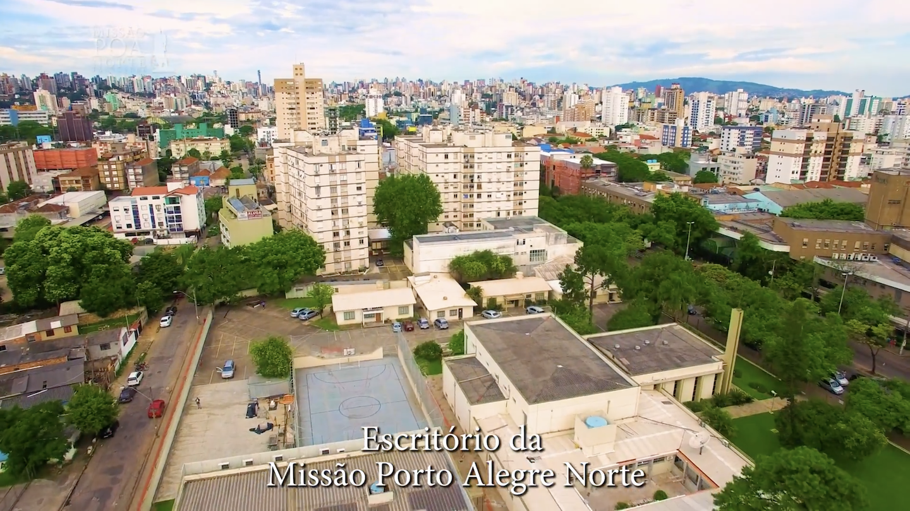
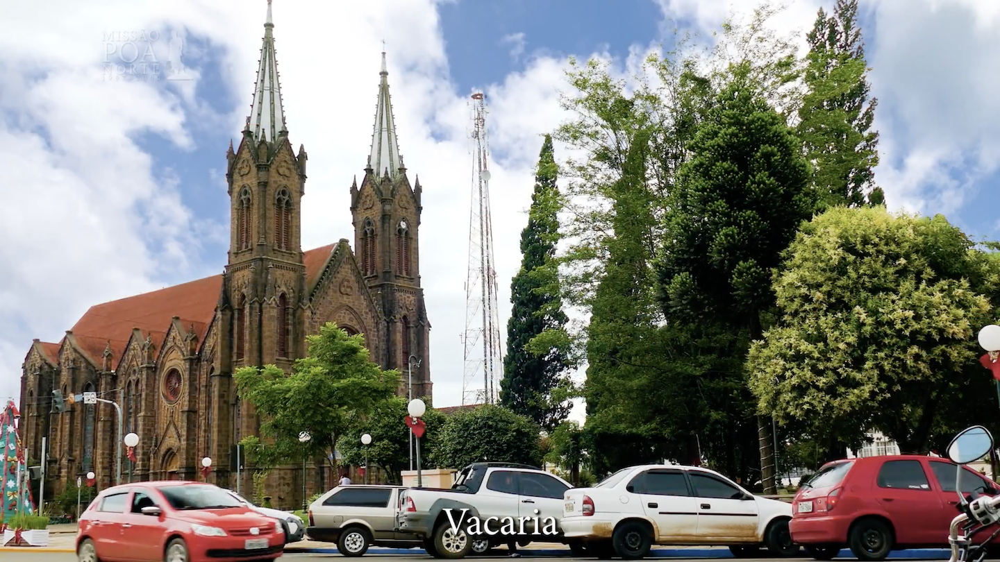

::: {.hero .column-screen}
[Missão Brasil Porto Alegre Norte · 1997–2000]{.eyebrow}

# O Chamado

[Presidente Arlan e Síster Sally Woodward]{.lead}

```{=html}
<div id="heroCarousel" class="carousel slide carousel-fade" data-bs-ride="carousel" data-bs-interval="4500">
  <div class="carousel-inner">
    <div class="carousel-item active"></div>
    <div class="carousel-item"></div>
    <div class="carousel-item"></div>
    <div class="carousel-item"></div>
    <div class="carousel-item"></div>
    <div class="carousel-item"></div>
    <div class="carousel-item"></div>
    <div class="carousel-item"></div>
  </div>
  <div class="carousel-nav">
    <button class="carousel-control-prev" type="button" data-bs-target="#heroCarousel" data-bs-slide="prev">
      <i class="bi bi-chevron-left" aria-hidden="true"></i><span class="visually-hidden">Anterior</span>
    </button>
    <div class="carousel-indicators">
      <button type="button" data-bs-target="#heroCarousel" data-bs-slide-to="0" class="active" aria-current="true" aria-label="Escritório"></button>
      <button type="button" data-bs-target="#heroCarousel" data-bs-slide-to="1" aria-label="Marau"></button>
      <button type="button" data-bs-target="#heroCarousel" data-bs-slide-to="2" aria-label="Santa Rosa"></button>
      <button type="button" data-bs-target="#heroCarousel" data-bs-slide-to="3" aria-label="Tramandaí"></button>
      <button type="button" data-bs-target="#heroCarousel" data-bs-slide-to="4" aria-label="Cruz Alta"></button>
      <button type="button" data-bs-target="#heroCarousel" data-bs-slide-to="5" aria-label="Santo Ângelo"></button>
      <button type="button" data-bs-target="#heroCarousel" data-bs-slide-to="6" aria-label="Capão da Canoa"></button>
      <button type="button" data-bs-target="#heroCarousel" data-bs-slide-to="7" aria-label="Vacaria"></button>
    </div>
    <button class="carousel-control-next" type="button" data-bs-target="#heroCarousel" data-bs-slide="next">
      <i class="bi bi-chevron-right" aria-hidden="true"></i><span class="visually-hidden">Próxima</span>
    </button>
  </div>
</div>
<p class="credito-fotos"><i class="bi bi-camera"></i> Fotos: cortesia do Élder George</p>
```
:::

::: {.band .column-screen #missao}
[A Missão]{.section-eyebrow}

```{=html}
<div class="lang-toggle" role="group" aria-label="Idioma / Language">
  <button type="button" data-lang="pt" class="active" aria-pressed="true">Português</button>
  <button type="button" data-lang="en" aria-pressed="false">English</button>
</div>

<blockquote class="scripture">
  <span class="lang-pt" lang="pt">Eleva o coração e regozija-te, pois é chegada a hora de tua missão.</span>
  <span class="lang-en" lang="en">Lift up your heart and rejoice, for the hour of your mission is come.</span>
  <footer><span class="lang-pt">Doutrina e Convênios 31:3</span><span class="lang-en">Doctrine and Covenants 31:3</span></footer>
</blockquote>

<div class="missao-texto lang-pt" lang="pt">
  <p class="missao-intro">A Missão Brasil Porto Alegre Norte cobria a metade norte do <strong>Rio Grande do Sul</strong>, o estado mais ao sul do Brasil: da zona norte de Porto Alegre e sua região metropolitana até a Serra Gaúcha, o Planalto e o Litoral Norte, e, até julho de 1998, o Noroeste e as Missões, perto da fronteira com a Argentina.</p>

  <div class="regioes">
    <div class="regiao"><h3><i class="bi bi-buildings"></i> Porto Alegre e região metropolitana</h3>
      <p>A capital gaúcha e as cidades ao seu redor: Canoas, Esteio, Gravataí, Cachoeirinha, Alvorada e Guaíba. Bairros movimentados, ônibus lotados e muitas zonas da missão.</p></div>
    <div class="regiao"><h3><i class="bi bi-house-door"></i> Vale dos Sinos</h3>
      <p>Novo Hamburgo, São Leopoldo, Sapiranga e Taquara. São Leopoldo foi o berço da imigração alemã no Brasil, em 1824, e o vale é conhecido pela indústria de calçados.</p></div>
    <div class="regiao"><h3><i class="bi bi-cup-hot"></i> Serra Gaúcha</h3>
      <p>Caxias do Sul, Bento Gonçalves, Farroupilha, Gramado e Canela. Terra da imigração italiana a partir de 1875, dos parreirais e do vinho, com invernos frios e, às vezes, neve.</p></div>
    <div class="regiao"><h3><i class="bi bi-flower1"></i> Planalto e Campos de Cima da Serra</h3>
      <p>Passo Fundo, Erechim, Carazinho, Marau e Vacaria. Lavouras de soja, trigo e milho, os pomares de maçã de Vacaria e algumas das madrugadas mais frias do estado.</p></div>
    <div class="regiao"><h3><i class="bi bi-water"></i> Litoral Norte</h3>
      <p>Osório, Tramandaí e Capão da Canoa. Praias, lagoas e vento constante: cheias de veranistas no verão e quase vazias no inverno.</p></div>
    <div class="regiao"><h3><i class="bi bi-bank"></i> Noroeste e Missões <small>até julho de 1998</small></h3>
      <p>Santo Ângelo, Ijuí, Cruz Alta e Santa Rosa, perto das ruínas jesuítico-guaranis de São Miguel das Missões, Patrimônio Mundial da UNESCO.</p></div>
  </div>

  <div class="missao-duo">
    <div><h3><i class="bi bi-thermometer-half"></i> O clima</h3>
      <p>Subtropical, com as quatro estações bem marcadas. Os verões são quentes e úmidos: em Porto Alegre o termômetro passa fácil dos 35 °C. Os invernos são frios e chuvosos, com geada no interior, neve de vez em quando nas partes altas da Serra e o minuano soprando do sudoeste. Muito missionário norte-americano chegou esperando o calor do Brasil e conheceu o frio gaúcho.</p></div>
    <div><h3><i class="bi bi-people"></i> O povo</h3>
      <p>O gaúcho é hospitaleiro e orgulhoso das suas tradições: o chimarrão passado de mão em mão, o churrasco de domingo, os CTGs e o 20 de Setembro, que lembra a Revolução Farroupilha. A população mistura descendentes de portugueses e açorianos, alemães, italianos, poloneses, africanos e indígenas. No interior ainda se ouve o talian ou o alemão em casa, e todo missionário logo aprendia a dizer “bah, tchê!”.</p></div>
  </div>

  <p class="missao-historia"><strong>Julho de 1998:</strong> a missão foi dividida para formar a <strong>Missão Brasil Santa Maria</strong>. As zonas de Ijuí e Santo Ângelo passaram para a nova missão.</p>
</div>

<div class="missao-texto lang-en" lang="en">
  <p class="missao-intro">The Brazil Porto Alegre North Mission covered the northern half of <strong>Rio Grande do Sul</strong>, Brazil's southernmost state: from the north side of Porto Alegre and its metro area up through the Serra Gaúcha highlands, the Planalto and the northern coast, and, until July 1998, the Northwest and the Missões region near the Argentine border.</p>

  <div class="regioes">
    <div class="regiao"><h3><i class="bi bi-buildings"></i> Porto Alegre and its metro area</h3>
      <p>The state capital and the cities around it: Canoas, Esteio, Gravataí, Cachoeirinha, Alvorada and Guaíba. Busy neighborhoods, packed buses and many of the mission's zones.</p></div>
    <div class="regiao"><h3><i class="bi bi-house-door"></i> Vale dos Sinos</h3>
      <p>Novo Hamburgo, São Leopoldo, Sapiranga and Taquara. São Leopoldo was the cradle of German immigration to Brazil in 1824, and the valley is known for its shoe industry.</p></div>
    <div class="regiao"><h3><i class="bi bi-cup-hot"></i> Serra Gaúcha</h3>
      <p>Caxias do Sul, Bento Gonçalves, Farroupilha, Gramado and Canela. Settled by Italian immigrants from 1875 on: vineyards, wine, cold winters and the occasional snowfall.</p></div>
    <div class="regiao"><h3><i class="bi bi-flower1"></i> Planalto and Campos de Cima da Serra</h3>
      <p>Passo Fundo, Erechim, Carazinho, Marau and Vacaria. Soy, wheat and corn fields, Vacaria's apple orchards and some of the coldest mornings in the state.</p></div>
    <div class="regiao"><h3><i class="bi bi-water"></i> Northern coast</h3>
      <p>Osório, Tramandaí and Capão da Canoa. Beaches, lagoons and constant wind: crowded with vacationers in summer, nearly empty in winter.</p></div>
    <div class="regiao"><h3><i class="bi bi-bank"></i> Northwest and Missões <small>until July 1998</small></h3>
      <p>Santo Ângelo, Ijuí, Cruz Alta and Santa Rosa, near the Jesuit-Guarani ruins of São Miguel das Missões, a UNESCO World Heritage Site.</p></div>
  </div>

  <div class="missao-duo">
    <div><h3><i class="bi bi-thermometer-half"></i> The climate</h3>
      <p>Subtropical, with four distinct seasons. Summers are hot and humid; Porto Alegre easily tops 35 °C (95 °F). Winters are cold and rainy, with frost inland, occasional snow in the high Serra and the <em>minuano</em> wind blowing in from the southwest. Many North American missionaries arrived expecting tropical Brazil and met the gaúcho winter instead.</p></div>
    <div><h3><i class="bi bi-people"></i> The people</h3>
      <p>Gaúchos are warm, hospitable and proud of their traditions: chimarrão passed from hand to hand, Sunday churrasco, the CTG tradition centers and the 20th of September, which remembers the Farroupilha Revolution. The population blends Portuguese and Azorean, German, Italian, Polish, African and Indigenous roots. In the interior you can still hear Talian or German spoken at home, and every missionary soon learned to say “bah, tchê!”.</p></div>
  </div>

  <p class="missao-historia"><strong>July 1998:</strong> the mission was divided to create the <strong>Brazil Santa Maria Mission</strong>. The Ijuí and Santo Ângelo zones went to the new mission.</p>
</div>

<script>
(function () {
  var sec = document.getElementById("missao");
  if (!sec) return;
  function set(lang) {
    sec.setAttribute("data-lang", lang);
    sec.querySelectorAll(".lang-toggle button").forEach(function (b) {
      var on = b.getAttribute("data-lang") === lang;
      b.classList.toggle("active", on);
      b.setAttribute("aria-pressed", on ? "true" : "false");
    });
    try { localStorage.setItem("ochamado-lang", lang); } catch (e) {}
  }
  sec.querySelectorAll(".lang-toggle button").forEach(function (b) {
    b.addEventListener("click", function () { set(b.getAttribute("data-lang")); });
  });
  var saved = null;
  try { saved = localStorage.getItem("ochamado-lang"); } catch (e) {}
  set(saved === "en" ? "en" : "pt");
})();
</script>
```
:::

:::: {.band .column-screen .section-muted #areas}
::: {.wrap}
[As Áreas]{.section-eyebrow}

## O quadro de transferências

[Escolha um mês para ver todas as zonas, áreas e duplas da missão naquele momento. Toque num nome para ver quando o missionário chegou e saiu. Viu algum erro? Escreva para [info@ochamado.net](mailto:info@ochamado.net).]{.section-intro}

```{ojs}
quadro = FileAttachment("data/quadro.json").json()
snaps = quadro.snapshots
pessoas = new Map(quadro.missionarios.map(p => [p.id, p]))
MES = ["jan", "fev", "mar", "abr", "mai", "jun", "jul", "ago", "set", "out", "nov", "dez"]
fmtYM = k => { if (!k) return "—"; const [y, m] = k.split("-"); return `${MES[+m - 1]}/${y}`; }
nomeCompleto = l => l.replace(/^E\s+/, "Élder ").replace(/^S\s+/, "Síster ")
norm = s => String(s ?? "").normalize("NFD").replace(/[\u0300-\u036f]/g, "").toLowerCase().replace(/-/g, " ").replace(/\s+/g, " ").trim()
aparicoes = {
  const m = new Map();
  for (const s of snaps) for (const z of s.zonas) for (const a of z.areas) for (const p of a.dupla) {
    const k = p.id ?? "?" + p.n;
    if (!m.has(k)) m.set(k, []);
    m.get(k).push({ key: s.key, zona: z.nome, area: a.rotulo ?? z.nome, companheiros: a.dupla.filter(x => x !== p).map(x => nomeCompleto(x.n)) });
  }
  return m;
}
function estado(v) { const el = htl.html`<span hidden></span>`; el.value = v; return el; }
function definir(el, v) { el.value = v; el.dispatchEvent(new Event("input", { bubbles: true })); }
viewof quadroKey = estado("1997-10")
DIVISAO = "1998-07"
snapIdx = snaps.findIndex(s => s.key === quadroKey)
snapAtual = snaps[snapIdx]
```

```{ojs}
{
  const first = snaps[0], last = snaps[snaps.length - 1];
  const max = Math.max(...snaps.map(s => s.stats.zonas));
  const W = 640, H = 56, gap = 3, bw = W / snaps.length;
  const tile = (num, lbl, base) => htl.html`<div class="stat-tile"><div class="num">${num}</div><div class="lbl">${lbl}</div></div>`;
  return htl.html`<div>
    <p class="growth-headline"><strong>${first.stats.zonas}</strong> zonas em ${fmtYM(first.key)} → <strong>${last.stats.zonas}</strong> zonas em ${fmtYM(last.key)}</p>
    <div class="stat-tiles">
      ${tile(snapAtual.stats.zonas, "Zonas")}
      ${tile(snapAtual.stats.areas, "Áreas")}
      ${tile(snapAtual.stats.missionarios, "Missionários")}
    </div>
    ${htl.svg`<svg class="growth-bars" viewBox="0 0 ${W} ${H}" preserveAspectRatio="none" role="img" aria-label="Zonas por mês">
      ${snaps.map((s, i) => {
        const h = Math.max(4, (s.stats.zonas / max) * H);
        return htl.svg`<rect class=${s.key === quadroKey ? "active" : ""} x=${i * bw + gap / 2} y=${H - h} width=${bw - gap} height=${h} rx="2"
          onclick=${() => definir(viewof quadroKey, s.key)}><title>${fmtYM(s.key)}: ${s.stats.zonas} zonas</title></rect>`;
      })}
      ${(() => {
        const i = snaps.findIndex(s => s.key === DIVISAO);
        return i < 0 ? "" : htl.svg`<line class="marco-divisao" x1=${i * bw} x2=${i * bw} y1="0" y2=${H}><title>Julho de 1998: divisão da missão</title></line>`;
      })()}
    </svg>`}
    <p class="growth-nota"><span class="marco"></span> Julho de 1998: a missão foi dividida para formar a Missão Brasil Santa Maria.</p>
  </div>`;
}
```

```{ojs}
{
  const anos = [...new Set(snaps.map(s => s.ano))];
  const doAno = snaps.filter(s => s.ano === snapAtual.ano);
  const go = k => definir(viewof quadroKey, k);
  const pill = (label, active, onclick) => htl.html`<button class=${active ? "pill active" : "pill"} onclick=${onclick}>${label}</button>`;
  return htl.html`<div class="filter-panel">
    <div class="pill-group">${anos.map(a => pill(a, a === snapAtual.ano, () => go(snaps.find(s => s.ano === a).key)))}</div>
    <div class="pill-group">${doAno.map(s => pill(MES[s.mes - 1], s.key === quadroKey, () => go(s.key)))}</div>
  </div>
  <div class="snap-nav">
    <button class="pill" aria-label="Mês anterior" disabled=${snapIdx === 0} onclick=${() => go(snaps[snapIdx - 1].key)}>‹</button>
    <span class="snap-label">${snapAtual.mesNome} de ${snapAtual.ano}</span>
    <button class="pill" aria-label="Próximo mês" disabled=${snapIdx === snaps.length - 1} onclick=${() => go(snaps[snapIdx + 1].key)}>›</button>
  </div>
  ${quadroKey === DIVISAO
    ? htl.html`<p class="aviso-divisao"><i class="bi bi-signpost-split"></i><span>Neste mês a missão foi dividida para formar a <strong>Missão Brasil Santa Maria</strong>. As zonas de Ijuí e Santo Ângelo passaram para a nova missão.</span></p>`
    : ""}
  ${jornalPorMes.has(quadroKey)
    ? htl.html`<a class="jornal-do-mes" target="_blank" rel="noopener" href=${jornalUrl(jornalPorMes.get(quadroKey))}>
        <i class="bi bi-file-earmark-pdf"></i><span>Ler <em>O Chamado</em> de ${snapAtual.mesNome} de ${snapAtual.ano}</span></a>`
    : ""}`;
}
```

```{ojs}
function verHistorico(q) {
  return htl.html`<a href="#busca" onclick=${e => {
    e.preventDefault();
    const inp = document.getElementById("busca");
    inp.value = q;
    inp.dispatchEvent(new Event("input", { bubbles: true }));
    inp.scrollIntoView({ behavior: "smooth", block: "center" });
  }}>Ver histórico completo ↓</a>`;
}

function detalheNome(p) {
  const ap = aparicoes.get(p.id ?? "?" + p.n) ?? [];
  if (!p.id) return htl.html`<div>Sem registro de chegada/saída · em ${ap.length} quadro(s)<br>${verHistorico(p.n)}</div>`;
  const x = pessoas.get(p.id);
  const provavel = p.c === "inferido" || p.c === "tolerancia";
  return htl.html`<div><strong>${x.titulo} ${x.plaqueta}</strong>${x.nacionalidade ? ` · ${x.nacionalidade}` : ""}<br>
    Chegada ${fmtYM(x.chegada)} · Saída ${fmtYM(x.saida)} · em ${ap.length} quadros
    ${provavel ? htl.html`<br><span class="provavel">identificação provável</span>` : ""}
    <br>${verHistorico(x.plaqueta)}</div>`;
}

function linhaArea(a, z, cont) {
  const slot = htl.html`<div class="nome-detalhe" hidden></div>`;
  let aberto = null;
  const chips = a.dupla.map(p => {
    const b = htl.html`<button class=${p.id ? "chip" : "chip sem-registro"}>${nomeCompleto(p.n)}</button>`;
    b.onclick = () => {
      if (aberto) aberto.classList.remove("open");
      if (aberto === b) { aberto = null; slot.hidden = true; return; }
      aberto = b;
      b.classList.add("open");
      slot.replaceChildren(detalheNome(p));
      slot.hidden = false;
    };
    return b;
  });
  return htl.html`<div class=${cont ? "area-row cont" : "area-row"}>
    ${a.nome ? htl.html`<div class="area-name">${a.nome}${a.total > 1 ? htl.html`<span class="dupla-tag">#${a.n}</span>` : ""}</div>` : ""}
    <div class="nomes">${chips}</div>
    ${slot}
  </div>`;
}
```

```{ojs}
{
  const zonas = [...snapAtual.zonas].sort((a, b) => a.especial - b.especial);
  return htl.html`<div class="board-grid">${zonas.map(z => {
    const comps = z.areas.length;
    return htl.html`<article class=${z.especial ? "zone-card especial" : "zone-card"}>
      <header><h3>${z.nome}</h3><span class="count">${comps} ${comps === 1 ? "dupla" : "duplas"}</span></header>
      ${z.areas.map((a, i) => linhaArea(a, z, i > 0 && a.n > 1 && z.areas[i - 1].nome === a.nome))}
    </article>`;
  })}</div>`;
}
```
:::
::::

:::: {.band .column-screen #missionarios}
::: {.wrap}
[Os Missionários]{.section-eyebrow}

## Chegadas e saídas

[515 missionários serviram com os Woodward. Escolha o ano e o mês para ver quem chegou e quem partiu.]{.section-intro}

```{ojs}
missionaries = FileAttachment("data/missionarios.json").json()
viewof anoSel = estado(1997)
viewof mesSel = estado(7)
mesesDe = a => a === 1997 ? [7, 8, 9, 10, 11, 12] : a === 2000 ? [1, 2, 3, 4, 5, 6] : [1, 2, 3, 4, 5, 6, 7, 8, 9, 10, 11, 12]
```

```{ojs}
{
  const pill = (label, active, onclick) => htl.html`<button class=${active ? "pill active" : "pill"} onclick=${onclick}>${label}</button>`;
  return htl.html`<div class="filter-panel">
    <div class="pill-group"><span class="filter-label">Ano</span>${[1997, 1998, 1999, 2000].map(a => pill(a, a === anoSel, () => {
      if (!mesesDe(a).includes(mesSel)) definir(viewof mesSel, mesesDe(a)[0]);
      definir(viewof anoSel, a);
    }))}</div>
    <div class="pill-group"><span class="filter-label">Mês</span>${mesesDe(anoSel).map(m => pill(MES[m - 1], m === mesSel, () => definir(viewof mesSel, m)))}</div>
  </div>`;
}
```

```{ojs}
{
  const ch = missionaries.filter(m => m.ChegadaAno === anoSel && m["ChegadaMês"] === mesSel);
  const sa = missionaries.filter(m => m["SaídaAno"] === anoSel && m["SaídaMês"] === mesSel);
  const byName = (a, b) => a.Plaqueta.localeCompare(b.Plaqueta, "pt");
  const panel = (arr, cls, icon, title, vazio) => htl.html`<div class=${"missionary-panel " + cls}>
    <h4><i class=${"bi " + icon}></i> ${title}<span class="count-badge">${arr.length}</span></h4>
    ${arr.length
      ? htl.html`<ul class="missionary-list">${[...arr].sort(byName).map(m => htl.html`<li><span>${m["Título"]} ${m.Plaqueta}</span><span class="tag">${m.Nacionalidade}</span></li>`)}</ul>`
      : htl.html`<p class="missionary-empty">${vazio}</p>`}
  </div>`;
  return htl.html`<div class="missionary-board">
    ${panel(ch, "panel-chegadas", "bi-airplane-fill", "Chegadas", "Nenhuma chegada neste mês.")}
    ${panel(sa, "panel-saidas", "bi-house-heart-fill", "Saídas", "Nenhuma saída neste mês.")}
  </div>`;
}
```

::: {.search-block}
### Procure um missionário

[Digite um sobrenome para ver todos os quadros, áreas e companheiros daquele missionário.]{.section-intro}

```{ojs}
viewof busca = htl.html`<input type="search" id="busca" class="form-control busca" placeholder="Sobrenome (ex.: Widerberg)" autocomplete="off">`
```

```{ojs}
function cartaoPessoa({ p, label, ap }) {
  const meta = p
    ? `${p.nacionalidade ?? ""} · Chegada ${fmtYM(p.chegada)} · Saída ${fmtYM(p.saida)} · em ${ap.length} quadro(s)`
    : `Sem registro de chegada/saída · em ${ap.length} quadro(s)`;
  return htl.html`<div class="pessoa-card">
    <h4>${p ? `${p.titulo} ${p.plaqueta}` : nomeCompleto(label)}</h4>
    <div class="meta">${meta}</div>
    ${ap.length
      ? htl.html`<div class="table-scroll"><table class="historico-table">
          <thead><tr><th>Quadro</th><th>Zona</th><th>Área</th><th>Companheiros</th></tr></thead>
          <tbody>${ap.map(a => htl.html`<tr><td>${fmtYM(a.key)}</td><td>${a.zona}</td><td>${a.area}</td><td>${a.companheiros.join(", ")}</td></tr>`)}</tbody>
        </table></div>`
      : htl.html`<p class="busca-hint">Não aparece nos quadros de transferências.</p>`}
  </div>`;
}
```

```{ojs}
{
  const q = norm(busca);
  if (q.length < 2) return htl.html`<p class="busca-hint">Digite pelo menos duas letras.</p>`;
  const pessoasEnc = quadro.missionarios
    .filter(p => norm(p.plaqueta).includes(q) || norm(`${p.titulo} ${p.plaqueta}`).includes(q) || norm(`${p.titulo[0]} ${p.plaqueta}`).includes(q))
    .map(p => ({ p, ap: aparicoes.get(p.id) ?? [] }));
  const semRegistro = [...aparicoes.keys()]
    .filter(k => k.startsWith("?") && norm(k.slice(1)).includes(q))
    .map(k => ({ label: k.slice(1), ap: aparicoes.get(k) }));
  const todos = [...pessoasEnc, ...semRegistro];
  if (!todos.length) return htl.html`<p class="busca-hint">Ninguém encontrado para “${busca}”.</p>`;
  return htl.html`<div>
    ${todos.length > 15 ? htl.html`<p class="busca-hint">${todos.length} resultados; mostrando 15. Refine a busca.</p>` : ""}
    ${todos.slice(0, 15).map(cartaoPessoa)}
  </div>`;
}
```
:::
:::
::::

:::: {.band .column-screen .section-muted #jornal}
::: {.wrap-narrow}
[O Jornal]{.section-eyebrow}

## O boletim da missão

[Edições do *O Chamado* publicadas durante a missão dos Woodward.]{.section-intro}

```{ojs}
jornais = [
  [1997, 10], [1997, 12], [1998, 1], [1998, 2],
  [1999, 1], [1999, 3], [1999, 4], [1999, 5], [1999, 6], [1999, 7], [1999, 10], [1999, 11], [1999, 12],
  [2000, 1], [2000, 2], [2000, 3], [2000, 4], [2000, 5], [2000, 6]
].map(([ano, mes]) => {
  const key = `${ano}-${String(mes).padStart(2, "0")}`;
  return { ano, mes, key, arquivo: `O Chamado - ${key}.pdf` };
})
jornalPorMes = new Map(jornais.map(j => [j.key, j]))
jornalUrl = j => "o-chamado-newsletters/" + encodeURIComponent(j.arquivo)
MES_NOME = ["Janeiro", "Fevereiro", "Março", "Abril", "Maio", "Junho", "Julho", "Agosto", "Setembro", "Outubro", "Novembro", "Dezembro"]
```

```{ojs}
htl.html`<div>${[...new Set(jornais.map(j => j.ano))].map(y => htl.html`
  <h3 class="jornal-year">${y}</h3>
  <div class="jornal-grid">
    ${jornais.filter(j => j.ano === y).map(j => htl.html`
      <a class="jornal-card" target="_blank" rel="noopener" href=${jornalUrl(j)}>
        <i class="bi bi-file-earmark-pdf"></i>
        <span><strong>${MES_NOME[j.mes - 1]}</strong><small>${j.ano}</small></span>
      </a>`)}
  </div>`)}</div>`
```

```{=html}
<div class="contato-card">
  <i class="bi bi-envelope-paper"></i>
  <div>
    <strong>Tem uma edição que falta aqui?</strong>
    <p>Se você guardou algum número do <em>O Chamado</em> que não está nesta lista, escreva para <a href="mailto:info@ochamado.net">info@ochamado.net</a>.</p>
  </div>
</div>
```
:::
::::

:::: {.band .column-screen .section-dark #reencontros}
::: {.wrap-narrow}
[Os Reencontros]{.section-eyebrow}

## Abril de 2016

```{=html}
<a class="ratio ratio-16x9 video-frame video-card" target="_blank" rel="noopener" href="https://youtu.be/31IHb7dBMEo" aria-label="Assistir ao reencontro de abril de 2016 no YouTube">
  
  <span class="video-meta">
    <span><strong>Reencontro dos missionários</strong><small>Abril de 2016</small></span>
    <span class="yt"><i class="bi bi-youtube"></i> Assistir no YouTube</span>
  </span>
</a>
```
:::
::::

::: {.band .column-screen #woodwards}
[Os Woodwards]{.section-eyebrow}

```{=html}
<div class="woodwards-foto">
  
  <span class="credito">Foto: <a href="https://www.thechurchnews.com/2007/11/17/23232387/missionary-training-center-presidents-4/" target="_blank" rel="noopener">Church News, 2007</a></span>
</div>
```

[Arlan & Sally Woodward]{.woodwards-names .d-block}

[Presidente e Síster da Missão Brasil Porto Alegre Norte, 1997–2000. Em 2007 voltaram ao Brasil para presidir o Centro de Treinamento Missionário.]{.section-intro .d-block}
:::

::: {.band .column-screen .section-muted #contato}
[Contato]{.section-eyebrow}

## Comentários e sugestões

[Tem fotos, histórias, correções no quadro de transferências ou ideias para o site? Adoraríamos ouvir de você.]{.section-intro}

```{=html}
<a class="email-btn" href="mailto:info@ochamado.net?subject=O%20Chamado%20-%20coment%C3%A1rio"><i class="bi bi-envelope"></i> info@ochamado.net</a>
```
:::

::: {.column-screen}
```{=html}

```
:::
